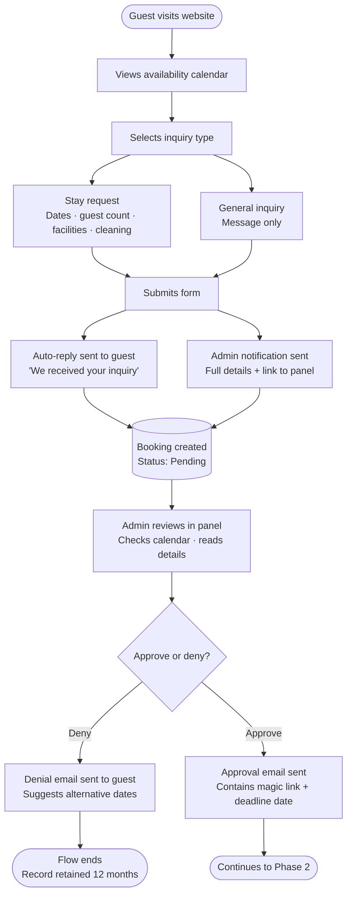
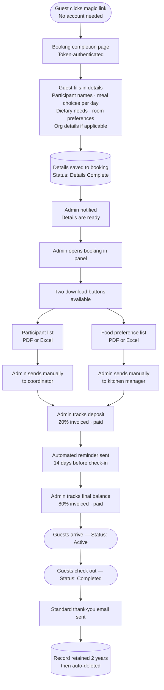
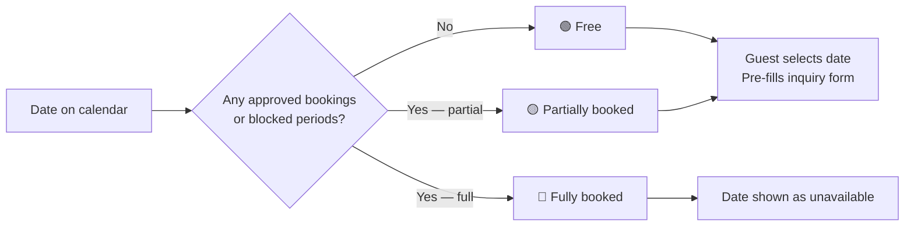

# Åkerögården — Booking System
## Software Requirements Specification
**Version:** 0.5 — Working Draft  
**Date:** June 2026  
**Status:** In progress — subject to change  
**Prepared by:** Developer & Claude (Anthropic)  
**Client:** Åkerögården, Norrtälje, Sverige  

**Changes from v0.4:**
- Q1 resolved: meal selection is per day (lunch & dinner), with a "same for all days" shortcut on the completion form
- Q2 resolved: admin can resend the magic link manually; approval email must state the deadline date explicitly
- Q3 resolved: both options available — admin can edit data directly in the panel, or resend the magic link for the guest to resubmit
- Q4/Q5/Q6 resolved: pricing is per person (headcount), not per room/bed capacity. Section 5.3 rewritten accordingly
- Day guests added as a new participant type: no bed, meals only (Q6 insight)
- New FR: admin can block a specific room or building for a date range (e.g. renovation)
- New FR: admin can create a booking on behalf of a guest, bypassing the public inquiry form
- New FR: day guest participant type supported (meals, no overnight)
- New FR: completion form includes "same for all days" shortcut for meal selection
- Smedjan corrected: separate cabin, 1 room, 1 double bed, 2 persons, not accessible
- New facility added: Spelrum (game room) — foosball, pinball, shuffleboard
- Check-in 14:00 / check-out 12:00 confirmed; early/late surcharge is an open question
- Section 5.3 room pricing model moved to Out of Scope (future release)
- New open questions: Q7 (check-in/out surcharge), Q8 (Tallstugan accessibility), Q9 (Spelrum name), Q10 (Spelrum in booking/cleaning flow)

---

## Table of Contents

1. [Introduction](#1-introduction)
2. [Booking Lifecycle](#2-booking-lifecycle)
3. [Accommodation and Capacity](#3-accommodation-and-capacity)
4. [Meals and Food Preferences](#4-meals-and-food-preferences)
5. [Pricing](#5-pricing)
6. [Functional Requirements](#6-functional-requirements)
7. [Non-Functional Requirements](#7-non-functional-requirements)
8. [Core Data Model](#8-core-data-model)
9. [Email Templates](#9-email-templates)
10. [Out of Scope](#10-out-of-scope)
11. [Hosting and Infrastructure](#11-hosting-and-infrastructure)
12. [Open Questions](#12-open-questions)

---

## 1. Introduction

### 1.1 Purpose

This document defines the software requirements for the Åkerögården booking system — a web application built to manage guest inquiries, bookings, participant data, meal orders, and administrative workflows for Åkerögården, a rural retreat property in Norrtälje, Sweden.

It serves as the single source of truth for all design, development, and testing decisions. Any scope change must be reflected as a new version of this document.

### 1.2 Project Background

Åkerögården has operated as a retreat and conference facility since 1978. The property currently accommodates up to 79 overnight guests across six residential buildings and two standalone cabins. The exact room configuration, meal offerings, facilities, and prices are managed by the property admin and may change over time. The system must reflect this — nothing operational is hardcoded.

### 1.3 Scope

**In scope:**
- A public-facing Blazor Server web application with pages for home, about, facilities, contact, availability calendar, and booking inquiry
- A public availability calendar showing only whether dates are booked or free — no personal data, no detail beyond availability status
- A full admin panel for booking management, review, approval, and all reference data management (buildings, rooms, meals, facilities, prices)
- Admin ability to create bookings manually on behalf of guests
- Admin ability to block individual rooms or buildings for a date range
- A token-based booking completion flow for approved guests — no account creation required
- Automated and manual email workflows at defined lifecycle points
- Downloadable participant and food preference lists (PDF and Excel)
- GDPR-compliant data retention and automatic deletion

**Out of scope** (see Section 10):
- Online payment processing
- Automatic list delivery to coordinators or kitchen
- Guest accounts or login
- Public display of menu or pricing
- Room-based pricing (future release)

### 1.4 Stakeholders

| Role | Responsibilities | System access |
|---|---|---|
| Property admin | Manages all bookings; manages all reference data (buildings, rooms, meals, facilities, prices); approves or denies inquiries; downloads lists; tracks invoices; can create bookings on behalf of guests | Full admin panel |
| Guest / contact person | Views availability calendar; submits inquiry; receives magic link; completes booking details | Public site + token-secured completion page |
| Coordinator (external) | Receives participant name list from admin | None — sent manually |
| Kitchen manager (external) | Receives food preference list from admin | None — sent manually |

### 1.5 Technology Decisions

| Concern | Decision | Rationale |
|---|---|---|
| Framework | Blazor Server (.NET) | Developer comfort; full-stack C# consistency |
| Database | PostgreSQL on Azure | Managed backups; familiar query model |
| Hosting | Azure App Service (Linux, B1) | Managed SSL; CI/CD from GitHub Actions |
| File storage | Azure Blob Storage | List downloads and media uploads |
| Email | MailKit (SMTP via One.com) | Robust .NET email library |
| ORM | Entity Framework Core | Standard .NET data access layer |
| CI/CD | GitHub Actions | Existing pipeline muscle memory |

---

## 2. Booking Lifecycle

### 2.1 Phase 1 — Inquiry to Decision

### 2.2 Phase 2 — Completion to Post-Stay

### 2.3 Public Calendar Logic

### 2.4 Booking Status Reference

| Status | Description |
|---|---|
| `Pending` | Inquiry submitted, awaiting admin review |
| `Approved` | Admin approved; awaiting guest completion |
| `Denied` | Admin denied; retained 12 months |
| `DetailsComplete` | Guest submitted participant and meal data |
| `Active` | Group currently on-site |
| `Completed` | Stay finished; in retention period |
| `Cancelled` | Cancelled after approval; deposit rules apply |

### 2.5 Magic Link Rules

- Cryptographically random token (minimum 128-bit entropy)
- Expires at whichever comes first: 30 days after issue, or 14 days before check-in
- The approval email must display the exact expiry date in plain text so the guest knows their deadline
- Single-use — invalidated immediately on form submission
- Admin can manually regenerate an expired token from the booking detail page at any time

### 2.6 GDPR Retention

| Outcome | Retention | Trigger |
|---|---|---|
| Completed stay | 2 years | From check-out date |
| Denied or cancelled | 12 months | From denial or cancellation date |
| Pending (no response) | 12 months | From submission date |

Admin receives a warning email 30 days before any record is deleted.

### 2.7 Check-In and Check-Out Times

- Standard check-in: **14:00**
- Standard check-out: **12:00**
- Early check-in and late check-out are available for a surcharge — see Section 12, Q7 for open details

---

## 3. Accommodation and Capacity

> **All accommodation data is admin-managed.** Buildings and rooms are created, edited, and deleted through the admin panel. The values below reflect the current known state of the property and will be entered by the admin on first setup — they are not hardcoded.

### 3.1 Buildings Overview

| Building | Rooms | Total beds | Accessibility | Notes |
|---|---|---|---|---|
| Blidö | 4 | 12 | Not accessible | Common room · 1 shower/cleaning room · 2 toilets |
| Ljusterö | 4 | 17 | Accessible | Common room · 1 shower/cleaning room · 1 toilet |
| Singö | 4 | 16 | Not accessible | Common room · 1 shower · 2 toilets |
| Tjockö | 4 | 10 | Not accessible | Common room · 1 shower/cleaning room · 2 toilets |
| Vätö 1 | 5 | 8 | Accessible | Common room · 2 showers/cleaning rooms · 2 toilets |
| Vätö 2 | 5 | 8 | Accessible | Common room · 2 showers/cleaning rooms · 2 toilets |
| Smedjan | 1 | 2 | Not accessible | Standalone cabin · 1 double bed · private facilities |
| Tallstugan | 1 | 4 | Unknown — see Q8 | Standalone cabin · private shower and toilet |
| **Total overnight** | | **79** | | |

### 3.2 Room-Level Detail

| Building | Room | Beds | Configuration |
|---|---|---|---|
| Blidö | Room 1 | 4 | 2 bunk beds |
| Blidö | Room 2 | 2 | 2 single beds |
| Blidö | Room 3 | 3 | 3 single beds |
| Blidö | Room 4 | 3 | 3 single beds |
| Ljusterö | Room 1 | 3 | 3 single beds |
| Ljusterö | Room 2 | 6 | 3 bunk beds |
| Ljusterö | Room 3 | 4 | 2 bunk beds |
| Ljusterö | Room 4 | 4 | 2 bunk beds |
| Singö | Room 1 | 3 | 3 single beds |
| Singö | Room 2 | 5 | 2 bunk beds + 1 single |
| Singö | Room 3 | 4 | 1 bunk bed + 2 singles |
| Singö | Room 4 | 4 | 1 bunk bed + 2 singles |
| Tjockö | Room 1 | 3 | 3 single beds |
| Tjockö | Room 2 | 2 | 2 single beds |
| Tjockö | Room 3 | 3 | 3 single beds |
| Tjockö | Room 4 | 2 | 2 single beds |
| Vätö 1 | Room 1 | 2 | 2 single beds |
| Vätö 1 | Room 2 | 2 | 2 single beds |
| Vätö 1 | Room 3 | 1 | 1 single bed |
| Vätö 1 | Room 4 | 1 | 1 single bed |
| Vätö 1 | Room 5 | 2 | 2 single beds |
| Vätö 2 | Room 6 | 2 | 2 single beds |
| Vätö 2 | Room 7 | 1 | 1 single bed |
| Vätö 2 | Room 8 | 1 | 1 single bed |
| Vätö 2 | Room 9 | 2 | 2 single beds |
| Vätö 2 | Room 10 | 2 | 2 single beds |
| Smedjan | Room 1 | 2 | 1 double bed |
| Tallstugan | Room 1 | 4 | 1 bunk bed + 2 singles |

### 3.3 Room and Building Blocking

The admin can mark a specific room or an entire building as unavailable for a defined date range — for example during renovation or when something is broken. Blocked rooms and buildings are excluded from the room selection on the completion form and from the admin's room assignment view for the affected dates. This is separate from the general blocked period feature (which blocks all bookings for a date range).

---

## 4. Meals and Food Preferences

> **All meal options are admin-managed.** The admin can add, edit, and deactivate meal options at any time. The options below reflect the current menu and will be entered on first setup.
>
> **The menu is not displayed publicly on the website.** It is internal reference data visible only in the admin panel and on the booking completion form sent to approved guests.

### 4.1 Meal Structure

Full-board accommodation includes per day: breakfast (buffet, no selection required), lunch (one option per participant per day), dinner (one option per participant per day), and fika twice daily (included, no selection).

Meal selection applies only to full-board guests. Self-catering guests do not use the meal system.

**Meal selection is per day.** Each participant selects a lunch and a dinner option for each day of their stay. The completion form must provide a "same for all days" shortcut so a participant can apply one choice across all days without filling in each day individually.

### 4.2 Day Guests

A booking may include day guests in addition to overnight guests. Day guests do not occupy a bed or a room. They attend for meals only and are included in participant counts on the food preference list. The number of day guests (and which meals they attend) must be captured on the completion form. There is no upper limit on day guest count — groups may have more day visitors than the property's overnight bed capacity.

### 4.3 Current Breakfast

Standard buffet. No per-person selection required.

### 4.4 Current Lunch Options

| Key | Description |
|---|---|
| `LUNCH_FISH` | Breaded fish with Danish remoulade, boiled vegetables, boiled potatoes |
| `LUNCH_CHICKEN` | Oven-roasted chicken drumstick with tzatziki and bulgur |
| `LUNCH_PASTA` | Spaghetti bolognese |
| `LUNCH_MEATBALLS` | Meatballs with mashed potatoes and cream sauce |
| `LUNCH_VEGETARIAN` | Stir-fried vegetables with noodles |

### 4.5 Current Dinner Options

| Key | Description |
|---|---|
| `DINNER_CHICKEN` | Grilled chicken fillet with mushroom sauce, sautéed vegetables, wedge potatoes |
| `DINNER_BURGER` | Burger with fries |
| `DINNER_HOTDOG` | Hot dog with bread or mashed potatoes |
| `DINNER_PANCAKES` | Pancakes with jam and cream |
| `DINNER_VEGETARIAN` | Stir-fried vegetables with noodles |

### 4.6 Dietary Requirements

Fixed system values — not admin-managed. Adding a new dietary type requires a code change.

| Value | Label |
|---|---|
| `NONE` | No dietary requirements |
| `VEGETARIAN` | Vegetarian |
| `VEGAN` | Vegan |
| `GLUTEN_FREE` | Gluten intolerance |
| `LACTOSE_FREE` | Lactose intolerance |
| `NUT_ALLERGY` | Nut allergy |
| `OTHER` | Other — free-text, max 200 characters |

---

## 5. Pricing

> **All prices are admin-managed** and can be changed at any time through the admin panel.  
> **Prices are not displayed publicly on the website.** They are internal reference data visible only in the admin panel.  
> Invoicing is performed manually outside the system. All prices are **exclusive of VAT (12%)**. Currency is SEK.

### 5.1 Accommodation With Meals (Full Board)

Pricing is **per person per night** based on the number of guests declared in the booking.

| Guest category | Price ex. VAT | Per |
|---|---|---|
| Adults and children aged 4 and over | 550 kr | Per person per night |
| Children under 3 years | Free | Per night |

### 5.2 Accommodation Without Meals (Self-Catering)

| Guest category | Price ex. VAT | Per |
|---|---|---|
| Adults and children aged 4 and over | 250 kr | Per person per night |
| Children under 3 years | Free | Per night |
| Kitchen use (self-catering guests) | 100 kr per person | Per day |

### 5.3 Cabins

**1 October – 31 March:**

| Cabin | Price ex. VAT | Per |
|---|---|---|
| Smedjan | 1 500 kr | Per night |
| Tallstugan | 1 500 kr | Per night |

**1 April – 30 September:**

| Cabin | Price ex. VAT | Per |
|---|---|---|
| Smedjan | 1 500 kr | Per night |
| Smedjan | 7 000 kr | Full week |
| Tallstugan | 1 500 kr | Per night |
| Tallstugan | 7 000 kr | Full week |

### 5.4 Facilities

| Facility | Price ex. VAT | Per |
|---|---|---|
| Chapel (Kapellet) | 1 000 kr | Per day |
| Conference room (Konferensrum) | 1 000 kr | Per day |
| Grounds excursion (Utflykt — gården) | 2 000 kr | Per day |
| Caravan pitch (Husvagn) | 300 kr | Per day |
| Tent pitch (Tält) | 250 kr | Per day |

### 5.5 Cleaning Packages

Cleaning packages are selectable per facility in the booking inquiry form. The guest sees only the buildings and facilities relevant to their booking — not the full cleaning price list.

If cleaning is not purchased for a facility, guests are responsible for cleaning it themselves before departure.

| Area | Price ex. VAT |
|---|---|
| Main building (Huvudbyggnad) | 2 000 kr |
| Small residential wing (Lilla bostadslängan) | 2 000 kr |
| Conference building (Konferensbyggnad) | 2 000 kr |
| Large residential wing (Stora bostadslängan) | 2 000 kr |
| Entire camp (Hela lägret) | 8 000 kr |

### 5.6 Payment Schedule

| Payment | Amount | Condition |
|---|---|---|
| Deposit | 20% of total | Due to confirm booking |
| Deposit refund | Full refund | Cancelled more than 2 months before arrival |
| Deposit forfeited | No refund | Cancelled less than 2 months before arrival |
| Final balance | Remaining 80% | Due before arrival |

> **Note on deposit tracking:** The system does not process payments. "Notera handpenning betald" means the admin manually marks in the panel that the 20% deposit invoice has been sent and/or that payment has been received. It is a status checkbox — not a payment integration.

---

## 6. Functional Requirements

### 6.1 Public Website

| ID | Requirement |
|---|---|
| FR-01 | The system shall provide a public-facing website with pages for: home, about, facilities, contact, availability calendar, and booking inquiry |
| FR-02 | The booking inquiry page shall present two tracks: stay request and general inquiry |
| FR-03 | The stay request track shall collect: contact name, email, phone (optional), check-in date, check-out date, number of overnight guests, number of day guests (optional), requested facilities (multi-select from active facility list), cleaning service selection per relevant facility (checklist — guest sees only buildings applicable to their booking), organisation details (optional), and a free-text message |
| FR-04 | The general inquiry track shall collect: contact name, email, phone (optional), and a required free-text message |
| FR-05 | The system shall send an automatic acknowledgement email to the guest immediately upon submission |
| FR-06 | The system shall send an admin notification email immediately upon submission with all details and a direct link to the booking record |
| FR-07 | The public website shall display the privacy policy and link to it from the booking form and the site footer |

### 6.2 Public Availability Calendar

| ID | Requirement |
|---|---|
| FR-08 | The system shall display a public-facing availability calendar |
| FR-09 | The calendar shall show only two states per date: booked or free. No names, group sizes, booking references, or any other detail shall be exposed |
| FR-10 | A date is considered booked when it falls within any approved booking or admin-created blocked period that is marked as publicly visible |
| FR-11 | Selecting a date range on the public calendar shall pre-fill the check-in and check-out fields on the inquiry form |
| FR-12 | The admin shall control whether a booking or blocked period contributes to the public calendar via an `IsPubliclyVisible` flag |

### 6.3 Admin — Content Management

#### 6.3.1 Buildings

| ID | Requirement |
|---|---|
| FR-13 | The admin shall be able to create a building with: name, description, accessibility status, shared facilities description, and display order |
| FR-14 | The admin shall be able to edit any building field |
| FR-15 | The admin shall be able to deactivate a building without deleting historical data |
| FR-16 | The admin shall not be able to hard-delete a building that has existing room assignments on any booking |

#### 6.3.2 Rooms

| ID | Requirement |
|---|---|
| FR-17 | The admin shall be able to create a room within a building with: room name, bed count, bed configuration description, and display order |
| FR-18 | The admin shall be able to edit any room field |
| FR-19 | The admin shall be able to deactivate a room without deleting historical assignments |
| FR-20 | The admin shall not be able to hard-delete a room referenced in an existing booking |
| FR-21 | The admin shall be able to block a specific room or an entire building for a defined date range, with an internal reason (e.g. renovation, damage). Blocked rooms and buildings are excluded from room selection and assignment for the affected period |

#### 6.3.3 Meal Options

| ID | Requirement |
|---|---|
| FR-22 | The admin shall be able to create a meal option with: name, description, meal type (Lunch or Dinner), vegetarian flag, and active/inactive status |
| FR-23 | The admin shall be able to edit any meal option |
| FR-24 | The admin shall be able to deactivate a meal option — it will no longer appear on the completion form |
| FR-25 | Deactivating a meal option shall not alter existing selections already saved on bookings |
| FR-26 | The admin shall not be able to hard-delete a meal option referenced in an existing meal preference record |

#### 6.3.4 Facilities

| ID | Requirement |
|---|---|
| FR-27 | The admin shall be able to create a facility with: name, description, image, and display order |
| FR-28 | The admin shall be able to edit any facility field |
| FR-29 | The admin shall be able to deactivate a facility |
| FR-30 | The admin shall not be able to hard-delete a facility referenced in an existing booking |

#### 6.3.5 Prices

| ID | Requirement |
|---|---|
| FR-31 | The admin shall be able to create a price rule with: label, amount (ex. VAT), VAT rate, unit, seasonal validity dates (optional), and active/inactive status |
| FR-32 | The admin shall be able to edit any price rule |
| FR-33 | The admin shall be able to deactivate a price rule without deleting it |
| FR-34 | Price rules are displayed as read-only reference information on booking records — not used for automatic calculation |

### 6.4 Admin — Booking Management

| ID | Requirement |
|---|---|
| FR-35 | The admin panel shall be accessible only to authenticated users |
| FR-36 | The admin panel shall display a list of all bookings, filterable by status, date range, and booking type |
| FR-37 | The admin panel shall display a calendar view of bookings and blocked periods |
| FR-38 | The admin shall be able to approve or deny an inquiry |
| FR-39 | The admin shall be able to add internal notes to any booking |
| FR-40 | The admin shall be able to create, edit, and delete blocked periods |
| FR-41 | The admin shall be able to mark a booking or blocked period as publicly visible or hidden |
| FR-42 | The admin shall be able to track deposit and final payment status per booking |
| FR-43 | The admin shall be able to manually regenerate an expired completion token from the booking detail page |
| FR-44 | When booking details are complete, a participant list download button shall be available (PDF and Excel) |
| FR-45 | When booking details are complete, a food preference list download button shall be available (PDF and Excel) |
| FR-46 | The admin panel shall allow management of public site content (hero text, about text, contact details, social links) |
| FR-47 | The admin shall be able to create a booking manually on behalf of a guest, bypassing the public inquiry form. All fields available in the inquiry form must be editable by the admin when creating a booking this way |
| FR-48 | The admin shall be able to edit the participant data on a booking directly in the admin panel after guest submission |
| FR-49 | The admin shall be able to resend the completion magic link to the guest from the booking detail page, regardless of whether the previous link has expired or been used |

### 6.5 Booking Completion (Guest-Facing)

| ID | Requirement |
|---|---|
| FR-50 | On approval, the system shall generate a unique completion token and store it against the booking |
| FR-51 | The approval email shall contain the magic link and must display the exact token expiry date in plain text |
| FR-52 | The token shall expire at whichever is earlier: 30 days after issue, or 14 days before check-in |
| FR-53 | The completion page requires no account — the URL token is the sole authentication |
| FR-54 | The completion form shall present meal options drawn from the current active admin-managed meal list |
| FR-55 | The completion form shall present room options drawn from the current active admin-managed room list, excluding any rooms or buildings blocked for the booking's dates |
| FR-56 | The completion form shall collect per overnight participant: full name, meal selection per day (lunch and dinner), dietary requirements, room preference or "choose for me" flag |
| FR-57 | The completion form shall collect per day guest: full name, which meals they attend (breakfast, lunch, dinner), dietary requirements. Day guests have no room assignment |
| FR-58 | The completion form shall provide a "same for all days" shortcut for meal selection so a participant can apply one choice across all days without repeating each day individually |
| FR-59 | The completion form shall collect org/invoice details if applicable |
| FR-60 | On submission the admin receives a notification email |
| FR-61 | On submission the token is invalidated and booking status updated to `DetailsComplete` |

### 6.6 Automated Notifications

| ID | Requirement |
|---|---|
| FR-62 | The system shall send an automated reminder email 14 days before check-in |
| FR-63 | The reminder shall confirm participant count, day guest count, meal summary, check-in time (14:00), and check-out time (12:00) |
| FR-64 | The system shall send a standard fixed thank-you email when the admin marks the booking completed — this message is not customisable per booking |
| FR-65 | The admin shall receive a warning email 30 days before automatic deletion of any record |

### 6.7 Data Retention

| ID | Requirement |
|---|---|
| FR-66 | Completed booking records shall be automatically deleted 2 years after check-out |
| FR-67 | Denied or cancelled records shall be automatically deleted 12 months after denial or cancellation |
| FR-68 | Deletion shall be performed by a scheduled background job |

---

## 7. Non-Functional Requirements

### 7.1 Security

| ID | Requirement |
|---|---|
| NFR-01 | All traffic served over HTTPS; SSL managed by Azure App Service |
| NFR-02 | Admin routes redirect unauthenticated requests to login |
| NFR-03 | Completion tokens are cryptographically random (min 128-bit entropy), single-use, time-limited |
| NFR-04 | Inquiry endpoint enforces rate limiting: max 5 submissions per IP per 10 minutes |
| NFR-05 | No personal data stored in URL query parameters |
| NFR-06 | All personal data stored within EU (Azure North Europe or Sweden Central) |
| NFR-07 | The public calendar endpoint exposes only availability status — no data that could identify a guest, group size, or booking detail |

### 7.2 Performance

| ID | Requirement |
|---|---|
| NFR-08 | Public pages load within 3 seconds on standard broadband |
| NFR-09 | Admin pages load within 5 seconds |
| NFR-10 | List downloads complete within 10 seconds for up to 200 participants (overnight + day guests combined) |

### 7.3 Reliability

| ID | Requirement |
|---|---|
| NFR-11 | 99% uptime target, consistent with Azure App Service Basic tier SLA |
| NFR-12 | Automated daily database backups with 7-day point-in-time restore |
| NFR-13 | Failed email sends are logged and retried; email failure does not fail the booking operation |

### 7.4 Data Integrity

| ID | Requirement |
|---|---|
| NFR-14 | Deactivating or editing a room, meal option, facility, or price rule shall not alter data already saved on existing bookings |
| NFR-15 | Meal preference records shall store a snapshot of the meal option name at submission time |
| NFR-16 | Room assignment records shall store a snapshot of the room name and building at submission time |

### 7.5 Usability

| ID | Requirement |
|---|---|
| NFR-17 | The public website shall be fully responsive on mobile devices |
| NFR-18 | The booking completion flow shall be completable by a non-technical user with no instructions beyond the approval email |
| NFR-19 | The admin panel shall be usable by a single non-technical admin for all day-to-day operations |

### 7.6 GDPR and Compliance

| ID | Requirement |
|---|---|
| NFR-20 | Privacy policy accessible from booking form and site footer |
| NFR-21 | Explicit privacy policy acknowledgement at inquiry submission |
| NFR-22 | Privacy policy names data controller, states retention periods, references IMY |
| NFR-23 | System does not collect personnummer |
| NFR-24 | All data processing within Azure EU regions |

---

## 8. Core Data Model

> A full Entity Relationship Diagram will be produced as a separate artefact prior to development.

### 8.1 Booking

| Field | Type | Notes |
|---|---|---|
| `Id` | GUID | Primary key |
| `BookingType` | Enum | `StayRequest` \| `GeneralInquiry` |
| `Status` | Enum | See Section 2.4 |
| `ContactName` | string | Required |
| `ContactEmail` | string | Required |
| `ContactPhone` | string | Optional |
| `CheckIn` | date | Required for stay requests |
| `CheckOut` | date | Required for stay requests |
| `OvernightGuestCount` | int | Required for stay requests |
| `DayGuestCount` | int | Optional — guests attending meals only, no bed |
| `IsOrganisation` | bool | |
| `OrgName` | string | Conditional |
| `OrgNumber` | string | Conditional |
| `InvoiceAddress` | string | Conditional |
| `RequestedFacilityIds` | GUID[] | References Facility records |
| `CleaningSelections` | GUID[] | References Facility records for which cleaning is requested |
| `Message` | string | Max 5 000 characters |
| `AdminNotes` | string | Internal only |
| `IsPubliclyVisible` | bool | Controls public calendar |
| `CompletionToken` | string | Nullable |
| `CompletionTokenExpiry` | datetime | Nullable |
| `GuestChoosesRooms` | bool | False = admin assigns rooms |
| `DepositInvoiced` | bool | |
| `DepositPaid` | bool | |
| `FinalInvoiced` | bool | |
| `FinalPaid` | bool | |
| `CreatedByAdmin` | bool | True when admin created booking on behalf of guest |
| `CreatedAt` | datetime | Auto |
| `UpdatedAt` | datetime | Auto |
| `DeleteAfter` | date | Computed |

### 8.2 Building

| Field | Type | Notes |
|---|---|---|
| `Id` | GUID | Primary key |
| `Name` | string | e.g. Blidö |
| `Description` | string | |
| `SharedFacilities` | string | |
| `IsAccessible` | bool | |
| `IsActive` | bool | |
| `DisplayOrder` | int | |

### 8.3 Room

| Field | Type | Notes |
|---|---|---|
| `Id` | GUID | Primary key |
| `BuildingId` | GUID | Foreign key → Building |
| `Name` | string | e.g. Room 1 |
| `BedCount` | int | Number of beds |
| `BedConfiguration` | string | |
| `IsActive` | bool | |
| `DisplayOrder` | int | |

### 8.4 RoomBlock

| Field | Type | Notes |
|---|---|---|
| `Id` | GUID | Primary key |
| `RoomId` | GUID? | Nullable — null means entire building is blocked |
| `BuildingId` | GUID | Required — defines scope |
| `StartDate` | date | |
| `EndDate` | date | |
| `Reason` | string | Internal only — e.g. "Renovation", "Broken window" |
| `CreatedAt` | datetime | Auto |

### 8.5 Participant

| Field | Type | Notes |
|---|---|---|
| `Id` | GUID | Primary key |
| `BookingId` | GUID | Foreign key → Booking |
| `FullName` | string | Required |
| `ParticipantType` | Enum | `Overnight` \| `DayGuest` |
| `RoomAssignmentSnapshot` | string | Stored as text at submission time; null for day guests |
| `DietaryRequirements` | Enum[] | Multi-select |
| `DietaryNotes` | string | Free text, max 200 chars |

### 8.6 MealPreference

| Field | Type | Notes |
|---|---|---|
| `Id` | GUID | Primary key |
| `ParticipantId` | GUID | Foreign key → Participant |
| `Date` | date | The specific day this selection applies to |
| `MealType` | Enum | `Lunch` \| `Dinner` |
| `MealOptionId` | GUID | Foreign key → MealOption |
| `MealOptionSnapshot` | string | Name stored at submission for historical accuracy |

### 8.7 MealOption

| Field | Type | Notes |
|---|---|---|
| `Id` | GUID | Primary key |
| `Name` | string | |
| `Description` | string | |
| `MealType` | Enum | `Lunch` \| `Dinner` |
| `IsVegetarian` | bool | |
| `IsActive` | bool | |
| `DisplayOrder` | int | |

### 8.8 Facility

| Field | Type | Notes |
|---|---|---|
| `Id` | GUID | Primary key |
| `Name` | string | |
| `Description` | string | |
| `ImageUrl` | string | Azure Blob Storage URL |
| `IsActive` | bool | |
| `DisplayOrder` | int | |

### 8.9 PriceRule

| Field | Type | Notes |
|---|---|---|
| `Id` | GUID | Primary key |
| `Label` | string | |
| `AmountExVat` | decimal | |
| `VatRate` | decimal | e.g. 0.12 |
| `Unit` | string | e.g. "per person per night" |
| `SeasonStart` | date? | Nullable |
| `SeasonEnd` | date? | Nullable |
| `IsActive` | bool | |
| `Notes` | string | |

### 8.10 BlockedPeriod

| Field | Type | Notes |
|---|---|---|
| `Id` | GUID | Primary key |
| `StartDate` | date | |
| `EndDate` | date | |
| `Reason` | string | Internal only |
| `AffectedBuildingIds` | GUID[] | Empty = all buildings |
| `IsPubliclyVisible` | bool | |
| `CreatedAt` | datetime | Auto |

---

## 9. Email Templates

All emails sent in Swedish. All include Åkerögården name, contact email, and privacy policy link in footer.

| Email | Trigger | Recipient | Key content |
|---|---|---|---|
| Inquiry acknowledgement | Inquiry submitted | Guest | Receipt confirmation; expected response time |
| Admin — new inquiry | Inquiry submitted | Admin | All details; link to booking in panel |
| Denial | Admin sets Denied | Guest | Polite denial; suggest alternative dates |
| Approval + magic link | Admin sets Approved | Guest | Approval; magic link; **exact expiry date stated in plain text**; what to prepare |
| Admin — details complete | Guest submits completion | Admin | Data ready; link to booking; reminder to download lists |
| Two-week reminder | Automated — 14 days before check-in | Guest | Participant count; day guest count; meal summary; check-in 14:00; check-out 12:00; address |
| Thank-you | Admin marks Completed | Guest | Standard fixed message; invitation to return — not customisable per booking |
| Pre-deletion warning | Automated — 30 days before `DeleteAfter` | Admin | Record due for deletion; booking reference |

---

## 10. Out of Scope

**Initial release:**
- Online payment processing
- Automatic list delivery to coordinators or kitchen
- Guest accounts or login
- Multi-language support (Swedish for guests, English for admin)
- Native mobile application
- External calendar integration
- SMS notifications
- Reviews or ratings
- Room-level granularity on public calendar (availability only — booked/free)
- Public display of menu or pricing
- Room-based pricing (pricing is per person per night in phase 1 — room-based pricing deferred to a future release)

**Deferred to future releases:**
- Automated invoice generation
- Dedicated GDPR contact address (dataskydd@akerogarden.se)
- Multi-admin with role-based permissions
- Room-based pricing model

---

## 11. Hosting and Infrastructure

| Service | Azure tier | Est. monthly (USD) | Purpose |
|---|---|---|---|
| Azure App Service | Basic B1 (Linux) | ~$13 | Hosts the Blazor Server application |
| Azure Database for PostgreSQL Flexible Server | Burstable B1ms | ~$13 | Primary database; automated daily backups |
| Azure Blob Storage | Hot tier, LRS | ~$1–2 | List downloads; facility images; uploaded media |
| Azure-managed SSL | Included | $0 | HTTPS certificate management |
| Custom domain | Included on Basic+ | $0 | akerogarden.se |
| **Total** | | **~$27–28/month** | |

> Prices are USD pay-as-you-go list prices as of June 2026, North Europe or Sweden Central region. Verify at [azure.microsoft.com/pricing/calculator](https://azure.microsoft.com/pricing/calculator) before client sign-off.

---

## 12. Open Questions

The following questions must be resolved before the relevant features are built. Each answer will trigger an update to this document.

### Q7 — Check-in and check-out surcharge

Standard check-in is 14:00 and check-out is 12:00. Early check-in and late check-out are available for an extra fee. Two sub-questions remain open:

- Is the surcharge a fixed amount, or does Attaf decide it case by case per booking?
- Does the guest request early/late check-in or check-out in the inquiry form, or do they arrange it directly with Attaf outside the system?

### Q8 — Tallstugan accessibility

Is Tallstugan accessible (handikappanpassad) or not?

### Q9 — Spelrum/Lekrum name

The property has a game room containing foosball, pinball, and shuffleboard. What should it be called in the system — "Spelrum", "Lekrum", or something else?

### Q10 — Spelrum in booking and cleaning flow

Should the game room be selectable as a facility in the booking inquiry form? Should it appear as an option in the cleaning checklist the same way as the chapel and conference room?

---

*End of document — Version 0.5 Working Draft*  
*Åkerögården Booking System — Software Requirements Specification*