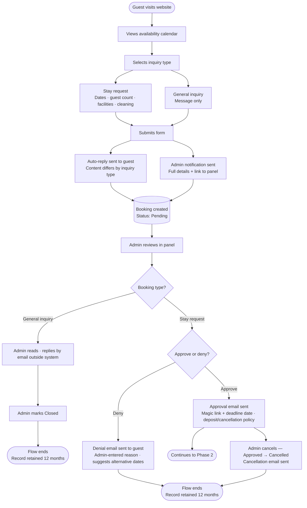
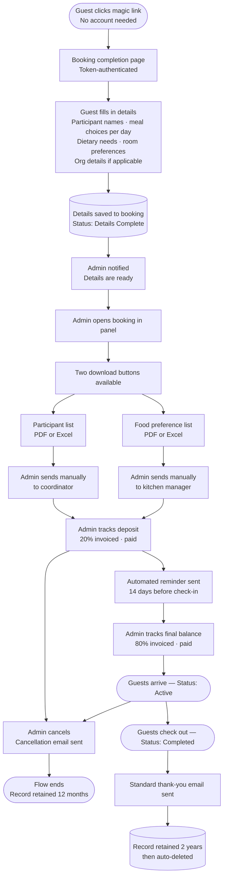
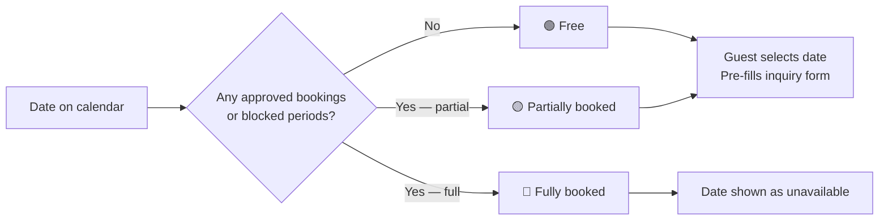

# Åkerögården — Booking System
## Software Requirements Specification
**Version:** 0.18 — Working Draft  
**Date:** June 2026  
**Status:** In progress — subject to change  
**Prepared by:** Developer & Claude (Anthropic)  
**Client:** Åkerögården, Norrtälje, Sverige  

**Changes from v0.17:**
- L1 resolved: public calendar shows 12 rolling months forward from today; no backward navigation — FR-84 added
- L2 resolved: image upload accepts JPEG, PNG, WebP; max 5 MB; inline error on violation — FR-27 updated
- L3 resolved: denial email uses a fixed Swedish line for alternative dates ("Kontakta oss för att diskutera alternativa datum") — no admin-entered dates field; Section 9 updated
- L4 resolved: booking status transition state machine defined in Section 2.4; invalid transitions are blocked by the system
- L6 resolved: when the 2-week reminder fires and booking is still `Approved` (completion form not submitted), the system sends both a guest nudge and an admin alert — FR-63 updated
- L7 resolved: Hela lägret covers all four building zones (Huvudbyggnad, Lilla bostadslängan, Konferensbyggnad, Stora bostadslängan); selecting it disables individual zone checkboxes on the inquiry form — Section 5.5 updated

**Changes from v0.16:**
- I5 resolved: `DeletionWarningEmailSentAt` field added to Booking model to prevent duplicate pre-deletion warning emails from the daily background job
- I6 resolved: framework pinned to .NET 10 LTS (released November 2025, supported until November 2028); .NET 9 is EOL as of May 2026; Section 1.5 updated
- I7 resolved: Blazor rendering mode specified — Static SSR for all public-facing pages; Interactive Server for admin panel; Section 1.5 updated

**Changes from v0.15:**
- I4 resolved: FR-03 wording corrected — "cleaning service selection per relevant facility" replaced with "per applicable building zone" to resolve terminology collision with bookable facilities

**Changes from v0.14:**
- I3 resolved: `AttendsBreakfast` boolean added to Participant model; FR-58 updated; breakfast-only day guest validation is a deferred minor detail that does not affect the model

**Changes from v0.13:**
- I2 resolved: calendar uses three states (Free / Partially booked / Fully booked) based on total booked guest count vs. property capacity (79 beds); FR-09 and FR-10 updated; public site note about partial availability added

**Changes from v0.12:**
- I1 resolved: FR-46 (admin management of public site text content) dropped — hero text, about text, contact details, and social links are hardcoded as they are not subject to change
- Prices and menu are now shown publicly: "not displayed publicly" notes removed from Sections 4.1 and 5; "Public display of menu or pricing" removed from Section 10 Out of Scope
- New FR-81: public facilities page renders dynamically from admin-managed facility records
- New FR-82: public prices page renders dynamically from admin-managed price rules
- New FR-83: public menu page renders dynamically from admin-managed meal options

**Changes from v0.11:**
- C5 resolved: General inquiry lifecycle defined — admin reads and replies outside the system, then marks `Closed`; no approve/deny applies; new `Closed` status added (general inquiries only)
- New FR-80: general inquiries have no approve/deny — only action is mark Closed
- FR-05 updated: auto-reply content differs by inquiry type
- `Closed` status added to Section 2.4; booking-type applicability noted on all statuses
- Closed general inquiry retention added to Section 2.6 (12 months from submission)
- Phase 1 lifecycle diagram updated to show the general inquiry branch
- Section 9 inquiry acknowledgement split into two variants

**Changes from v0.10:**
- C4 resolved: Cancellation fully defined — admin-only, from any non-terminal status; cancellation type (Guest-initiated / Property-initiated) required; reason optional; cancellation email sent automatically with deposit clause conditional on type and timing
- New FR-76 through FR-79: cancel action, cancellation type, optional reason, cancellation email
- `CancelledAt`, `CancellationInitiator`, `CancellationReason` fields added to Booking model (Section 8.1)
- Cancellation email added to Section 9
- Section 2.4 status reference updated with reachability notes
- Lifecycle diagrams updated to show cancellation paths

**Changes from v0.9:**
- C3 resolved: Magic link minimum window rule added — token always valid for at least 48 hours from issue regardless of check-in proximity; Section 2.5 and FR-53 updated
- New FR-75: admin receives a warning when approving a booking with check-in within 14 days, stating the shortened token expiry window; approval is not blocked

**Changes from v0.8:**
- C2 resolved: Full-board vs self-catering is declared at booking level on the inquiry form (`MealPlan`: FullBoardAll / SelfCateringAll / Mixed) and overridable per participant on the completion form (`IsFullBoard` boolean, pre-populated from booking default)
- `MealPlan` enum field added to Booking model (Section 8.1)
- `IsFullBoard` boolean field added to Participant model (Section 8.5)
- FR-03 updated: inquiry form now includes meal plan selection
- FR-57 updated: completion form collects `IsFullBoard` per participant; meal selection only shown for full-board participants
- Section 4.1 updated to describe the three meal plan options and per-participant override
- Day guests clarified: only applicable when `MealPlan` is `FullBoardAll` or `Mixed` — not valid for `SelfCateringAll` bookings

**Changes from v0.7:**
- C1 resolved: Admin authentication fully defined — ASP.NET Core Identity, email + password login at `admin.akerogarden.se`, 30-day "remember me" persistent cookie, password reset via one-time email link; multiple admin accounts supported in v1 (designed for 2–3); all admins have equal access — role differentiation remains deferred
- New FR-70 through FR-74: admin login page, remember-me session, password reset, admin account creation, admin account deactivation
- New Section 6.4 "Admin — Authentication and Account Management"; existing Sections 6.4–6.7 renumbered to 6.5–6.8
- ASP.NET Core Identity added to technology decisions (Section 1.5)
- "Multi-admin with role-based permissions" in Section 10 updated: multiple accounts now v1; role-based permissions remain deferred

**Changes from v0.6:**
- Q8 resolved: No buildings or rooms at Åkerögården are accessible — all `IsAccessible` values are false; Section 3.1 updated for Tallstugan (was "Unknown"), Ljusterö, Vätö 1, and Vätö 2 (were "Accessible") — Q8 removed from Open Questions
- Q10 resolved: Spelrum price is 1 500 kr per day, cleaning included — price updated in Section 5.4; no separate cleaning fee
- Q11 resolved: Spelrum cleaning is included in the 1 500 kr/day facility price; standalone Spelrum cleaning row removed from Section 5.5 — Q10 and Q11 removed from Open Questions

**Changes from v0.5:**
- Approval email scope clarified: must state cancellation/deposit policy (Section 5.6) in addition to the expiry date
- Denial email now requires an admin-entered reason, shown to the guest — new `DenialReason` field on Booking
- New FR-50: admin must enter a denial reason when setting a booking to `Denied`, which is included in the denial email
- Resolved contradiction between deferred Swedish admin UI and "Out of Scope" multi-language exclusion: English admin UI confirmed for v1, with Swedish admin UI now explicitly tracked as a near-term post-launch item (not someday-maybe), given NFR-19's non-technical Swedish-speaking admin
- New NFR-25: PostgreSQL Flexible Server uses private network access only (VNet integration), replacing the old Windows-firewall-based "block port 5432" approach
- New Section 7.7 Testing (NFR-26–28): unit tests for business logic (pricing, retention, token expiry) and integration tests for all API endpoints, required to pass in CI — addresses the old system's documented "no test suite" gap
- NFR-04 rate limiter now requires a distributed store (Azure Cache for Redis) from day one rather than in-memory state, avoiding the old system's documented scaling known issue. Added to Technology Decisions (1.5) and Hosting cost table (Section 11, ~$16/month added)
- New NFR-29: quarterly backup restore drill required, addressing README's "test the restore procedure" step that had no equivalent here
- New NFR-30: SMTP credentials stored as encrypted secrets, not plain text/source control
- New NFR-31: end-to-end email delivery verified against production SMTP before go-live
- README.md deleted — all content migrated to requirements.md (this document), design.md, and operational-tasks.md
- Q7 resolved: early check-in/late check-out surcharge is admin discretion, no fixed price, arranged outside the system — Section 2.7 updated, Q7 removed from Open Questions
- Q9 resolved: game room named "Spelrum" — Q9 removed from Open Questions
- Q10 resolved (structurally): Spelrum is selectable in the booking inquiry form and has its own cleaning line item, same as Kapell/Konferensrum. Q10 narrowed to just the pending price figures (placeholders added to Sections 5.4 and 5.5)
- Section 2.1 lifecycle diagram updated: denial node now shows the admin-entered reason, approval node now shows the deposit/cancellation policy — diagram had drifted out of sync with Section 9/FR-50
- Reversed the v0.6 "English admin UI" decision: the entire system (public site and admin panel) is Swedish-only — English was never actually needed, not even as a deferred item. New NFR-32; removed "Swedish admin UI" from both Out of Scope lists in Section 10
- New Q11: whether Spelrum's cleaning should be its own line item in Section 5.5 (which is otherwise building-level zones only) or folded into its containing building's package — flagged, not yet resolved
- Resolved conflict between booking-level `GuestChoosesRooms` and the per-participant "choose for me" flag: room choice is booking-level only. FR-56/57 rewritten — the completion form is filled in by the booking's contact person on behalf of the whole group (not by each participant individually), and only shows a room field at all when `GuestChoosesRooms` is true. Clarified that participant names are collected for fire-safety/headcount purposes
- Renumbered FR-50 through FR-69 (previously the denial-reason requirement was appended out of sequence as FR-69 after FR-49). It's now FR-50 in its correct position in Section 6.4, and every subsequent FR shifted up by one — FR-01 through FR-69 now read sequentially top to bottom

**Changes from v0.4:**
- Q1 resolved: meal selection is per day (lunch & dinner), with a "same for all days" shortcut on the completion form
- Q2 resolved: admin can resend the magic link manually; approval email must state the deadline date explicitly
- Q3 resolved: both options available — admin can edit data directly in the panel, or resend the magic link for the guest to resubmit
- Q4/Q5/Q6 resolved: pricing is per person (headcount), not per room/bed capacity. Section 5.3 rewritten accordingly
- Day guests added as a new participant type: no bed, meals only (Q6 insight)
- New FR: admin can block a specific room or building for a date range (e.g. renovation)
- New FR: admin can create a booking on behalf of a guest, bypassing the public inquiry form
- New FR: day guest participant type supported (meals, no overnight)
- New FR: completion form includes "same for all days" shortcut for meal selection
- Smedjan corrected: separate cabin, 1 room, 1 double bed, 2 persons, not accessible
- New facility added: Spelrum (game room) — foosball, pinball, shuffleboard
- Check-in 14:00 / check-out 12:00 confirmed; early/late surcharge is an open question
- Section 5.3 room pricing model moved to Out of Scope (future release)
- New open questions: Q7 (check-in/out surcharge), Q8 (Tallstugan accessibility), Q9 (Spelrum name), Q10 (Spelrum in booking/cleaning flow)

---

## Table of Contents

1. [Introduction](#1-introduction)
2. [Booking Lifecycle](#2-booking-lifecycle)
3. [Accommodation and Capacity](#3-accommodation-and-capacity)
4. [Meals and Food Preferences](#4-meals-and-food-preferences)
5. [Pricing](#5-pricing)
6. [Functional Requirements](#6-functional-requirements)
7. [Non-Functional Requirements](#7-non-functional-requirements)
8. [Core Data Model](#8-core-data-model)
9. [Email Templates](#9-email-templates)
10. [Out of Scope](#10-out-of-scope)
11. [Hosting and Infrastructure](#11-hosting-and-infrastructure)
12. [Open Questions](#12-open-questions)

---

## 1. Introduction

### 1.1 Purpose

This document defines the software requirements for the Åkerögården booking system — a web application built to manage guest inquiries, bookings, participant data, meal orders, and administrative workflows for Åkerögården, a rural retreat property in Norrtälje, Sweden.

It serves as the single source of truth for all design, development, and testing decisions. Any scope change must be reflected as a new version of this document.

### 1.2 Project Background

Åkerögården has operated as a retreat and conference facility since 1978. The property currently accommodates up to 79 overnight guests across six residential buildings and two standalone cabins. The exact room configuration, meal offerings, facilities, and prices are managed by the property admin and may change over time. The system must reflect this — nothing operational is hardcoded.

### 1.3 Scope

**In scope:**
- A public-facing web application (.NET 10 Blazor, Static SSR) with pages for home, about, facilities, menu, prices, contact, availability calendar, and booking inquiry
- A public availability calendar showing only whether dates are booked or free — no personal data, no detail beyond availability status
- A full admin panel for booking management, review, approval, and all reference data management (buildings, rooms, meals, facilities, prices)
- Admin ability to create bookings manually on behalf of guests
- Admin ability to block individual rooms or buildings for a date range
- A token-based booking completion flow for approved guests — no account creation required
- Automated and manual email workflows at defined lifecycle points
- Downloadable participant and food preference lists (PDF and Excel)
- GDPR-compliant data retention and automatic deletion

**Out of scope** (see Section 10):
- Online payment processing
- Automatic list delivery to coordinators or kitchen
- Guest accounts or login
- Room-based pricing (future release)

### 1.4 Stakeholders

| Role | Responsibilities | System access |
|---|---|---|
| Property admin | Manages all bookings; manages all reference data (buildings, rooms, meals, facilities, prices); approves or denies inquiries; downloads lists; tracks invoices; can create bookings on behalf of guests | Full admin panel |
| Guest / contact person | Views availability calendar; submits inquiry; receives magic link; completes booking details | Public site + token-secured completion page |
| Coordinator (external) | Receives participant name list from admin | None — sent manually |
| Kitchen manager (external) | Receives food preference list from admin | None — sent manually |

### 1.5 Technology Decisions

| Concern | Decision | Rationale |
|---|---|---|
| Framework | .NET 10 Blazor (LTS — supported until November 2028) | Developer comfort; full-stack C# consistency |
| Blazor rendering mode | Static SSR for all public-facing pages; Interactive Server for the admin panel | Static SSR produces plain server-rendered HTML for SEO and fast first load; Interactive Server is appropriate for the admin panel where SEO is irrelevant and rich interactivity is needed |
| Admin authentication | ASP.NET Core Identity | Single-library solution for credential storage, password hashing, cookie auth, and password reset — no external auth dependency |
| Database | PostgreSQL on Azure | Managed backups; familiar query model |
| Hosting | Azure App Service (Linux, B1) | Managed SSL; CI/CD from GitHub Actions |
| File storage | Azure Blob Storage | List downloads and media uploads |
| Rate limiting store | Azure Cache for Redis | Distributed rate-limit counters; correct under multi-instance scale-out (NFR-04) |
| Email | MailKit (SMTP via One.com) | Robust .NET email library |
| ORM | Entity Framework Core | Standard .NET data access layer |
| CI/CD | GitHub Actions | Existing pipeline muscle memory |

---

## 2. Booking Lifecycle

### 2.1 Phase 1 — Inquiry to Decision

### 2.2 Phase 2 — Completion to Post-Stay

### 2.3 Public Calendar Logic

### 2.4 Booking Status Reference

| Status | Applies to | Description |
|---|---|---|
| `Pending` | Both | Inquiry submitted, awaiting admin review |
| `Approved` | Stay request | Admin approved; awaiting guest completion |
| `Denied` | Stay request | Admin denied; retained 12 months |
| `DetailsComplete` | Stay request | Guest submitted participant and meal data |
| `Active` | Stay request | Group currently on-site |
| `Completed` | Stay request | Stay finished; in retention period |
| `Cancelled` | Stay request | Cancelled by admin; reachable from `Approved`, `DetailsComplete`, or `Active`; deposit rules apply (see Section 5.6) |
| `Closed` | General inquiry | Admin has read and responded; no approve/deny applies; retained 12 months from submission |

### 2.5 Booking Status Transitions

The system shall enforce the following allowed transitions. Any transition not in this table is blocked.

| From | To | Who / How |
|---|---|---|
| `Pending` | `Approved` | Admin — stay requests only |
| `Pending` | `Denied` | Admin — stay requests only |
| `Pending` | `Closed` | Admin — general inquiries only |
| `Approved` | `DetailsComplete` | System — on guest completion form submission |
| `Approved` | `Cancelled` | Admin |
| `DetailsComplete` | `Active` | Admin — marks guests as arrived |
| `DetailsComplete` | `Cancelled` | Admin |
| `Active` | `Completed` | Admin — marks stay finished |
| `Active` | `Cancelled` | Admin |

`Denied`, `Completed`, `Closed`, and `Cancelled` are terminal states — no transitions out.

### 2.6 Magic Link Rules

- Cryptographically random token (minimum 128-bit entropy)
- Expires at whichever comes first: 30 days after issue, or 14 days before check-in — with a minimum floor of 48 hours from issue regardless of how close check-in is
- The approval email must display the exact expiry date and time in plain text so the guest knows their deadline
- Single-use — invalidated immediately on form submission
- Generating a new token immediately invalidates any previously issued token for the same booking
- Admin can manually regenerate an expired token from the booking detail page at any time
- When the admin approves a booking with check-in within 14 days, the system displays a warning stating the exact token expiry (e.g. "Completion link will expire in 48 hours — consider contacting the guest directly")

### 2.7 GDPR Retention

| Outcome | Retention | Trigger |
|---|---|---|
| Completed stay | 2 years | From check-out date |
| Denied or cancelled | 12 months | From denial or cancellation date |
| Pending (no response) | 12 months | From submission date |
| Closed general inquiry | 12 months | From submission date |

Admin receives a warning email 30 days before any record is deleted.

### 2.8 Check-In and Check-Out Times

- Standard check-in: **14:00**
- Standard check-out: **12:00**
- Early check-in and late check-out are available for a surcharge, at the admin's discretion (no fixed price rule). This is arranged directly between the guest and the admin outside the system — there is no field on the inquiry or completion form for it, and no PriceRule entry

---

## 3. Accommodation and Capacity

> **All accommodation data is admin-managed.** Buildings and rooms are created, edited, and deleted through the admin panel. The values below reflect the current known state of the property and will be entered by the admin on first setup — they are not hardcoded.

### 3.1 Buildings Overview

| Building | Rooms | Total beds | Accessibility | Notes |
|---|---|---|---|---|
| Blidö | 4 | 12 | Not accessible | Common room · 1 shower/cleaning room · 2 toilets |
| Ljusterö | 4 | 17 | Not accessible | Common room · 1 shower/cleaning room · 1 toilet |
| Singö | 4 | 16 | Not accessible | Common room · 1 shower · 2 toilets |
| Tjockö | 4 | 10 | Not accessible | Common room · 1 shower/cleaning room · 2 toilets |
| Vätö 1 | 5 | 8 | Not accessible | Common room · 2 showers/cleaning rooms · 2 toilets |
| Vätö 2 | 5 | 8 | Not accessible | Common room · 2 showers/cleaning rooms · 2 toilets |
| Smedjan | 1 | 2 | Not accessible | Standalone cabin · 1 double bed · private facilities |
| Tallstugan | 1 | 4 | Not accessible | Standalone cabin · private shower and toilet |
| **Total overnight** | | **79** | | |

### 3.2 Room-Level Detail

| Building | Room | Beds | Configuration |
|---|---|---|---|
| Blidö | Room 1 | 4 | 2 bunk beds |
| Blidö | Room 2 | 2 | 2 single beds |
| Blidö | Room 3 | 3 | 3 single beds |
| Blidö | Room 4 | 3 | 3 single beds |
| Ljusterö | Room 1 | 3 | 3 single beds |
| Ljusterö | Room 2 | 6 | 3 bunk beds |
| Ljusterö | Room 3 | 4 | 2 bunk beds |
| Ljusterö | Room 4 | 4 | 2 bunk beds |
| Singö | Room 1 | 3 | 3 single beds |
| Singö | Room 2 | 5 | 2 bunk beds + 1 single |
| Singö | Room 3 | 4 | 1 bunk bed + 2 singles |
| Singö | Room 4 | 4 | 1 bunk bed + 2 singles |
| Tjockö | Room 1 | 3 | 3 single beds |
| Tjockö | Room 2 | 2 | 2 single beds |
| Tjockö | Room 3 | 3 | 3 single beds |
| Tjockö | Room 4 | 2 | 2 single beds |
| Vätö 1 | Room 1 | 2 | 2 single beds |
| Vätö 1 | Room 2 | 2 | 2 single beds |
| Vätö 1 | Room 3 | 1 | 1 single bed |
| Vätö 1 | Room 4 | 1 | 1 single bed |
| Vätö 1 | Room 5 | 2 | 2 single beds |
| Vätö 2 | Room 6 | 2 | 2 single beds |
| Vätö 2 | Room 7 | 1 | 1 single bed |
| Vätö 2 | Room 8 | 1 | 1 single bed |
| Vätö 2 | Room 9 | 2 | 2 single beds |
| Vätö 2 | Room 10 | 2 | 2 single beds |
| Smedjan | Room 1 | 2 | 1 double bed |
| Tallstugan | Room 1 | 4 | 1 bunk bed + 2 singles |

### 3.3 Room and Building Blocking

The admin can mark a specific room or an entire building as unavailable for a defined date range — for example during renovation or when something is broken. Blocked rooms and buildings are excluded from the room selection on the completion form and from the admin's room assignment view for the affected dates. This is separate from the general blocked period feature (which blocks all bookings for a date range).

---

## 4. Meals and Food Preferences

> **All meal options are admin-managed.** The admin can add, edit, and deactivate meal options at any time. The options below reflect the current menu and will be entered on first setup. Active meal options are displayed publicly on the menu page (FR-83).

### 4.1 Meal Structure

Full-board accommodation includes per day: breakfast (buffet, no selection required), lunch (one option per participant per day), dinner (one option per participant per day), and fika twice daily (included, no selection).

**Three meal plan options exist at booking level**, declared on the inquiry form:

| Value | Meaning |
|---|---|
| `FullBoardAll` | All guests are full-board — meals included for everyone |
| `SelfCateringAll` | All guests are self-catering — no meals provided |
| `Mixed` | A mix of full-board and self-catering participants; each participant specifies their own plan on the completion form |

The booking-level `MealPlan` pre-populates each participant's `IsFullBoard` field on the completion form. The contact person can override any individual participant's value at that point. The admin can also override per participant in the admin panel at any time (FR-48).

**Meal selection is per day, for full-board participants only.** Each full-board participant selects a lunch and a dinner option for each day of their stay. The completion form must provide a "same for all days" shortcut. Self-catering participants have no meal selection.

### 4.2 Day Guests

A booking may include day guests in addition to overnight guests. Day guests do not occupy a bed or a room. They attend for meals only and are included in participant counts on the food preference list. The number of day guests (and which meals they attend) must be captured on the completion form. There is no upper limit on day guest count — groups may have more day visitors than the property's overnight bed capacity.

> **Day guests are only applicable when `MealPlan` is `FullBoardAll` or `Mixed`.** A `SelfCateringAll` booking does not have catered meals, so there is no basis for day guest meal attendance. The inquiry form must not show the day guest field when `SelfCateringAll` is selected.

### 4.3 Current Breakfast

Standard buffet. No per-person selection required.

### 4.4 Current Lunch Options

| Key | Description |
|---|---|
| `LUNCH_FISH` | Breaded fish with Danish remoulade, boiled vegetables, boiled potatoes |
| `LUNCH_CHICKEN` | Oven-roasted chicken drumstick with tzatziki and bulgur |
| `LUNCH_PASTA` | Spaghetti bolognese |
| `LUNCH_MEATBALLS` | Meatballs with mashed potatoes and cream sauce |
| `LUNCH_VEGETARIAN` | Stir-fried vegetables with noodles |

### 4.5 Current Dinner Options

| Key | Description |
|---|---|
| `DINNER_CHICKEN` | Grilled chicken fillet with mushroom sauce, sautéed vegetables, wedge potatoes |
| `DINNER_BURGER` | Burger with fries |
| `DINNER_HOTDOG` | Hot dog with bread or mashed potatoes |
| `DINNER_PANCAKES` | Pancakes with jam and cream |
| `DINNER_VEGETARIAN` | Stir-fried vegetables with noodles |

### 4.6 Dietary Requirements

Fixed system values — not admin-managed. Adding a new dietary type requires a code change.

| Value | Label |
|---|---|
| `NONE` | No dietary requirements |
| `VEGETARIAN` | Vegetarian |
| `VEGAN` | Vegan |
| `GLUTEN_FREE` | Gluten intolerance |
| `LACTOSE_FREE` | Lactose intolerance |
| `NUT_ALLERGY` | Nut allergy |
| `OTHER` | Other — free-text, max 200 characters |

---

## 5. Pricing

> **All prices are admin-managed** and can be changed at any time through the admin panel. Active price rules are displayed publicly on the prices page (FR-82).  
> Invoicing is performed manually outside the system. All prices are **exclusive of VAT (12%)**. Currency is SEK.

### 5.1 Accommodation With Meals (Full Board)

Applies to participants where `IsFullBoard` is true.

Pricing is **per person per night** based on the number of guests declared in the booking.

| Guest category | Price ex. VAT | Per |
|---|---|---|
| Adults and children aged 4 and over | 550 kr | Per person per night |
| Children under 3 years | Free | Per night |

### 5.2 Accommodation Without Meals (Self-Catering)

Applies to participants where `IsFullBoard` is false.

| Guest category | Price ex. VAT | Per |
|---|---|---|
| Adults and children aged 4 and over | 250 kr | Per person per night |
| Children under 3 years | Free | Per night |
| Kitchen use (self-catering guests) | 100 kr per person | Per day |

### 5.3 Cabins

**1 October – 31 March:**

| Cabin | Price ex. VAT | Per |
|---|---|---|
| Smedjan | 1 500 kr | Per night |
| Tallstugan | 1 500 kr | Per night |

**1 April – 30 September:**

| Cabin | Price ex. VAT | Per |
|---|---|---|
| Smedjan | 1 500 kr | Per night |
| Smedjan | 7 000 kr | Full week |
| Tallstugan | 1 500 kr | Per night |
| Tallstugan | 7 000 kr | Full week |

### 5.4 Facilities

| Facility | Price ex. VAT | Per |
|---|---|---|
| Chapel (Kapellet) | 1 000 kr | Per day |
| Conference room (Konferensrum) | 1 000 kr | Per day |
| Grounds excursion (Utflykt — gården) | 2 000 kr | Per day |
| Caravan pitch (Husvagn) | 300 kr | Per day |
| Tent pitch (Tält) | 250 kr | Per day |
| Game room (Spelrum) | 1 500 kr *(cleaning included)* | Per day |

### 5.5 Cleaning Packages

Cleaning packages are selectable per facility in the booking inquiry form. The guest sees only the buildings and facilities relevant to their booking — not the full cleaning price list.

If cleaning is not purchased for a facility, guests are responsible for cleaning it themselves before departure.

| Area | Price ex. VAT |
|---|---|
| Main building (Huvudbyggnad) | 2 000 kr |
| Small residential wing (Lilla bostadslängan) | 2 000 kr |
| Conference building (Konferensbyggnad) | 2 000 kr |
| Large residential wing (Stora bostadslängan) | 2 000 kr |
| Entire camp (Hela lägret) | 8 000 kr |

> **Hela lägret** covers all four building zones: Huvudbyggnad, Lilla bostadslängan, Konferensbyggnad, and Stora bostadslängan. Spelrum cleaning is included in its facility fee and is not part of this package. Selecting Hela lägret on the inquiry form disables the individual building zone checkboxes — they are mutually exclusive.

### 5.6 Payment Schedule

| Payment | Amount | Condition |
|---|---|---|
| Deposit | 20% of total | Due to confirm booking |
| Deposit refund | Full refund | Cancelled more than 2 months before arrival |
| Deposit forfeited | No refund | Cancelled less than 2 months before arrival |
| Final balance | Remaining 80% | Due before arrival |

> **Note on deposit tracking:** The system does not process payments. "Notera handpenning betald" means the admin manually marks in the panel that the 20% deposit invoice has been sent and/or that payment has been received. It is a status checkbox — not a payment integration.

---

## 6. Functional Requirements

### 6.1 Public Website

| ID | Requirement |
|---|---|
| FR-01 | The system shall provide a public-facing website with pages for: home, about, facilities, contact, availability calendar, and booking inquiry |
| FR-02 | The booking inquiry page shall present two tracks: stay request and general inquiry |
| FR-03 | The stay request track shall collect: contact name, email, phone (optional), check-in date, check-out date, number of overnight guests, meal plan (FullBoardAll / SelfCateringAll / Mixed — required), number of day guests (optional — hidden when SelfCateringAll is selected), requested bookable facilities (multi-select from active facility list — e.g. Kapellet, Spelrum), cleaning service selection per applicable building zone (checklist — guest sees only building zones applicable to their booking; building zones are distinct from bookable facilities), organisation details (optional), and a free-text message |
| FR-04 | The general inquiry track shall collect: contact name, email, phone (optional), and a required free-text message |
| FR-05 | The system shall send an automatic acknowledgement email to the guest immediately upon submission. Content differs by inquiry type: stay requests receive a booking receipt ("we received your stay request"); general inquiries receive a contact acknowledgement ("we received your message and will be in touch") |
| FR-06 | The system shall send an admin notification email immediately upon submission with all details and a direct link to the booking record |
| FR-07 | The public website shall display the privacy policy and link to it from the booking form and the site footer |
| FR-81 | The public facilities page shall display active facility records in their configured display order, drawn dynamically from the admin-managed facility list (name, description, image) |
| FR-82 | The public website shall include a prices page displaying current active price rules, drawn dynamically from the admin-managed price list |
| FR-83 | The public website shall include a menu page displaying current active meal options (lunch and dinner), drawn dynamically from the admin-managed meal list |

### 6.2 Public Availability Calendar

| ID | Requirement |
|---|---|
| FR-08 | The system shall display a public-facing availability calendar |
| FR-09 | The calendar shall show three states per date: Free, Partially booked, or Fully booked. No names, group sizes, booking references, or any other personal detail shall be exposed |
| FR-10 | Calendar state per date is determined by summing `OvernightGuestCount` across all approved bookings whose date range includes that date, against total property capacity (79 beds): **Free** — no approved bookings and no publicly visible blocked periods; **Partially booked** — total booked guest count is between 1 and 78; **Fully booked** — total booked guest count reaches 79 or more, or a publicly visible admin-created blocked period covers all buildings on that date |
| FR-10a | The public calendar page shall display a note clarifying that partially available dates are subject to admin confirmation — submitting an inquiry does not guarantee availability |
| FR-11 | Selecting a date range on the public calendar shall pre-fill the check-in and check-out fields on the inquiry form |
| FR-12 | The admin shall control whether a booking or blocked period contributes to the public calendar via an `IsPubliclyVisible` flag |
| FR-84 | The public calendar shall display 12 rolling months forward from today's date. Backward navigation to past months is not available |

### 6.3 Admin — Content Management

#### 6.3.1 Buildings

| ID | Requirement |
|---|---|
| FR-13 | The admin shall be able to create a building with: name, description, accessibility status, shared facilities description, and display order |
| FR-14 | The admin shall be able to edit any building field |
| FR-15 | The admin shall be able to deactivate a building without deleting historical data |
| FR-16 | The admin shall not be able to hard-delete a building that has existing room assignments on any booking |

#### 6.3.2 Rooms

| ID | Requirement |
|---|---|
| FR-17 | The admin shall be able to create a room within a building with: room name, bed count, bed configuration description, and display order |
| FR-18 | The admin shall be able to edit any room field |
| FR-19 | The admin shall be able to deactivate a room without deleting historical assignments |
| FR-20 | The admin shall not be able to hard-delete a room referenced in an existing booking |
| FR-21 | The admin shall be able to block a specific room or an entire building for a defined date range, with an internal reason (e.g. renovation, damage). Blocked rooms and buildings are excluded from room selection and assignment for the affected period |

#### 6.3.3 Meal Options

| ID | Requirement |
|---|---|
| FR-22 | The admin shall be able to create a meal option with: name, description, meal type (Lunch or Dinner), vegetarian flag, and active/inactive status |
| FR-23 | The admin shall be able to edit any meal option |
| FR-24 | The admin shall be able to deactivate a meal option — it will no longer appear on the completion form |
| FR-25 | Deactivating a meal option shall not alter existing selections already saved on bookings |
| FR-26 | The admin shall not be able to hard-delete a meal option referenced in an existing meal preference record |

#### 6.3.4 Facilities

| ID | Requirement |
|---|---|
| FR-27 | The admin shall be able to create a facility with: name, description, image, and display order. Image upload accepts JPEG, PNG, and WebP formats; maximum 5 MB per file. Violations show an inline error — no silent failures |
| FR-28 | The admin shall be able to edit any facility field |
| FR-29 | The admin shall be able to deactivate a facility |
| FR-30 | The admin shall not be able to hard-delete a facility referenced in an existing booking |

#### 6.3.5 Prices

| ID | Requirement |
|---|---|
| FR-31 | The admin shall be able to create a price rule with: label, amount (ex. VAT), VAT rate, unit, seasonal validity dates (optional), and active/inactive status |
| FR-32 | The admin shall be able to edit any price rule |
| FR-33 | The admin shall be able to deactivate a price rule without deleting it |
| FR-34 | Price rules are displayed as read-only reference information on booking records — not used for automatic calculation |

### 6.4 Admin — Authentication and Account Management

| ID | Requirement |
|---|---|
| FR-70 | The admin panel shall be hosted at the subdomain `admin.akerogarden.se`, fully separated from the public site |
| FR-71 | Admin users shall authenticate via email address and password on a dedicated login page at `admin.akerogarden.se/login` |
| FR-72 | The login form shall offer a "remember me" option that persists the admin session for 30 days via a secure, HTTP-only cookie |
| FR-73 | Admin users shall be able to reset their password via a one-time reset link sent to their registered email address; the link shall expire after 1 hour |
| FR-74 | An authenticated admin shall be able to create new admin accounts (by email invitation) and deactivate existing admin accounts; an admin cannot deactivate their own account. The system is designed for a small number of admins (2–3); there is no enforced hard limit |

> **Note on admin user storage:** Admin accounts are managed by ASP.NET Core Identity, which provides its own user tables (`AspNetUsers`, etc.). There is no custom `AdminUser` entity in the application data model — Identity tables are treated as infrastructure.

---

### 6.5 Admin — Booking Management

| ID | Requirement |
|---|---|
| FR-35 | The admin panel shall be accessible only to authenticated admin users; all authenticated admins have equal access to all features |
| FR-36 | The admin panel shall display a list of all bookings, filterable by status, date range, and booking type |
| FR-37 | The admin panel shall display a calendar view of bookings and blocked periods |
| FR-38 | The admin shall be able to approve or deny an inquiry |
| FR-39 | The admin shall be able to add internal notes to any booking |
| FR-40 | The admin shall be able to create, edit, and delete blocked periods |
| FR-41 | The admin shall be able to mark a booking or blocked period as publicly visible or hidden |
| FR-42 | The admin shall be able to track deposit and final payment status per booking |
| FR-43 | The admin shall be able to manually regenerate an expired completion token from the booking detail page |
| FR-44 | When booking details are complete, a participant list download button shall be available (PDF and Excel) |
| FR-45 | When booking details are complete, a food preference list download button shall be available (PDF and Excel) |
| FR-47 | The admin shall be able to create a booking manually on behalf of a guest, bypassing the public inquiry form. All fields available in the inquiry form must be editable by the admin when creating a booking this way |
| FR-48 | The admin shall be able to edit the participant data on a booking directly in the admin panel after guest submission |
| FR-49 | The admin shall be able to resend the completion magic link to the guest from the booking detail page, regardless of whether the previous link has expired or been used |
| FR-50 | When setting a booking's status to `Denied`, the admin shall be required to enter a denial reason. The reason shall be included in the denial email sent to the guest |
| FR-75 | When the admin sets a booking's status to `Approved` and check-in is within 14 days, the system shall display an inline warning stating the shortened completion link expiry (e.g. "Check-in is in X days — the completion link will expire in 48 hours. Consider contacting the guest directly."). Approval is not blocked |
| FR-76 | The admin shall be able to cancel a booking from any status except `Completed` and `Denied`. Cancellation is an admin-only action |
| FR-77 | When cancelling, the admin must select the cancellation type: Guest-initiated or Property-initiated. This selection controls the deposit clause in the cancellation email |
| FR-78 | The admin may optionally enter a free-text cancellation reason, stored as an internal note on the booking |
| FR-79 | On cancellation, the system shall automatically send a cancellation email to the guest. If Guest-initiated: the email states whether the deposit is refunded (full refund if cancelled more than 2 months before check-in) or forfeited (cancelled less than 2 months before check-in). If Property-initiated: the email states a full refund will be issued regardless of timing |
| FR-80 | General inquiries shall not have an approve or deny action. The only admin status action available for a general inquiry is to mark it as `Closed`. Promote-to-stay-request is not supported — if a guest wishes to book after a general inquiry, they submit a new stay request |

### 6.6 Booking Completion (Guest-Facing)

| ID | Requirement |
|---|---|
| FR-51 | On approval, the system shall generate a unique completion token and store it against the booking |
| FR-52 | The approval email shall contain the magic link and must display the exact token expiry date in plain text |
| FR-53 | The token shall expire at whichever is earlier: 30 days after issue, or 14 days before check-in — with a minimum floor of 48 hours from issue. A token generated when check-in is less than 14 days away shall always be valid for at least 48 hours regardless |
| FR-54 | The completion page requires no account — the URL token is the sole authentication |
| FR-55 | The completion form shall present meal options drawn from the current active admin-managed meal list — only for participants where `IsFullBoard` is true. Self-catering participants have no meal selection section |
| FR-56 | If `GuestChoosesRooms` is true, the completion form shall present room options drawn from the current active admin-managed room list, excluding any rooms or buildings blocked for the booking's dates, so the booking's contact person can assign a room per overnight participant. If `GuestChoosesRooms` is false, no room field is shown — the admin assigns rooms separately in the panel |
| FR-57 | The completion form shall collect per overnight participant, entered by the booking's contact person on everyone's behalf (not by each participant individually): full name (required for fire-safety/headcount purposes), meal plan (`IsFullBoard` — pre-populated from the booking's `MealPlan` setting but overridable per participant by the contact person), meal selection per day — lunch and dinner, shown only when `IsFullBoard` is true — dietary requirements, and — only if `GuestChoosesRooms` is true — a room assignment |
| FR-58 | The completion form shall collect per day guest: full name, whether they attend breakfast (`AttendsBreakfast` — checkbox, no meal selection required), meal selection for lunch and/or dinner if attending (drawn from active meal options), dietary requirements. Day guests have no room assignment |
| FR-59 | The completion form shall provide a "same for all days" shortcut for meal selection so a participant can apply one choice across all days without repeating each day individually |
| FR-60 | The completion form shall collect org/invoice details if applicable |
| FR-61 | On submission the admin receives a notification email |
| FR-62 | On submission the token is invalidated and booking status updated to `DetailsComplete` |

### 6.7 Automated Notifications

| ID | Requirement |
|---|---|
| FR-63 | The system shall send an automated reminder 14 days before check-in. Behaviour depends on booking status: if `DetailsComplete` or later — send the standard guest reminder (FR-64); if still `Approved` (guest has not submitted the completion form) — send the guest a nudge ("You have not yet completed your booking details") AND send the admin an alert ("Guest has not completed their booking — consider following up directly") |
| FR-64 | The reminder shall confirm participant count, day guest count, meal summary, check-in time (14:00), and check-out time (12:00) |
| FR-65 | The system shall send a standard fixed thank-you email when the admin marks the booking completed — this message is not customisable per booking |
| FR-66 | The admin shall receive a warning email 30 days before automatic deletion of any record |

### 6.8 Data Retention

| ID | Requirement |
|---|---|
| FR-67 | Completed booking records shall be automatically deleted 2 years after check-out |
| FR-68 | Denied or cancelled records shall be automatically deleted 12 months after denial or cancellation |
| FR-69 | Deletion shall be performed by a scheduled background job |

---

## 7. Non-Functional Requirements

### 7.1 Security

| ID | Requirement |
|---|---|
| NFR-01 | All traffic served over HTTPS; SSL managed by Azure App Service |
| NFR-02 | All routes under `admin.akerogarden.se` redirect unauthenticated requests to the login page |
| NFR-03 | Completion tokens are cryptographically random (min 128-bit entropy), single-use, time-limited |
| NFR-04 | Inquiry endpoint enforces rate limiting: max 5 submissions per IP per 10 minutes, backed by a distributed store (Azure Cache for Redis) rather than in-memory state, so the limit holds correctly if App Service ever scales to multiple instances |
| NFR-05 | No personal data stored in URL query parameters |
| NFR-06 | All personal data stored within EU (Azure North Europe or Sweden Central) |
| NFR-07 | The public calendar endpoint exposes only availability status — no data that could identify a guest, group size, or booking detail |
| NFR-25 | The PostgreSQL Flexible Server shall have public network access disabled, reachable only via VNet integration from the App Service. No direct internet path to the database shall exist |
| NFR-30 | SMTP credentials shall be stored as encrypted secrets (Azure App Service Application Settings or Key Vault), never committed to source control or stored in plain text configuration |

### 7.2 Performance

| ID | Requirement |
|---|---|
| NFR-08 | Public pages load within 3 seconds on standard broadband |
| NFR-09 | Admin pages load within 5 seconds |
| NFR-10 | List downloads complete within 10 seconds for up to 200 participants (overnight + day guests combined) |

### 7.3 Reliability

| ID | Requirement |
|---|---|
| NFR-11 | 99% uptime target, consistent with Azure App Service Basic tier SLA |
| NFR-12 | Automated daily database backups with 7-day point-in-time restore |
| NFR-13 | Failed email sends are logged and retried; email failure does not fail the booking operation |
| NFR-29 | A restore drill shall be performed quarterly to confirm backups are actually restorable, with results documented. Not satisfied merely by the existence of automated backups |
| NFR-31 | End-to-end email delivery (admin notification and all guest-facing emails) shall be verified against the production SMTP configuration before go-live, not assumed to work from a successful build |

### 7.4 Data Integrity

| ID | Requirement |
|---|---|
| NFR-14 | Deactivating or editing a room, meal option, facility, or price rule shall not alter data already saved on existing bookings |
| NFR-15 | Meal preference records shall store a snapshot of the meal option name at submission time |
| NFR-16 | Room assignment records shall store a snapshot of the room name and building at submission time |

### 7.5 Usability

| ID | Requirement |
|---|---|
| NFR-17 | The public website shall be fully responsive on mobile devices |
| NFR-18 | The booking completion flow shall be completable by a non-technical user with no instructions beyond the approval email |
| NFR-19 | The admin panel shall be usable by a single non-technical admin for all day-to-day operations |
| NFR-32 | All UI text — public website and admin panel alike — shall be in Swedish. English is not a target language; this is not a deferred/future item, it is the v1 default |

### 7.6 GDPR and Compliance

| ID | Requirement |
|---|---|
| NFR-20 | Privacy policy accessible from booking form and site footer |
| NFR-21 | Explicit privacy policy acknowledgement at inquiry submission |
| NFR-22 | Privacy policy names data controller, states retention periods, references IMY |
| NFR-23 | System does not collect personnummer |
| NFR-24 | All data processing within Azure EU regions |

### 7.7 Testing

| ID | Requirement |
|---|---|
| NFR-26 | Unit test coverage required for business logic with non-trivial rules: pricing calculation, retention/deletion date computation, completion token expiry logic, and meal/participant validation |
| NFR-27 | Integration test coverage required for all API endpoints, including the booking inquiry endpoint, admin approval/denial actions, and the token-authenticated completion submission |
| NFR-28 | CI pipeline shall fail the build if unit or integration tests fail |

---

## 8. Core Data Model

> A full Entity Relationship Diagram will be produced as a separate artefact prior to development.

### 8.1 Booking

| Field | Type | Notes |
|---|---|---|
| `Id` | GUID | Primary key |
| `BookingType` | Enum | `StayRequest` \| `GeneralInquiry` |
| `Status` | Enum | See Section 2.4 |
| `ContactName` | string | Required |
| `ContactEmail` | string | Required |
| `ContactPhone` | string | Optional |
| `CheckIn` | date | Required for stay requests |
| `CheckOut` | date | Required for stay requests |
| `OvernightGuestCount` | int | Required for stay requests |
| `DayGuestCount` | int | Optional — guests attending meals only, no bed |
| `IsOrganisation` | bool | |
| `OrgName` | string | Conditional |
| `OrgNumber` | string | Conditional |
| `InvoiceAddress` | string | Conditional |
| `RequestedFacilityIds` | GUID[] | References Facility records |
| `CleaningSelections` | GUID[] | References Facility records for which cleaning is requested |
| `Message` | string | Max 5 000 characters |
| `AdminNotes` | string | Internal only |
| `DenialReason` | string | Required when `Status` is set to `Denied`; shown to the guest in the denial email |
| `IsPubliclyVisible` | bool | Controls public calendar |
| `CompletionToken` | string | Nullable |
| `CompletionTokenExpiry` | datetime | Nullable |
| `MealPlan` | Enum | `FullBoardAll \| SelfCateringAll \| Mixed` — declared on inquiry form; determines default `IsFullBoard` value for all participants |
| `GuestChoosesRooms` | bool | Booking-wide setting, not per-participant. True = contact person assigns rooms for the whole group on the completion form (FR-56/57); false = admin assigns rooms separately in the panel |
| `DepositInvoiced` | bool | |
| `DepositPaid` | bool | |
| `FinalInvoiced` | bool | |
| `FinalPaid` | bool | |
| `CancelledAt` | datetime? | Set when status changes to `Cancelled`; used as trigger for 12-month GDPR retention |
| `CancellationInitiator` | Enum? | `GuestInitiated \| PropertyInitiated` — required when cancelling; controls deposit clause in cancellation email |
| `CancellationReason` | string? | Optional internal note entered by admin at cancellation |
| `CreatedByAdmin` | bool | True when admin created booking on behalf of guest |
| `CreatedAt` | datetime | Auto |
| `UpdatedAt` | datetime | Auto |
| `DeleteAfter` | date | Computed |
| `DeletionWarningEmailSentAt` | datetime? | Set when the 30-day pre-deletion warning email is sent; prevents the daily background job from sending duplicate warnings |

### 8.2 Building

| Field | Type | Notes |
|---|---|---|
| `Id` | GUID | Primary key |
| `Name` | string | e.g. Blidö |
| `Description` | string | |
| `SharedFacilities` | string | |
| `IsAccessible` | bool | |
| `IsActive` | bool | |
| `DisplayOrder` | int | |

### 8.3 Room

| Field | Type | Notes |
|---|---|---|
| `Id` | GUID | Primary key |
| `BuildingId` | GUID | Foreign key → Building |
| `Name` | string | e.g. Room 1 |
| `BedCount` | int | Number of beds |
| `BedConfiguration` | string | |
| `IsActive` | bool | |
| `DisplayOrder` | int | |

### 8.4 RoomBlock

| Field | Type | Notes |
|---|---|---|
| `Id` | GUID | Primary key |
| `RoomId` | GUID? | Nullable — null means entire building is blocked |
| `BuildingId` | GUID | Required — defines scope |
| `StartDate` | date | |
| `EndDate` | date | |
| `Reason` | string | Internal only — e.g. "Renovation", "Broken window" |
| `CreatedAt` | datetime | Auto |

### 8.5 Participant

| Field | Type | Notes |
|---|---|---|
| `Id` | GUID | Primary key |
| `BookingId` | GUID | Foreign key → Booking |
| `FullName` | string | Required |
| `ParticipantType` | Enum | `Overnight` \| `DayGuest` |
| `RoomAssignmentSnapshot` | string | Stored as text at submission time; null for day guests |
| `IsFullBoard` | bool | Pre-populated from booking `MealPlan` (`FullBoardAll` → true, `SelfCateringAll` → false, `Mixed` → set per participant on completion form); overridable by contact person on completion form and by admin in panel |
| `AttendsBreakfast` | bool | Day guests only — true if attending breakfast buffet; always true for overnight guests (no selection needed) |
| `DietaryRequirements` | Enum[] | Multi-select |
| `DietaryNotes` | string | Free text, max 200 chars |

### 8.6 MealPreference

| Field | Type | Notes |
|---|---|---|
| `Id` | GUID | Primary key |
| `ParticipantId` | GUID | Foreign key → Participant |
| `Date` | date | The specific day this selection applies to |
| `MealType` | Enum | `Lunch` \| `Dinner` |
| `MealOptionId` | GUID | Foreign key → MealOption |
| `MealOptionSnapshot` | string | Name stored at submission for historical accuracy |

### 8.7 MealOption

| Field | Type | Notes |
|---|---|---|
| `Id` | GUID | Primary key |
| `Name` | string | |
| `Description` | string | |
| `MealType` | Enum | `Lunch` \| `Dinner` |
| `IsVegetarian` | bool | |
| `IsActive` | bool | |
| `DisplayOrder` | int | |

### 8.8 Facility

| Field | Type | Notes |
|---|---|---|
| `Id` | GUID | Primary key |
| `Name` | string | |
| `Description` | string | |
| `ImageUrl` | string | Azure Blob Storage URL |
| `IsActive` | bool | |
| `DisplayOrder` | int | |

### 8.9 PriceRule

| Field | Type | Notes |
|---|---|---|
| `Id` | GUID | Primary key |
| `Label` | string | |
| `AmountExVat` | decimal | |
| `VatRate` | decimal | e.g. 0.12 |
| `Unit` | string | e.g. "per person per night" |
| `SeasonStart` | date? | Nullable |
| `SeasonEnd` | date? | Nullable |
| `IsActive` | bool | |
| `Notes` | string | |

### 8.10 BlockedPeriod

| Field | Type | Notes |
|---|---|---|
| `Id` | GUID | Primary key |
| `StartDate` | date | |
| `EndDate` | date | |
| `Reason` | string | Internal only |
| `AffectedBuildingIds` | GUID[] | Empty = all buildings |
| `IsPubliclyVisible` | bool | |
| `CreatedAt` | datetime | Auto |

---

## 9. Email Templates

All emails sent in Swedish. All include Åkerögården name, contact email, and privacy policy link in footer.

| Email | Trigger | Recipient | Key content |
|---|---|---|---|
| Inquiry acknowledgement — stay request | Stay request submitted | Guest | Booking receipt confirmation; expected response time |
| Inquiry acknowledgement — general inquiry | General inquiry submitted | Guest | Message receipt; "we will be in touch" |
| Admin — new inquiry | Inquiry submitted | Admin | All details; link to booking in panel |
| Denial | Admin sets Denied | Guest | Polite denial; **admin-entered reason stated in plain text**; fixed closing line: *"Kontakta oss för att diskutera alternativa datum"* |
| Cancellation | Admin sets Cancelled | Guest | Cancellation confirmed; **deposit clause conditional on initiator and timing** — Guest-initiated + >2 months: full refund; Guest-initiated + <2 months: deposit forfeited; Property-initiated: full refund regardless of timing |
| Approval + magic link | Admin sets Approved | Guest | Approval; magic link; **exact expiry date stated in plain text**; **deposit/cancellation policy (20% deposit, full refund >2 months before arrival, forfeited <2 months before)**; what to prepare |
| Admin — details complete | Guest submits completion | Admin | Data ready; link to booking; reminder to download lists |
| Two-week reminder | Automated — 14 days before check-in | Guest | Participant count; day guest count; meal summary; check-in 14:00; check-out 12:00; address |
| Thank-you | Admin marks Completed | Guest | Standard fixed message; invitation to return — not customisable per booking |
| Pre-deletion warning | Automated — 30 days before `DeleteAfter` | Admin | Record due for deletion; booking reference |

---

## 10. Out of Scope

**Initial release:**
- Online payment processing
- Automatic list delivery to coordinators or kitchen
- Guest accounts or login
- English UI — not planned at all, not even as a future item. Public site and admin panel are Swedish-only (NFR-32)
- Native mobile application
- External calendar integration
- SMS notifications
- Reviews or ratings
- Room-level granularity on public calendar (availability only — booked/free)
- Room-based pricing (pricing is per person per night in phase 1 — room-based pricing deferred to a future release)

**Deferred to future releases:**
- Automated invoice generation
- Dedicated GDPR contact address (dataskydd@akerogarden.se)
- Role-based admin permissions (multiple admin accounts are supported in v1 — role differentiation and per-admin access control are deferred)
- Room-based pricing model

---

## 11. Hosting and Infrastructure

| Service | Azure tier | Est. monthly (USD) | Purpose |
|---|---|---|---|
| Azure App Service | Basic B1 (Linux) | ~$13 | Hosts the Blazor Server application |
| Azure Database for PostgreSQL Flexible Server | Burstable B1ms | ~$13 | Primary database; automated daily backups |
| Azure Blob Storage | Hot tier, LRS | ~$1–2 | List downloads; facility images; uploaded media |
| Azure Cache for Redis | Basic C0 | ~$16 | Distributed rate-limit counters (NFR-04) |
| Azure-managed SSL | Included | $0 | HTTPS certificate management |
| Custom domains | Included on Basic+ | $0 | akerogarden.se (public site) + admin.akerogarden.se (admin panel) — both point to the same App Service |
| **Total** | | **~$43–44/month** | |

> Prices are USD pay-as-you-go list prices as of June 2026, North Europe or Sweden Central region. Verify at [azure.microsoft.com/pricing/calculator](https://azure.microsoft.com/pricing/calculator) before client sign-off.

---

## 12. Open Questions

All known open questions have been resolved. This section will be updated if new questions arise during development.

---

*End of document — Version 0.6 Working Draft*  
*Åkerögården Booking System — Software Requirements Specification*