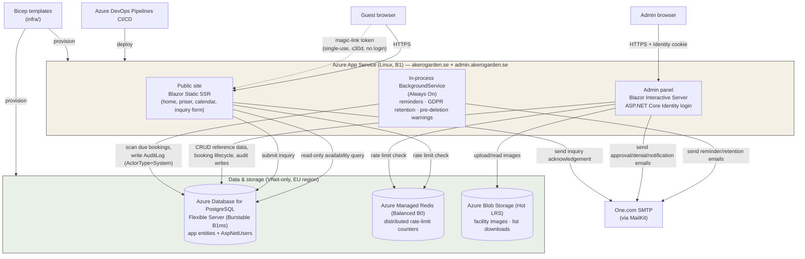

# Åkerögården — App-Level Architecture

**Derived from:** requirements.md v0.47, §1.3 (Scope), §1.5 (Technology Decisions), §2.5 (Booking Status Transitions), §2.6 (Magic Link Rules), §6.4 (Admin Auth), §6.7/FR-63–66 (Automated Notifications), §6.9 (Audit Trail), §10 (Out of Scope), §11/§11.1 (Hosting & Environments).
**Status:** Pre-go-live artefact — reflects the target production topology (Phase 10b), not the current local-dev-only state.

This is a system/component view — how the public site, admin panel, background jobs, and external Azure services fit together. For the data model see [erd.md](erd.md); for infra-as-code see the `.bicep` templates under `infra/`.

---

## Tech stack (locked, §1.5)

| Layer | Technology |
|---|---|
| Web framework | .NET 10 LTS Blazor — Static SSR (public), Interactive Server (admin) |
| Data access | EF Core + PostgreSQL |
| Database hosting | Azure Database for PostgreSQL Flexible Server (Burstable B1ms), VNet-only |
| Auth | ASP.NET Core Identity (email + password, admin panel only) |
| App hosting | Azure App Service, Basic B1 (Linux) |
| Rate limiting | Azure Managed Redis (Balanced B0) |
| File/image storage | Azure Blob Storage (Hot tier, LRS) |
| Email | MailKit over One.com SMTP |
| CI/CD | Azure DevOps Pipelines (migrated from GitHub Actions, Phase 10a) |
| Infra-as-code | Bicep (prod + staging from the same templates, different parameter files) |

This stack is locked per the project's CLAUDE.md — changes require explicit discussion, not silent substitution.

---

## Diagram

---

## Notes

1. **One App Service, two hostnames.** `akerogarden.se` (public) and `admin.akerogarden.se` (admin) are both bound to the same Azure App Service — not separate deployments or slots (B1 doesn't support slots). Separation between the two surfaces is enforced in routing/auth, not infrastructure (FR-70, §6.4).

2. **Rendering modes differ by surface.** Public pages are Blazor **Static SSR** — no persistent circuit, cheapest to serve, matches the read-mostly/inquiry-form nature of the public site. The admin panel is Blazor **Interactive Server** — a live SignalR circuit per session, justified by the admin panel's CRUD-heavy, stateful interactions (§1.5).

3. **Guests never authenticate.** There is no guest account system. The only guest-facing "auth" is the magic-link token issued at booking approval: single-use, ≥128-bit entropy, expiring at the earliest of 30 days after issue or 14 days before check-in (floor 48h) — §2.6, FR-51–54, NFR-03. Admin auth is the only real login surface, via ASP.NET Core Identity (§6.4, FR-70–74).

4. **The background job is in-process, not a separate service.** Scheduled work (14-day reminders, completion nudges, GDPR retention deletes, 30-day pre-deletion warnings) runs as an in-process hosted `BackgroundService` inside the same App Service process, kept alive by **Always On** (B1 supports it). An external scheduler (Azure Functions timer trigger or Logic App) was evaluated and deferred — §10, FR-69/91/98. It authors `AuditLog` rows with `ActorType = System`.

5. **Redis is rate-limiting only.** Azure Managed Redis (successor to the retired Azure Cache for Redis) holds no application data — its sole job is distributed rate-limit counters shared across the single App Service instance (NFR-04).

6. **Postgres is VNet-only.** No public internet access to the database — reachable only via VNet integration from the App Service (NFR-25). This is also why staging is a fully separate resource group rather than a slot: network isolation and synthetic data can't leak into/from production this way (§11.1).

7. **Identity tables live in the same Postgres instance** as the application schema, but are treated as infrastructure, not part of the application data model (§6.4) — see the note at the top of [erd.md](erd.md).

8. **Everything in this diagram must exist in Bicep.** Per the project's IaC rule, both production and staging are provisioned from the same `.bicep` templates with different parameter files — no resource shown here should ever be click-through-provisioned.
