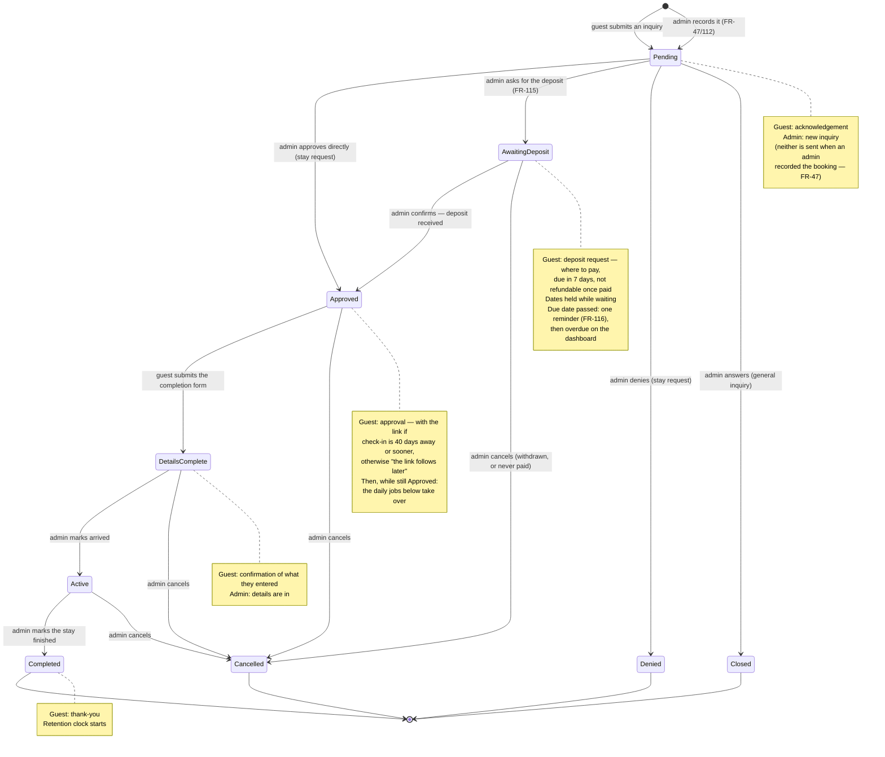
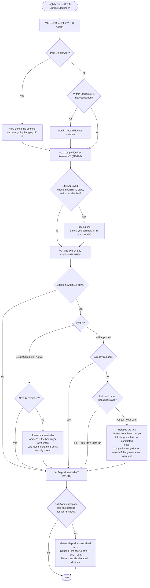
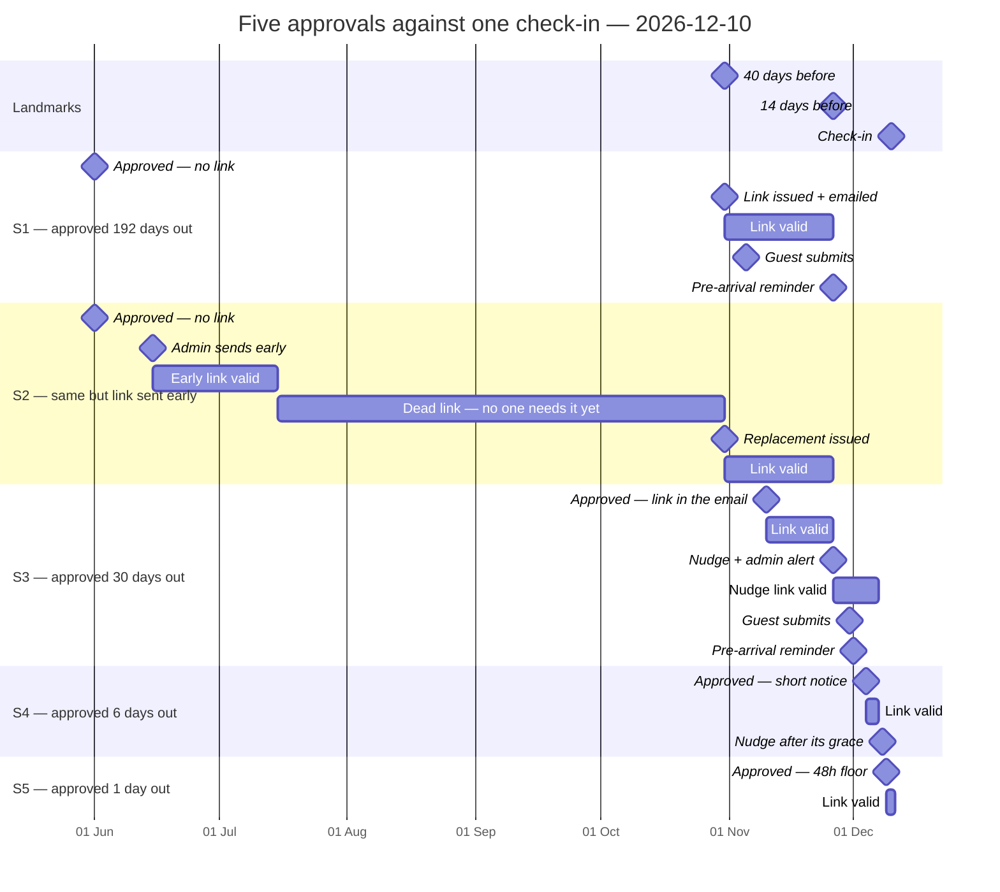
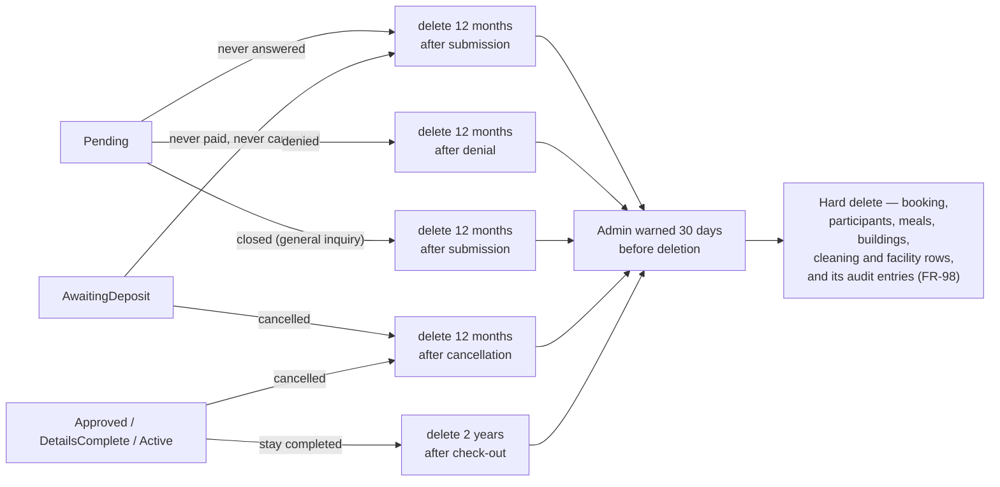

# Booking lifecycle and timeline

What happens to a booking from inquiry to deletion, and — the part that is hard to hold in your
head — **when** each automated email fires and **how long each completion link lives**.

The rules themselves live in `requirements.md` (§2.5 transitions, §2.6 magic link, §2.7 retention,
§9 email templates). This document only draws them. If the two disagree, the SRS wins.

---

## 1. Status transitions and the emails they trigger

`Denied`, `Closed`, `Cancelled` and `Completed` are terminal — nothing transitions out of them.
`DetailsComplete` never returns to the completion form; corrections after submission are made by the
admin in the panel and change no status (C10).

### An admin-recorded booking enters at the same place, quietly

A booking an admin takes by telephone starts in `Pending` like any other and follows the identical
path — **it still waits for approval**, and approval still issues the completion link. What differs is
only what is sent at creation: **no guest acknowledgement and no admin notification** (FR-47). The
acknowledgement says *"we have received your booking request"*, which is untrue for a booking already
agreed on the phone, and undeliverable to a guest with no email address at all. The approval mail —
or, if the admin asks for a deposit, the deposit request (FR-115) — is then the single, accurate first
message the guest receives, which is also why the terms reach them there rather than earlier. That gap was closed by decision on 2026-09-09 with a process control:
`/bokningar/ny` tells the admin to send a guest who has an email to the web form instead (FR-111).

Where the guest has no email, the admin's own address stands in as the booking's contact email so the
approval mail and completion link reach whoever will fill the form in, and the booking records which
admin is acting and that the terms were read out verbally (FR-112, `OnBehalfOfAdminId` /
`TermsAttestedAt`). Everything below applies unchanged to those bookings — the dates, the link
lifetimes and the nightly decisions do not know or care how the booking was created.

---

## 2. What the nightly run decides

One run, 03:00 Europe/Stockholm, four jobs in the order they are registered
(`AkeroServiceCollectionExtensions.AddAkeroScheduledJobs`). The order matters only in the rare case
noted below. *(Until 2026-10 this section drew retention last; the code has always run it first.)*

**Two flags, never one.** The pre-arrival reminder and the completion nudge are guarded separately.
A guest nudged at 14 days who then submits at 12 still receives the pre-arrival email at 10. While
one flag guarded both, that guest received neither the address nor their stated times.

**A failed email changes nothing, so the next night retries it** (NFR-13, FR-63/108). A flag is set
only on a confirmed send. Issuance and the nudge replace the guest's link before sending; if the
send fails they put the previous link back, so the guest keeps what they had and the booking is due
again tomorrow. A failed nudge also holds the admin alert, which would name a link that no longer
exists. Only the admin alert on its own is never retried — that would nudge the guest twice.

**Why issuance runs first.** The two are normally 26 days apart. If issuance has been down and a
link-less booking reaches 14 days, this order hands it the link first — the nudge then sees a link
sent seconds ago and defers on its grace period, instead of telling the same guest in the same
minute both "here is your link" and "you have not filled in your details".

---

## 3. Every issuance outcome, on one check-in date

All five bookings below arrive **2026-12-10** and leave **2026-12-13**. The only thing that differs
is when the admin approved. Three dates are fixed by that check-in:

| Landmark | Date | What happens there |
|---|---|---|
| 40 days before | **2026-10-31** | the issuance job's window opens |
| 14 days before | **2026-11-26** | pre-arrival reminder *or* completion nudge |
| 3 days before | **2026-12-07** | the deadline any link issued 14 days or fewer out runs to — a late approval *or* the nudge |

### The same thing, exactly

| | Approved | Link issued at approval? | Link expires | Why that date | 14-day email |
|---|---|---|---|---|---|
| **S1** | 2026-06-01 (192 d) | **No** — beyond 40 days | 2026-11-26 | issued 10-31 at the 40-day mark; the 14-day cut-off binds before the 30-day ceiling | pre-arrival (submitted 11-05) |
| **S2** | 2026-06-01 (192 d) | **No**, but the admin sent one on 06-15 | early link 2026-07-15, replacement 2026-11-26 | the early link hits the 30-day ceiling; the job replaces it at the 40-day mark | pre-arrival |
| **S3** | 2026-11-10 (30 d) | **Yes** | 2026-11-26, then **2026-12-07** | 14-day cut-off; the nudge then reissues, and that link is a late issue → 3 days before check-in | nudge — guest had not submitted |
| **S4** | 2026-12-04 (6 d) | **Yes** | 2026-12-07 | late issue → 3 days before check-in | nudge on 12-08, held 3 days after the link |
| **S5** | 2026-12-09 (1 d) | **Yes** | 2026-12-11 | 3-days-before is already past → 48-hour floor | **none** — the grace outlasts check-in, and nobody nudges a guest who has arrived |

**S2 is the case that reopens the gap if the issuance job is written the obvious way.** Keyed on
"has a link ever been sent", the job would skip S2 for ever and the guest would hold a dead URL from
15 July to the nudge on 26 November — 134 days. Keyed on "is there a usable link", it replaces it on
31 October. See §2.6 and FR-108.

**S3 is the case the flag split fixes.** The nudge fires on 11-26 and the guest submits on 11-30. The
pre-arrival email with the address and their stated times must still go out on 12-01. Under one
shared flag it never did.

**S3 also shows the late-issue floor doing its second job.** The nudge reissues the link at 03:00 on
11-26 — 14 days out, so that reissue is itself a late issue and the new link runs to 12-07, eleven
days. Compared against the 14:00 check-in *instant* rather than in whole days, 03:00 read as eleven
hours early, took the ordinary cut-off, expired that same afternoon and landed on the 48-hour floor:
the guest being chased for being late got two days, while S4 — approved eight days later — got
eleven. Corrected 2026-08-10; see FR-53.

---

## 4. Terminal branches and how long the record lives

`AwaitingDeposit` keeps the 12-months-from-submission date it had as `Pending` (FR-91), so a booking
nobody pays and nobody cancels cannot keep guest data indefinitely. Live in-progress states
(`Approved`, `DetailsComplete`, `Active`) carry **no** deletion date; the
clock only starts when the booking reaches a terminal state.

Worked example on the same booking: cancelled by the guest on **2026-11-15**. If a deposit was paid,
the cancellation email states it is not refunded, and that any further fee follows the terms in force
when the booking was confirmed (FR-79) — the email never restates the scale itself. The record is deleted
**2027-11-15**, and the admin is warned on **2027-10-16**.
