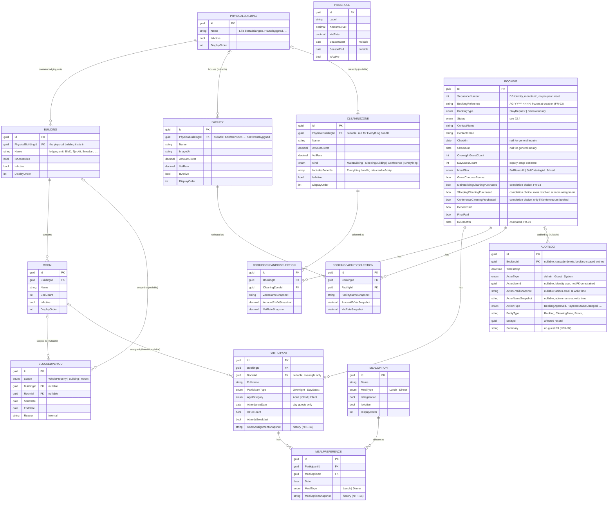

# Åkerögården — Entity Relationship Diagram

**Derived from:** requirements.md v0.47, Section 8 (Core Data Model)
**Status:** Pre-development artefact — the schema blueprint for the .NET 10 / EF Core / PostgreSQL build.

This is the diagram Section 8 of the SRS calls for. Attribute lists below show the **primary key, foreign keys, and the fields that drive relationships or logic** — see requirements.md §8 for the complete field list of each entity.

> **Admin accounts are out of this diagram.** They live in ASP.NET Core Identity's own tables (`AspNetUsers`, etc.) and are treated as infrastructure, not application entities (requirements.md §6.4).

---

## Diagram

> `PRICERULE` has no foreign keys — it is standalone reference data, displayed read-only on the public prices page (FR-82) and on booking records (FR-34). It is shown above without relationship lines for that reason.

---

## Relationships at a glance

| From | To | Cardinality | Via | Notes |
|---|---|---|---|---|
| PhysicalBuilding | Building | 1 → many | `Building.PhysicalBuildingId` | A physical building holds several lodging units (Lilla bostadslängan → Blidö/Ljusterö/Singö/Tjockö); standalone cabins are their own physical building |
| PhysicalBuilding | Facility | 0..1 → many | `Facility.PhysicalBuildingId` | Nullable — set only where a facility sits in a cleaning-relevant building (Konferensrum → Konferensbyggnad) |
| PhysicalBuilding | CleaningZone | 0..1 → 0..1 | `CleaningZone.PhysicalBuildingId` | The building a zone cleans; null for the `Everything` bundle |
| Building | Room | 1 → many | `Room.BuildingId` | A building contains its rooms |
| Booking | Participant | 1 → many | `Participant.BookingId` | General inquiries have zero participants |
| Room | Participant | 0..1 → many | `Participant.RoomId` | Nullable — set only for assigned overnight guests (I14) |
| Participant | MealPreference | 1 → many | `MealPreference.ParticipantId` | One row per day × meal type |
| MealOption | MealPreference | 1 → many | `MealPreference.MealOptionId` | Live ref; name also snapshotted |
| Booking | BookingCleaningSelection | 1 → many | `BookingCleaningSelection.BookingId` | One row per purchased cleaning zone; populated at completion (FR-93) |
| CleaningZone | BookingCleaningSelection | 1 → many | `BookingCleaningSelection.CleaningZoneId` | Live ref; name + amount snapshotted (NFR-33) |
| Booking | BookingFacilitySelection | 1 → many | `BookingFacilitySelection.BookingId` | One row per selected facility |
| Facility | BookingFacilitySelection | 1 → many | `BookingFacilitySelection.FacilityId` | Live ref; name + amount snapshotted (NFR-34) |
| Building | BlockedPeriod | 0..1 → many | `BlockedPeriod.BuildingId` | Null for `WholeProperty` scope |
| Room | BlockedPeriod | 0..1 → many | `BlockedPeriod.RoomId` | Set only for `Room` scope |
| CleaningZone | CleaningZone | many ↔ many (self) | `CleaningZone.IncludesZoneIds[]` | A bundle (Hela lägret) covers other zones |
| Booking | AuditLog | 0..1 → many | `AuditLog.BookingId` | Nullable, cascade-delete — set for booking-scoped audit entries; null for reference-data/admin-account entries (which are keyed only by `EntityType`/`EntityId`) |

---

## Modelling notes

1. **Snapshot pattern.** `MealPreference`, `BookingCleaningSelection`, and `Participant.RoomAssignmentSnapshot` each keep a *live FK* **and** a *text/amount snapshot* taken at submission time. The FK powers queries and conflict detection; the snapshot preserves what was agreed if the reference data is later edited (NFR-15/16/33). Hard-delete of referenced reference data is blocked (FR-16/20/26/30/88). *Cleaning (FR-93) is chosen at completion, not inquiry: `MainBuilding`/`Conference` rows snapshot at submission, while the combined `SleepingBuilding` choice is stored as intent (`Booking.SleepingCleaningPurchased`) and its rows are resolved from room assignment and snapshotted when that assignment is set/changed.*

2. **No monetary totals.** Per C8, no booking total / deposit / balance is stored. `AmountExVat` on `CleaningZone`/`PriceRule` is reference data only; deposit/final tracking on `Booking` is boolean status.

3. **Array columns.** `CleaningZone.IncludesZoneIds` is a PostgreSQL `uuid[]` column (supported by EF Core), used only for the Hela lägret bundle self-reference. Facility and cleaning *selections* are full child entities (with snapshots), not arrays.

4. **Facility & cleaning selections are symmetric.** Both `BookingFacilitySelection` and `BookingCleaningSelection` are child entities with a live FK plus name/amount snapshots, so an agreed facility or cleaning price survives later edits to the reference record (NFR-33/34, resolved consistently with C6). This was previously an asymmetry (facilities were a bare ID array) — aligned in v0.32.

5. **PhysicalBuilding is the cleaning/blocking level.** Cleaning is priced per physical building, so `CleaningZone` links to `PhysicalBuilding` by **FK** (not a `uuid[]` of building/facility IDs) — sleeping-cleaning resolves by the structural join room → `Building.PhysicalBuildingId` → `CleaningZone.PhysicalBuildingId` with referential integrity, and `Facility.PhysicalBuildingId` drives conference cleaning. The lodging `Building` (Blidö, …) is a *unit inside* a physical building; the level was promoted to a first-class entity (rather than a `CleaningZone`↔`Building` join table) because a concrete future use exists — blocking a whole physical building (e.g. all of Stora bostadslängan) in one action, a `BlockedPeriod.PhysicalBuilding` scope planned as a later slice.

6. **AuditLog is accountability, not preservation.** The snapshot pattern (note 1) answers *"what was agreed?"*; `AuditLog` (§8.15) answers *"who changed this, and when?"* — a distinct concern, so it is a separate append-only entity, not more snapshot columns. It is **semi-polymorphic**: `EntityType`/`EntityId` identify the affected record of any kind, while an optional hard FK `BookingId` (ON DELETE CASCADE) is set for booking-scoped entries so they are purged with the booking (FR-98) and listable per booking. It stores **no guest personal data** (NFR-37) — booking-change entries carry the action + `BookingReferenceSnapshot` only, never guest field values or art. 9 dietary data. Actor is `Admin` / `Guest` (magic-link completion) / `System` (background jobs), so every change is attributable. Admin identity is stored as a live `ActorUserId` plus an `ActorEmailSnapshot` (not FK-constrained — Identity tables are infrastructure, §6.4 — and admins can be removed, FR-74).
