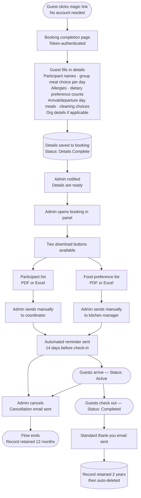
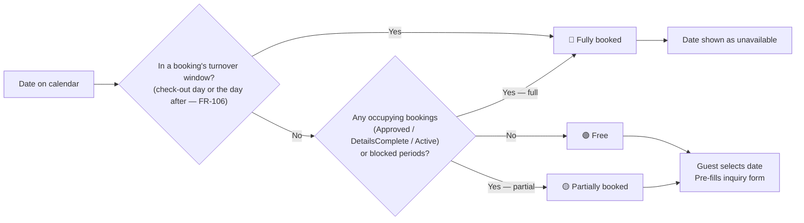

# Åkerögården — Booking System
## Software Requirements Specification
**Status:** Living document — current truth, edited in place.  
**Client:** Åkerögården, Norrtälje, Sverige  

> This document is not versioned. It states what the system does now; when a requirement changes,
> the text is edited in place and the rationale goes in the commit body
> (`git log --follow docs/product/requirements.md`). Where a change alters a live constraint, its
> *why* is folded into the section that governs it. History up to the retirement of versioning is
> archived in [`requirements-changelog.md`](requirements-changelog.md).

---

## Table of Contents

1. [Introduction](#1-introduction)
2. [Booking Lifecycle](#2-booking-lifecycle)
3. [Accommodation and Capacity](#3-accommodation-and-capacity)
4. [Meals and Food Preferences](#4-meals-and-food-preferences)
5. [Pricing](#5-pricing)
6. [Functional Requirements](#6-functional-requirements)
7. [Non-Functional Requirements](#7-non-functional-requirements)
8. [Core Data Model](#8-core-data-model)
9. [Email Templates](#9-email-templates)
10. [Out of Scope](#10-out-of-scope)
11. [Hosting and Infrastructure](#11-hosting-and-infrastructure)
12. [Open Questions](#12-open-questions)

---

## 1. Introduction

### 1.1 Purpose

This document defines the software requirements for the Åkerögården booking system — a web application built to manage guest inquiries, bookings, participant data, meal orders, and administrative workflows for Åkerögården, a rural retreat property in Norrtälje, Sweden.

It serves as the single source of truth for all design, development, and testing decisions. Any scope change must be reflected as a new version of this document.

### 1.2 Project Background

Åkerögården has operated as a retreat and conference facility since 1978. The property currently accommodates up to 79 overnight guests across six residential buildings and two standalone cabins. The exact room configuration, meal offerings, facilities, and prices are managed by the property admin and may change over time. The system must reflect this — nothing operational is hardcoded.

### 1.3 Scope

**In scope:**
- A public-facing web application (.NET 10 Blazor, Static SSR) with pages for home, about, facilities, mat & priser (combined menu + prices), contact, availability calendar, and booking inquiry
- A public availability calendar showing only whether dates are booked or free — no personal data, no detail beyond availability status
- A full admin panel for booking management, review, approval, and all reference data management (buildings, rooms, meals, facilities, prices)
- Admin ability to create bookings manually on behalf of guests
- Admin ability to block a room, a building, or the whole property for a date range
- A token-based booking completion flow for approved guests — no account creation required
- Automated and manual email workflows at defined lifecycle points
- Downloadable participant and food preference lists (PDF and Excel)
- GDPR-compliant data retention and automatic deletion

**Out of scope** (see Section 10):
- Online payment processing
- Automatic list delivery to coordinators or kitchen
- Guest accounts or login
- Room-based pricing (future release)

### 1.4 Stakeholders

| Role | Responsibilities | System access |
|---|---|---|
| Property admin | Manages all bookings; manages all reference data (buildings, rooms, meals, facilities, prices); approves or denies inquiries; assigns lodging buildings; downloads lists; can create bookings on behalf of guests | Full admin panel — role `Administratör` |
| Guest / contact person | Views availability calendar; submits inquiry; receives magic link; completes booking details | Public site + token-secured completion page |
| Coordinator (external) | Reads the participant name list | Admin panel, role `Samordnare` — restricted to the two per-booking lists |
| Kitchen manager (external) | Reads the food preference list | Admin panel, role `Samordnare` — restricted to the two per-booking lists |

> Invoicing and payment tracking are **outside the system entirely** — see §5.4. The admin
> records neither invoices nor receipts here.

### 1.5 Technology Decisions

| Concern | Decision | Rationale |
|---|---|---|
| Framework | .NET 10 Blazor (LTS — supported until November 2028) | Developer comfort; full-stack C# consistency |
| Blazor rendering mode | Static SSR for all public-facing pages; Interactive Server for the admin panel | Static SSR produces plain server-rendered HTML for SEO and fast first load; Interactive Server is appropriate for the admin panel where SEO is irrelevant and rich interactivity is needed |
| Admin authentication | ASP.NET Core Identity | Single-library solution for credential storage, password hashing, cookie auth, and password reset — no external auth dependency |
| Database | PostgreSQL on Azure | Managed backups; familiar query model |
| Hosting | Azure App Service (Linux, B1) | Managed SSL; CI/CD from Azure DevOps Pipelines |
| File storage | Azure Blob Storage | List downloads and media uploads |
| Rate limiting store | Azure Managed Redis | Distributed rate-limit counters; correct under multi-instance scale-out (NFR-04). Successor to the retired Azure Cache for Redis |
| Email | MailKit (SMTP via One.com) | Robust .NET email library |
| ORM | Entity Framework Core | Standard .NET data access layer |
| CI/CD | Azure DevOps Pipelines | Migrated from GitHub Actions in Phase 10a — client has Azure DevOps access via their subscription, no GitHub presence |

---

## 2. Booking Lifecycle

### 2.1 Phase 1 — Inquiry to Decision

### 2.2 Phase 2 — Completion to Post-Stay

### 2.3 Public Calendar Logic

### 2.4 Booking Status Reference

| Status | Applies to | Description |
|---|---|---|
| `Pending` | Both | Inquiry submitted, awaiting admin review |
| `Approved` | Stay request | Admin approved; awaiting guest completion |
| `Denied` | Stay request | Admin denied; retained 12 months |
| `DetailsComplete` | Stay request | Guest submitted participant and meal data |
| `Active` | Stay request | Group currently on-site |
| `Completed` | Stay request | Stay finished; in retention period |
| `Cancelled` | Stay request | Cancelled by admin; reachable from `Approved`, `DetailsComplete`, or `Active`; deposit rules apply (see Section 5.6) |
| `Closed` | General inquiry | Admin has read and responded; no approve/deny applies; retained 12 months from submission |

### 2.5 Booking Status Transitions

The system shall enforce the following allowed transitions. Any transition not in this table is blocked.

| From | To | Who / How |
|---|---|---|
| `Pending` | `Approved` | Admin — stay requests only |
| `Pending` | `Denied` | Admin — stay requests only |
| `Pending` | `Closed` | Admin — general inquiries only |
| `Approved` | `DetailsComplete` | System — on guest completion form submission |
| `Approved` | `Cancelled` | Admin |
| `DetailsComplete` | `Active` | Admin — marks guests as arrived |
| `DetailsComplete` | `Cancelled` | Admin |
| `Active` | `Completed` | Admin — marks stay finished |
| `Active` | `Cancelled` | Admin |

`Denied`, `Completed`, `Closed`, and `Cancelled` are terminal states — no transitions out.

> **No reopen after completion (C10):** `DetailsComplete` has no transition back to the completion flow. Once the guest submits, they cannot re-open the form; the single-use token stays invalidated (FR-62) and is not re-issued (FR-49). Any correction after submission is made by the admin directly in the panel (FR-48) and does not change the booking's status.

### 2.6 Magic Link Rules

- Cryptographically random token (minimum 128-bit entropy)
- **The link is issued when the guest can use it, not when the booking is approved.** If check-in is more than 40 days away the approval email carries no link at all; the daily job issues one once check-in comes within 40 days (FR-108). 40 is not an arbitrary number. The 30-day ceiling below outlives the 14-days-before-check-in cut-off only while the link is issued **within 44 days** of check-in (issue + 30 ≥ check-in − 14); past that the ceiling binds first and the link dies mid-wait. 40 sits four days inside that boundary, so the daily job has room to fire without the rule resting on its exact edge. **Do not raise it toward 44, and do not lower the 30-day ceiling without lowering this in step** — either move re-creates the dead-link gap this rule exists to close
- Expires at whichever comes first: 30 days after issue, or 14 days before check-in. The 30-day ceiling is a security bound, not an operational one: the link is a password-free credential that grants access to participant names and allergies, and an emailed URL lives indefinitely in mailboxes, forwards and backups — the ceiling caps how long a leaked one is worth anything. The 14-day cut-off is operational: the kitchen and cleaning need the details by then
- **Floor for late issues:** when a link is issued **14 days or fewer before check-in** the cut-off above is today or already past, so the link instead runs until **3 days before check-in**, and in no case less than 48 hours from issue. A guest approved ten days out gets a week to collect everyone's names and allergies rather than two days. This covers the **completion nudge** as well as a late approval — the nudge is the "you are late" email, so its link is the last one that needs to be usable. **Counted in whole days, not by comparing instants against the 14:00 check-in time:** the nudge fires at 03:00 on the 14-days-before date, which as an instant reads as eleven hours *early*, took the ordinary cut-off, expired that same afternoon and fell through to the 48-hour floor — so a chased guest got two days where a guest approved one day later got eleven, decided by the hour the job happened to run (corrected 2026-08-10)
- All thresholds are evaluated as exact timestamps; the link is valid up to its computed expiry instant and is rejected at or after it
- Whenever an email carries a link it must display that link's exact expiry date and time in plain text, so the guest knows their deadline
- Single-use — invalidated immediately on form submission
- Generating a new token immediately invalidates any previously issued token for the same booking
- Admin can manually regenerate or resend the completion token from the booking detail page while the booking is awaiting completion (status `Approved`), whether or not the previous token has expired; once the booking is `DetailsComplete` the token is not re-issued (see FR-49)
- When the admin approves a booking with check-in 14 days away or sooner, the system displays a warning stating the exact token expiry (e.g. "Completion link expires 3 days before check-in — consider contacting the guest directly")
- **No link ever expires while the guest still needs it.** Issuing at 40 days (above) means an issued link always survives to the completion nudge at 14 days, which replaces it; any link issued 14 days or fewer out — a late approval, or the nudge's own reissue — survives to 3 days before check-in. This is why there is no pre-expiry warning email: the earlier design warned the guest that their link was dying, which treated the symptom. Fixing *when* the link is issued removed the condition instead (FR-99, retired 2026-08-09). Do not reintroduce a warning without first reintroducing the gap it warned about
- **The invariant above holds for links the daily job issues — one path can still break it, and the job is what repairs it.** An admin may send the link early on request (FR-49). On a booking approved far ahead that link expires at its 30-day ceiling with check-in still months away, so between that expiry and the 40-day mark the guest holds a dead URL. This is why the issuing job asks whether a **usable** link exists rather than whether one was ever sent: at 40 days it replaces the dead one and the guest is whole again. Keying that job on "never sent" is the intuitive reading and is wrong — it reopens exactly the gap deferred issuance was introduced to close (found by walking the admin resend, 2026-08-10)

### 2.7 GDPR Retention

| Outcome | Retention | Trigger |
|---|---|---|
| Completed stay | 2 years | From check-out date |
| Denied or cancelled | 12 months | From denial or cancellation date |
| Pending (no response) | 12 months | From submission date |
| Closed general inquiry | 12 months | From submission date |

Admin receives a warning email 30 days before any record is deleted.

### 2.8 Check-In and Check-Out Times

- **Standard check-in: 14:00. Standard check-out: 12:00.** These remain the defaults and cover the ordinary case in one click
- The guest **states their intended check-in and check-out time on the inquiry form** (FR-100), using a constrained picker: 30-minute steps, bounded 07:00–22:00, pre-filled with the standard times. Free text is not accepted — "sometime in the afternoon" cannot be used downstream
- The stated time is **a request, not a commitment**. The guest states it; the admin may adjust it (FR-48); the guest may amend it on the completion form. There is deliberately **no accept/decline workflow** — this stays a booking system, not a ticketing tool
- Early check-in and late check-out remain available for a surcharge at the admin's discretion (no fixed price rule, no PriceRule entry). **The negotiation and the surcharge are still arranged directly between guest and admin outside the system** — capturing the intended time changed *what the admin knows*, not *what the system does*. The system neither prices nor approves a non-standard time
- When a stated time deviates from the standard, the admin panel shows an inline warning at approval (FR-101). Without it, a guest whose booking is approved would reasonably assume their 08:00 arrival was approved along with it, and the surcharge conversation would never happen. The warning does not block approval — the same pattern as FR-75
- **Which meals are served on the arrival and departure day is chosen by the guest at completion, not derived from these times** (§4.1). The two are deliberately independent: a group arriving at 11:00 may still want breakfast, and any cutoff rule (11:59 qualifies for lunch, 12:01 does not) would be wrong often enough to be worse than trusting the group. This independence is also what makes it safe to capture the times at inquiry and the meals at completion — they cannot contradict each other

---

## 3. Accommodation and Capacity

> **All accommodation data is admin-managed.** Buildings and rooms are created, edited, and deleted through the admin panel. The values below reflect the current known state of the property and will be entered by the admin on first setup — they are not hardcoded.

### 3.1 Buildings Overview

| Building | Rooms | Total beds | Accessibility | Notes |
|---|---|---|---|---|
| Blidö | 4 | 12 | Not accessible | Common room · 1 shower/cleaning room · 2 toilets |
| Ljusterö | 4 | 17 | Not accessible | Common room · 1 shower/cleaning room · 1 toilet |
| Singö | 4 | 16 | Not accessible | Common room · 1 shower · 2 toilets |
| Tjockö | 4 | 10 | Not accessible | Common room · 1 shower/cleaning room · 2 toilets |
| Vätö 1 | 5 | 8 | Not accessible | Common room · 2 showers/cleaning rooms · 2 toilets |
| Vätö 2 | 5 | 8 | Not accessible | Common room · 2 showers/cleaning rooms · 2 toilets |
| Smedjan | 1 | 2 | Not accessible | Standalone cabin · 1 double bed · private facilities |
| Tallstugan | 1 | 4 | Not accessible | Standalone cabin · private shower and toilet |
| **Total overnight** | | **79** | | |

> **Lodging units vs physical buildings.** The rows above are lodging **`Building`** units (§8.2). Several of them physically sit inside a larger **`PhysicalBuilding`** (§8.14) — the level at which cleaning is priced (§5.5) and a whole building can be blocked (future). Mapping:
>
> | PhysicalBuilding | Lodging units in it |
> |---|---|
> | Lilla bostadslängan | Blidö, Ljusterö, Singö, Tjockö |
> | Stora bostadslängan | Vätö 1, Vätö 2 |
> | Smedjan | Smedjan (standalone) |
> | Tallstugan | Tallstugan (standalone) |
> | Huvudbyggnad | *(no lodging — matsal & shared areas)* |
> | Konferensbyggnad | *(no lodging — conference; Konferensrum facility sits here)* |

### 3.2 Room-Level Detail

| Building | Room | Beds | Configuration |
|---|---|---|---|
| Blidö | Room 1 | 4 | 2 bunk beds |
| Blidö | Room 2 | 2 | 2 single beds |
| Blidö | Room 3 | 3 | 3 single beds |
| Blidö | Room 4 | 3 | 3 single beds |
| Ljusterö | Room 1 | 3 | 3 single beds |
| Ljusterö | Room 2 | 6 | 3 bunk beds |
| Ljusterö | Room 3 | 4 | 2 bunk beds |
| Ljusterö | Room 4 | 4 | 2 bunk beds |
| Singö | Room 1 | 3 | 3 single beds |
| Singö | Room 2 | 5 | 2 bunk beds + 1 single |
| Singö | Room 3 | 4 | 1 bunk bed + 2 singles |
| Singö | Room 4 | 4 | 1 bunk bed + 2 singles |
| Tjockö | Room 1 | 3 | 3 single beds |
| Tjockö | Room 2 | 2 | 2 single beds |
| Tjockö | Room 3 | 3 | 3 single beds |
| Tjockö | Room 4 | 2 | 2 single beds |
| Vätö 1 | Room 1 | 2 | 2 single beds |
| Vätö 1 | Room 2 | 2 | 2 single beds |
| Vätö 1 | Room 3 | 1 | 1 single bed |
| Vätö 1 | Room 4 | 1 | 1 single bed |
| Vätö 1 | Room 5 | 2 | 2 single beds |
| Vätö 2 | Room 6 | 2 | 2 single beds |
| Vätö 2 | Room 7 | 1 | 1 single bed |
| Vätö 2 | Room 8 | 1 | 1 single bed |
| Vätö 2 | Room 9 | 2 | 2 single beds |
| Vätö 2 | Room 10 | 2 | 2 single beds |
| Smedjan | Room 1 | 2 | 1 double bed |
| Tallstugan | Room 1 | 4 | 1 bunk bed + 2 singles |

### 3.3 Blocking (Room, Building, or Whole Property)

The admin can block availability for a defined date range at one of three scopes — a single room, an entire building, or the whole property — for example during renovation or when something is broken. This is a single feature (one `BlockedPeriod` record per block; see Section 8.10). A block has two effects: **(1)** a blocked building cannot be assigned to a booking whose stay overlaps the blocked dates (FR-102), and **(2)** the block reduces the date's effective capacity on the public availability calendar (FR-10). A whole-property block marks the date fully unavailable.

> **Why the assignment guard is stated explicitly.** Until building assignment replaced per-participant room assignment, blocked rooms were kept out of use only as a side effect of being filtered out of the completion form's room picker. That picker no longer exists, so the protection is now a first-class rule rather than a consequence of a UI list — otherwise nothing would stop an admin assigning a building that is closed for renovation.

---

## 4. Meals and Food Preferences

> **All meal options are admin-managed.** The admin can add, edit, and deactivate meal options at any time. The options below reflect the current menu and will be entered on first setup. Active meal options are displayed publicly on the combined Mat & priser page (FR-83).

### 4.1 Meal Structure

Full-board accommodation includes per day: breakfast (buffet, no selection required), lunch (one option **for the whole group** per day), dinner (one option **for the whole group** per day), and fika twice daily (included, no selection).

**Two meal plan options exist at booking level**, declared on the inquiry form:

| Value | Meaning |
|---|---|
| `FullBoardAll` | All guests are full-board — meals included for everyone |
| `SelfCateringAll` | All guests are self-catering — no meals provided |

> **A booking is all-or-nothing on catering.** There is no mixed plan and no per-participant catering flag: if the booking is full-board, every participant eats. This removes what was previously a per-person `IsFullBoard` field — the value is now entirely derivable from the booking, so storing it per participant would only invite the two to disagree.

**Meal selection is per meal sitting per day, and applies to the whole group** (FR-105). For each applicable lunch and dinner of the stay, the contact person picks **one** option that everybody eats. Nobody chooses individually, and the system does not record who eats what.

> **The "same for all days" shortcut was retired (2026-08-07).** It is described here for the reader who finds it referenced elsewhere. It existed to cascade one choice across every *participant* — when 78 people each picked their own meals, that was a rescue from hundreds of dropdowns. Group-level selection satisfies that intent **by construction**: there is nothing left to cascade from. Read literally as its name suggests — one dish for every lunch and every dinner of the stay — it makes the booking worse rather than faster, and is least wanted on exactly the long stays where it saves most clicks.
>
> **Why group-level rather than per person.** The kitchen list has never used per-person meal data — it aggregates every individual choice into per-dish counts before the caterer sees it (FR-45). Collecting 78 individual selections in order to produce one number was work for the guest that the system then discarded. Individual needs are still met, through allergies and dietary preferences below, which is what they were always for.

**Meals by day of stay:**
- **Arrival day and departure day:** the group **chooses** which of breakfast, lunch and dinner it takes — any combination, including all three (FR-105). This is stored data, not derived.
- **Middle days (full days):** always breakfast (buffet, no selection), lunch, and dinner — derived, not chosen.

> **The edge days are deliberately not derived from the check-in and check-out times.** They used to be: fixed 14:00/12:00 implied dinner only on arrival and breakfast only on departure. Once guests state their own times (§2.8) that derivation stops being safe — and constraining the choice by the stated time would require a cutoff rule that is wrong often enough to be worse than trusting the group. A party arriving at 11:00 may perfectly reasonably want breakfast.

A lunch or dinner option is chosen for every sitting the group has said it will take, so a one-night stay with dinner on arrival and breakfast on departure collects exactly one dinner selection.

### 4.2 Day Guests

A booking may include day guests in addition to overnight guests. Day guests do not occupy a bed. They attend for meals only and are included in participant counts on the food preference list. Each day guest is **named**, and attends a single date (captured as `AttendanceDate`, Section 8.5); a visitor who attends on multiple days is entered as a separate day-guest record per day. There is no upper limit on day guest count — groups may have more day visitors than the property's overnight bed capacity.

**Day guests eat what the group eats.** They make no meal selection of their own — the group's choice for that sitting applies to them too.

**Which meals day guests attend is one setting for the whole booking**, not per day guest: three flags (breakfast / lunch / dinner) applying to every day guest, whichever date each attends.

> **This is required, not merely convenient.** Attendance used to be *implied* by which meal rows existed for a day guest — no lunch row meant no lunch. Once meal selection moved to the booking, that signal disappeared entirely, and without explicit flags a dinner-only visitor would be indistinguishable from one eating all three, making the kitchen counts wrong.
>
> **Accepted limitation:** if a booking ever has day guests with genuinely different meal patterns, the model cannot express it and the counts will be wrong. Accepted on the client's judgement that this does not occur in practice.
>
> **Day guests are only applicable when `MealPlan` is `FullBoardAll`.** A `SelfCateringAll` booking does not have catered meals, so there is no basis for day guest meal attendance. The inquiry form must not show the day guest field when `SelfCateringAll` is selected.

### 4.3 Current Breakfast

Standard buffet. No per-person selection required.

### 4.4 Current Lunch Options

| Key | Description |
|---|---|
| `LUNCH_FISH` | Breaded fish with Danish remoulade, boiled vegetables, boiled potatoes |
| `LUNCH_CHICKEN` | Oven-roasted chicken drumstick with tzatziki and bulgur |
| `LUNCH_PASTA` | Spaghetti bolognese |
| `LUNCH_MEATBALLS` | Meatballs with mashed potatoes and cream sauce |
| `LUNCH_VEGETARIAN` | Stir-fried vegetables with noodles |

### 4.5 Current Dinner Options

| Key | Description |
|---|---|
| `DINNER_CHICKEN` | Grilled chicken fillet with mushroom sauce, sautéed vegetables, wedge potatoes |
| `DINNER_BURGER` | Burger with fries |
| `DINNER_HOTDOG` | Hot dog with bread or mashed potatoes |
| `DINNER_PANCAKES` | Pancakes with jam and cream |
| `DINNER_VEGETARIAN` | Stir-fried vegetables with noodles |

### 4.6 Allergies and Dietary Preferences

Individual dietary needs are captured in **two separate ways**, because they are two different kinds of fact. Both are fixed system values — not admin-managed; adding a new type requires a code change.

**Allergies — recorded per named participant.** A medical constraint. The kitchen must know *which* person receives the adapted plate, so these are always attached to a name.

| Value | Label |
|---|---|
| `NONE` | Inga allergier |
| `GLUTEN` | Glutenintolerans |
| `LACTOSE` | Laktosintolerans |
| `NUT` | Nötallergi |
| `OTHER` | Annat — free-text, max 200 characters |

**Dietary preferences — recorded as counts on the booking.** A choice, not a medical constraint. The kitchen needs to know *how many* portions to adapt, not who requested them.

| Value | Label |
|---|---|
| `VEGETARIAN` | Vegetariskt |
| `VEGAN` | Veganskt |

> **Why the split.** These were previously one list, so a nut allergy and vegetarianism were stored identically. They are not alike: an allergy carries a safety consequence and is special-category health data under GDPR art. 9, whereas a preference is an ordinary choice. Separating them lets the kitchen read "2 nut allergies (safety)" differently from "3 vegetarian portions (preference)", and lets preferences be stored as a count — **strictly less personal data than before**, since nobody needs to know which individuals are vegetarian.
>
> **The vegetarian preference must remain recordable.** With group-level meal selection (§4.1) an individual can no longer quietly pick the vegetarian dish for themselves, so this flag is the only remaining way to record a vegetarian in a group eating something else. The vegetarian *menu options* also stay available (§4.4, §4.5) so a group may choose an all-vegetarian meal for everyone — the two mechanisms serve different cases and do not conflict.

---

## 5. Pricing

> **All prices are admin-managed** and can be changed at any time through the admin panel. Active price rules are displayed publicly on the combined Mat & priser page (FR-82).  
> Invoicing is performed manually outside the system. All prices are **exclusive of VAT**. VAT is stored per item via the `VatRate` field (on each price rule and cleaning zone), because rates differ by category — e.g. 12% for lodging and food, potentially 25% for facility/conference hire. The exact rate per category is admin-entered configuration to be confirmed with the client's accountant. Currency is SEK.

### 5.1 Accommodation With Meals (Full Board)

Applies when the booking's `MealPlan` is `FullBoardAll` — catering is all-or-nothing per booking (§4.1), so the plan applies to every participant on it.

Pricing is **per person per night** based on the number of guests declared in the booking.

| Guest category | Price ex. VAT | Per |
|---|---|---|
| Adults and children aged 4 and over | 550 kr | Per person per night |
| Children aged 3 and under | Free | Per night |

> The applicable tier (standard rate vs free infant) is derived from each overnight participant's `AgeCategory` (Section 8.5).

### 5.2 Accommodation Without Meals (Self-Catering)

Applies when the booking's `MealPlan` is `SelfCateringAll` (§4.1).

| Guest category | Price ex. VAT | Per |
|---|---|---|
| Adults and children aged 4 and over | 250 kr | Per person per night |
| Children aged 3 and under | Free | Per night |
| Kitchen use (self-catering guests) | 100 kr per person | Per day |

> As in 5.1, the standard-rate vs free-infant tier is derived from each overnight participant's `AgeCategory` (Section 8.5).

### 5.3 Cabins

**1 October – 31 March:**

| Cabin | Price ex. VAT | Per |
|---|---|---|
| Smedjan | 1 500 kr | Per night |
| Tallstugan | 1 500 kr | Per night |

**1 April – 30 September:**

| Cabin | Price ex. VAT | Per |
|---|---|---|
| Smedjan | 1 500 kr | Per night |
| Smedjan | 7 000 kr | Full week |
| Tallstugan | 1 500 kr | Per night |
| Tallstugan | 7 000 kr | Full week |

### 5.4 Facilities

| Facility | Price ex. VAT | Per |
|---|---|---|
| Chapel (Kapellet) | 1 000 kr | Per day |
| Conference room (Konferensrum) | 1 000 kr | Per day |
| Grounds excursion (Utflykt — gården) | 2 000 kr | Per day |
| Caravan pitch (Husvagn) | 300 kr | Per day |
| Tent pitch (Tält) | 250 kr | Per day |
| Game room (Spelrum) | 1 500 kr *(cleaning included)* | Per day |

### 5.5 Cleaning

Cleaning is admin-managed `CleaningZone` reference data (Section 8.11), displayed on the public Mat & priser page (FR-82). It is **not** selected at inquiry — it is chosen on the **completion form** (FR-93), after approval, because it depends on what the booking actually occupies (buildings are not assigned at inquiry time).

If cleaning is not purchased for a given area, the guest is responsible for cleaning it themselves before departure.

Cleaning is priced **per physical building** (§8.14). Each cleaning zone links to one physical building by FK (`CleaningZone.PhysicalBuildingId`), except the `Everything` bundle.

| Area (PhysicalBuilding) | Price ex. VAT | `Kind` (§8.11) | Offered when |
|---|---|---|---|
| Huvudbyggnad | 2 000 kr | `MainBuilding` | booking has any overnight lodging |
| Lilla bostadslängan | 2 000 kr | `SleepingBuilding` | an assigned `Building` sits in it (Blidö/Ljusterö/Singö/Tjockö) |
| Stora bostadslängan | 2 000 kr | `SleepingBuilding` | an assigned `Building` sits in it (Vätö 1/Vätö 2) |
| Smedjan | 500 kr | `SleepingBuilding` | the Smedjan cabin is assigned |
| Tallstugan | 500 kr | `SleepingBuilding` | the Tallstugan cabin is assigned |
| Konferensbyggnad | 2 000 kr | `Conference` | a booked `Facility` in it is booked (Konferensrum) |
| Hela lägret | 8 000 kr | `Everything` (bundle) | rate-card reference only — not a guest option |

> **Cleaning is per physical building, never per lodging unit.** A `SleepingBuilding` zone cleans a whole physical building: Lilla/Stora bostadslängan each hold several lodging `Building` units (assigning Tjockö means the whole Lilla bostadslängan is cleaned), while Smedjan/Tallstugan are their own one-unit physical buildings. Assigning any lodging building puts its zone in play at the **full** price — never prorated; two assigned lodging units in the same physical building (Blidö *and* Tjockö → both Lilla) count as **one** zone charge. Applicability resolves by structural join (assigned `Building.PhysicalBuildingId` → `CleaningZone.PhysicalBuildingId`, and `Facility.PhysicalBuildingId` for conference), so a new physical building or facility-linked zone is added by admin configuration alone, with no code change.
>
> **Resolution is simpler than it once was.** Sleeping-zone rows previously had to be derived from the *rooms* individual participants were assigned to, which only became known when the guest submitted the completion form — so the rows had to be resolved late and re-resolved whenever an assignment changed. Buildings are now assigned by the admin **before approval** (FR-103), so the zones are already known when the guest makes the cleaning choice, and the rows are written once at submission alongside the Huvudbyggnad and Konferensbyggnad rows.

**Completion-form cleaning choice.** The guest is offered up to three self-clean/buy toggles, each shown only when relevant:

- **Huvudbyggnad** (main building — matsal & shared areas) — offered whenever the booking has overnight lodging.
- **Sovbyggnader** (the sleeping building(s) used) — a single **combined** toggle covering whichever residential buildings the group sleeps in (Lilla and/or Stora bostadslängan). Offered whenever the booking has overnight lodging. The specific zones — and therefore the priced snapshots — resolve from the booking's **assigned buildings** (Section 8.16). It stays one combined toggle rather than a per-building choice so the guest makes a single self-clean-or-buy decision about "our sleeping quarters" instead of being asked to price the property's internal zone structure, which is not theirs to reason about.
- **Konferensbyggnad** — offered only when the Konferensrum facility is booked.

> **Hela lägret** ("everything") covers all four building zones. It is a rate-card line for reference and manual invoicing only — it is **not** a separate guest option, because with per-area toggles it is simply "all areas selected", and 4 × 2 000 already equals the 8 000 package. Spelrum cleaning is included in its facility fee and is not a cleaning zone. The bundle relationship is modelled on `CleaningZone` via `IncludesZoneIds` (Section 8.11).

### 5.6 Payment Schedule

| Payment | Amount | Condition |
|---|---|---|
| Deposit | 20% of total | Due to confirm booking |
| Deposit refund | Full refund | Cancelled more than 2 months before arrival |
| Deposit forfeited | No refund | Cancelled 2 months or less before arrival |
| Final balance | Remaining 80% | Due before arrival |

> **Note on payments:** The system does not process payments, and **does not track them either.** No monetary amount — no booking total, deposit amount, or balance — is stored or calculated anywhere (C8), and no record is kept of whether an invoice was sent or paid. The 20% / 80% figures shown in emails are fixed policy wording, not values computed by the system. The deposit **policy** below is real and governs the approval and cancellation emails; the money itself lives entirely in whatever the property uses for invoicing.
>
> Four deposit/final-payment checkboxes previously existed in the admin panel and were removed 2026-08-06 (FR-42). With invoicing already outside the system, they formed an island of payment state that drove nothing and could not be validated against anything — the whole financial domain now sits outside consistently, rather than 95% outside.

---

## 6. Functional Requirements

### 6.1 Public Website

| ID | Requirement |
|---|---|
| FR-01 | The system shall provide a public-facing website with pages for: home, about, facilities, mat & priser (combined menu + prices), contact, availability calendar, and booking inquiry |
| FR-02 | The booking inquiry page shall present two tracks: stay request and general inquiry |
| FR-03 | The stay request track shall collect: contact name, email, phone (optional), check-in date, check-out date, **intended check-in and check-out time** (FR-100 — pre-filled with the 14:00/12:00 defaults), number of overnight guests, meal plan (FullBoardAll / SelfCateringAll — required), number of day guests (optional — hidden when SelfCateringAll is selected), requested bookable facilities (multi-select from active facility list — e.g. Kapellet, Spelrum), organisation details (optional), and a free-text message. **Cleaning is not selected here** — it is chosen on the completion form (FR-93), since it depends on what the booking actually occupies (buildings are not assigned until approval, FR-103) |
| FR-04 | The general inquiry track shall collect: contact name, email, phone (optional), and a required free-text message |
| FR-05 | The system shall send an automatic acknowledgement email to the guest immediately upon submission. Content differs by inquiry type: stay requests receive a booking receipt ("we received your stay request"); general inquiries receive a contact acknowledgement ("we received your message and will be in touch") |
| FR-06 | The system shall send an admin notification email immediately upon submission with all details and a direct link to the booking record |
| FR-07 | The public website shall display the privacy policy and link to it from the booking form and the site footer |
| FR-81 | The public facilities page shall display active facility records in their configured display order, drawn dynamically from the admin-managed facility list (name, description, image) |
| FR-82 | The public website shall display current active price rules and active cleaning zones, drawn dynamically from the admin-managed price and cleaning-zone lists, on a combined **Mat & priser** page (shown together with the menu, FR-83) |
| FR-83 | The public website shall display current active meal options (lunch and dinner), drawn dynamically from the admin-managed meal list, on the combined **Mat & priser** page (shown together with prices, FR-82) |

> **Why menu and prices are one page.** FR-82 and FR-83 were originally two separate public pages. They were merged during the Phase 6 UI/UX pass because a group organiser weighs food and cost together — reading them apart forced a comparison the site should have made for them. Both requirements keep their numbers and describe content served on the single `/mat-och-priser` page. Meal options and price rules/cleaning zones remain separately admin-managed; this is a presentation decision only.

### 6.2 Public Availability Calendar

| ID | Requirement |
|---|---|
| FR-08 | The system shall display a public-facing availability calendar |
| FR-09 | The calendar shall show three states per date: Free, Partially booked, or Fully booked. No names, group sizes, booking references, or any other personal detail shall be exposed |
| FR-10 | Calendar state per date is determined by summing `OvernightGuestCount` across all **occupying bookings** — those in status `Approved`, `DetailsComplete`, or `Active` — whose date range includes that date, against the date's **effective capacity**. Effective capacity = total property capacity (79 beds) minus the beds removed by any `Building`- or `Room`-scoped blocks active on that date. State: **Free** — no occupying bookings and no blocks; **Fully booked** — booked guest count reaches effective capacity, a `WholeProperty` block covers that date, **or the date falls in an occupying booking's turnover window (FR-106)**; **Partially booked** — any date with occupying bookings and/or partial blocks that is neither Free nor Fully booked. `Pending` inquiries do not count (availability is subject to admin confirmation); `Denied`, `Cancelled`, `Completed`, and `Closed` bookings never count |
| FR-10a | The public calendar page shall display a note clarifying that partially available dates are subject to admin confirmation — submitting an inquiry does not guarantee availability |
| FR-11 | Selecting a date range on the public calendar shall pre-fill the check-in and check-out fields on the inquiry form |
| FR-12 | *(Removed in v0.26 — the `IsPubliclyVisible` flag is dropped; all occupying bookings and all blocks always contribute to public availability. See architect-review I9.)* |
| FR-84 | The public calendar shall display 12 rolling months forward from today's date. Backward navigation to past months is not available |

### 6.3 Admin — Content Management

#### 6.3.1 Buildings

| ID | Requirement |
|---|---|
| FR-13 | The admin shall be able to create a **lodging building** with: name, **the physical building it belongs to** (§8.14, required), description, accessibility status, shared facilities description, and display order |
| FR-14 | The admin shall be able to edit any building field |
| FR-15 | The admin shall be able to deactivate a building without deleting historical data |
| FR-16 | The admin shall not be able to hard-delete a building that is assigned to any booking (§8.16), that still contains rooms, or that a `BlockedPeriod` still references (FR-20) |
| FR-94 | The admin shall be able to manage **physical buildings** (§8.14) — create/edit with name, description, active/inactive status and display order; deactivate rather than hard-delete while referenced by a lodging building, a facility, or a cleaning zone. Physical buildings are the level at which cleaning is priced (§5.5) and (in a future slice) a whole building can be blocked |

#### 6.3.2 Rooms

| ID | Requirement |
|---|---|
| FR-17 | The admin shall be able to create a room within a building with: room name, bed count, bed configuration description, and display order |
| FR-18 | The admin shall be able to edit any room field |
| FR-19 | The admin shall be able to deactivate a room without deleting it. *(Rooms carry no booking history since per-participant room assignment was withdrawn (FR-56) — deactivation now removes the room's beds from calendar capacity (FR-10) while preserving any `BlockedPeriod` that references it.)* |
| FR-20 | The admin shall not be able to hard-delete a room, or a building, that a `BlockedPeriod` still references. `BlockedPeriod.BuildingId` / `RoomId` are logical references rather than foreign keys (§8.10), so without this guard deleting a room would silently orphan any block pointing at it. **This requirement was previously stated as "a room referenced in an existing booking"; bookings no longer reference rooms at all (FR-56 retired), which would have left the guard counting zero for ever and always passing — a check that looks alive but protects nothing.** It is repointed here at the referential hole that does exist |
| FR-21 | The admin shall be able to create a block at room, building, or whole-property scope for a defined date range, with an internal reason (e.g. renovation, damage) — the unified blocked-period feature (Section 8.10, FR-40). Blocks prevent an overlapping building assignment (FR-102) and reduce effective calendar capacity (FR-10) |

#### 6.3.3 Meal Options

| ID | Requirement |
|---|---|
| FR-22 | The admin shall be able to create a meal option with: name, description, meal type (Lunch or Dinner), vegetarian flag, and active/inactive status |
| FR-23 | The admin shall be able to edit any meal option |
| FR-24 | The admin shall be able to deactivate a meal option — it will no longer appear on the completion form |
| FR-25 | Deactivating a meal option shall not alter existing selections already saved on bookings |
| FR-26 | The admin shall not be able to hard-delete a meal option referenced by an existing `BookingMealSelection` record (§8.6) |

#### 6.3.4 Facilities

| ID | Requirement |
|---|---|
| FR-27 | The admin shall be able to create a facility with: name, description, image, and display order. Image upload accepts JPEG, PNG, and WebP formats; maximum 5 MB per file. Violations show an inline error — no silent failures. The admin shall also be able to **remove** an existing image, returning the facility to having none. Selecting, replacing or removing an image takes effect only when the form is saved, and a replaced or removed image is deleted from storage rather than left behind |
| FR-28 | The admin shall be able to edit any facility field |
| FR-29 | The admin shall be able to deactivate a facility |
| FR-30 | The admin shall not be able to hard-delete a facility referenced in an existing booking |

#### 6.3.5 Prices

| ID | Requirement |
|---|---|
| FR-31 | The admin shall be able to create a price rule with: label, amount (ex. VAT), VAT rate, unit, seasonal validity dates (optional), and active/inactive status |
| FR-32 | The admin shall be able to edit any price rule |
| FR-33 | The admin shall be able to deactivate a price rule without deleting it |
| FR-34 | Price rules are displayed as read-only reference information on booking records — not used for automatic calculation |

#### 6.3.6 Cleaning Zones

| ID | Requirement |
|---|---|
| FR-85 | The admin shall be able to create a cleaning zone with: name, description, amount (ex. VAT), VAT rate, **kind (`MainBuilding` / `SleepingBuilding` / `Conference` / `Everything`) and the physical building it cleans (§8.14 FK — required for all kinds except `Everything`)**, included zones (optional — for the `Everything` bundle), active/inactive status, and display order |
| FR-86 | The admin shall be able to edit any cleaning zone field |
| FR-87 | The admin shall be able to deactivate a cleaning zone — it will no longer appear on the completion form. Deactivation shall not alter cleaning selections already saved on existing bookings |
| FR-88 | The admin shall not be able to hard-delete a cleaning zone referenced by an existing booking's cleaning selection |

### 6.4 Admin — Authentication and Account Management

| ID | Requirement |
|---|---|
| FR-70 | The admin panel shall be hosted at the subdomain `admin.akerogarden.se`, fully separated from the public site |
| FR-71 | Admin users shall authenticate via email address and password on a dedicated login page at `admin.akerogarden.se/login` |
| FR-72 | The login form shall offer a "remember me" option that persists the admin session for 30 days via a secure, HTTP-only cookie |
| FR-73 | Admin users shall be able to reset their password via a one-time reset link sent to their registered email address; the link shall expire after 1 hour |
| FR-74 | An authenticated admin shall be able to create new admin accounts (by email invitation) and deactivate existing admin accounts; an admin cannot deactivate their own account. The system is designed for a small number of admins (2–3); there is no enforced hard limit. For a **pending invitation** (an invited account that has not completed its one-time setup link — which expires after 1 hour), an admin shall additionally be able to **resend a fresh invitation** and **remove the pending invite**; these two actions apply only to never-activated invites (an activated account offers deactivate only, never delete). Every admin shall have a **first name, last name and phone number (all required)**; the **invitee enters these themselves** when activating their account on the setup/password page (so the invitation stays email-only). These are shown in the admin account list and used to attribute audit-trail actions by name (§6.9, §8.15). The invitation shall **carry a role** (FR-104), chosen when the invite is sent and changeable afterwards from the account list; an account holds **exactly one** role, and an admin cannot change **their own** role — demoting yourself would remove the account page and with it the only way back. Every account has a role: accounts that predate FR-104 are adopted into `Administratör` at startup, and the invite defaults to `Administratör`. *(Pre-go-live / Phase 9 — agreed on staging 2026-07-11; invite lifecycle built, admin profile fields added during Phase 11 audit-trail work; role added with FR-104 in the 2026-08 demo-feedback work.)* |

> **Note on admin user storage:** Admin accounts are managed by ASP.NET Core Identity, which provides its own user tables (`AspNetUsers`, etc.). There is no custom `AdminUser` entity in the application data model — Identity tables are treated as infrastructure. The `ApplicationUser` (Identity) record carries `FirstName` and `LastName` (custom) plus the built-in `PhoneNumber` and `Email` — all required (FR-74) and entered by the invitee at account activation — and the existing `IsActive` / `SetupCompletedAt` flags. These remain infrastructure, not an app entity.

---

### 6.5 Admin — Booking Management

| ID | Requirement |
|---|---|
| FR-35 | The admin panel shall be accessible only to authenticated admin users; all authenticated admins have equal access to all features |
| FR-36 | The admin panel shall display a list of all bookings, filterable by status, date range, and booking type, and searchable by booking reference (FR-92) |
| FR-37 | The admin panel shall display a calendar view of bookings and blocked periods. Each occupying booking shall also show its **turnover days** (FR-106) — the two days it holds on the public calendar — so the admin can see which dates guests are being shown as unavailable without re-deriving the rule by hand. Bookings that occupy nothing (`Pending` and terminal statuses) show no turnover days, since they reserve none; showing them would make this view contradict the public calendar it describes. Both surfaces read one shared definition of the window, so they cannot drift apart |
| FR-38 | The admin shall be able to approve or deny an inquiry. Approving a stay request with overnight guests requires at least one lodging building to be assigned first (FR-103). The approval confirmation dialog shall state the guest email address the completion link will be sent to — a manually created booking is never acknowledged by email (FR-47), so a mistyped address would otherwise go unnoticed until the 14-days-before-check-in admin alert (FR-63) |
| FR-39 | The admin shall be able to add internal notes to any booking |
| FR-40 | The admin shall be able to create, edit, and delete blocked periods |
| FR-41 | *(Removed in v0.26 — public-visibility flag dropped; see architect-review I9 and FR-12.)* |
| FR-42 | *(Removed 2026-08-06 — the four deposit/final-payment tracking checkboxes are withdrawn. §5.4 already places invoicing entirely outside the system and C8 forbids storing any monetary total, so these flags formed an island of payment state connected to nothing: not derivable, not validatable, driving no behaviour. Removing them puts the whole financial domain cleanly outside the system. The deposit **policy** is unaffected and still governs the approval and cancellation emails — see §5.6, FR-77/79.)* |
| FR-43 | *(Merged into FR-49 in v0.23 — token regeneration and resend are a single requirement.)* |
| FR-44 | When booking details are complete, a participant list download button shall be available (PDF and Excel). The two formats **deliberately differ** (2026-08-06): the **PDF** is a printable roster of name, type and age only, while the **Excel** additionally carries `Närvaro` and `Kostbehov` as the fuller working copy. The PDF omits them because the Matlista (FR-45) already carries attendance by day and names everyone needing an adapted plate — printing that twice adds width without adding information. Do not "restore" the columns to the PDF for symmetry. Both formats state the booking's reference (FR-92) in the document heading, and it forms part of the download filename (e.g. `deltagarlista-AG-2026-0042.pdf`) so lists for different bookings do not collide in a downloads folder |
| FR-45 | When booking details are complete, a food preference list ("Matlista") download shall be available (PDF and Excel), structured as a **kitchen prep summary**: (1) a **tillagningsöversikt** listing, per serving day and meal (frukost/lunch/middag), the count of each chosen dish (e.g. "Tis · Middag · Halloumibiff · 78") plus a per-day breakfast headcount — **no participant names**; and (2) a **kostbehov & allergier** section naming **only** the participants who have a dietary requirement or note, with the days they attend so the kitchen can prepare adapted plates, **plus the booking's dietary-preference counts** (vegetarian/vegan portions required — §4.6, which are counts and name nobody). The full named roster lives in the participant list (FR-44), so the food list carries no per-person bulk. *(Redesigned after Phase 8 client UAT: a per-person row-per-guest table is unusable for large groups — a caterer needs "how many of each dish", and names only matter for special handling.)*  **A meal the group is having but has not picked a dish for is listed as `Ej vald`, with its headcount** — e.g. "Fre · Lunch · Ej vald · 12". This happens when the admin adds an arrival- or departure-day meal after the guest has submitted (FR-48); the meal is now happening, but nothing is chosen. The line is printed rather than omitted because leaving it out tells the kitchen there is no lunch that day, which is false — the group is expecting one and someone needs to decide what it is. |
| FR-46 | *(Dropped before implementation — never built. Retained only to keep numbering stable.)* |
| FR-47 | The admin shall be able to create a booking manually on behalf of a guest, bypassing the public inquiry form. All fields available in the inquiry form must be editable by the admin when creating a booking this way |
| FR-48 | The admin shall be able to edit a booking's guest-supplied data directly in the admin panel after submission — participant details and allergies, the group's meal selections (FR-105), the arrival/departure-day and day-guest meal flags, the dietary-preference counts, the stated check-in/check-out times (FR-100), and the assigned buildings (FR-103). No status change and no guest email results (C10) |
| FR-49 | The admin shall be able to (re)generate and resend the completion magic link from the booking detail page while the booking is still awaiting completion (status `Approved`), whether or not the previous link has expired — **including before the automatic issue at 40 days (FR-108)**, which is how a guest who already knows their participants gets the form early: they ask, and the admin sends it. The resend carries the **"completion link now available"** email (Section 9), not a second copy of the approval — a far-out guest read the approval months earlier, and re-sending it would announce the same approval twice and restate unchanged deposit terms. Generating a new link immediately invalidates any previous link (Section 2.6). **An early-sent link is not the guest's final one:** on a far-out booking it expires at the 30-day ceiling, and FR-108's job issues a fresh one when check-in reaches 40 days. Once the booking is `DetailsComplete`, the link is not re-issued — corrections after submission are made by the admin directly in the panel (FR-48), with no status change |
| FR-50 | When setting a booking's status to `Denied`, the admin shall be required to enter a denial reason. The reason shall be included in the denial email sent to the guest |
| FR-75 | When the admin sets a booking's status to `Approved` and check-in is 14 days away or sooner, the system shall display an inline warning stating the shortened completion link expiry (e.g. "Check-in is in X days — the completion link will expire on *[datum]*. Consider contacting the guest directly."). Approval is not blocked |
| FR-76 | The admin shall be able to cancel a booking from `Approved`, `DetailsComplete`, or `Active` status (matching the transitions in Section 2.5). Cancellation is an admin-only action. `Pending` inquiries are denied rather than cancelled; terminal states (`Completed`, `Denied`, `Closed`, already-`Cancelled`) cannot be cancelled |
| FR-77 | When cancelling, the admin must select the cancellation type: Guest-initiated or Property-initiated. This selection controls the deposit clause in the cancellation email |
| FR-78 | The admin may optionally enter a free-text cancellation reason, stored as an internal note on the booking |
| FR-79 | On cancellation, the system shall automatically send a cancellation email to the guest. If Guest-initiated: the email states whether the deposit is refunded (full refund if cancelled more than 2 months before check-in) or forfeited (cancelled 2 months or less before check-in). If Property-initiated: the email states a full refund will be issued regardless of timing |
| FR-80 | General inquiries shall not have an approve or deny action. The only admin status action available for a general inquiry is to mark it as `Closed`. Promote-to-stay-request is not supported — if a guest wishes to book after a general inquiry, they submit a new stay request |
| FR-92 | Every booking (stay request or general inquiry) shall be assigned a human-readable `BookingReference` (format `AG-YYYY-NNNN`) at creation, derived from a database-generated monotonic `SequenceNumber` — see §8.1. It shall be shown on the admin booking list and detail page, in the subject line and body of every automated guest and admin email (§9), and shall be usable as an admin search term on the booking list (extends FR-36's filtering). The Swedish label shown to guest and admin is the type-neutral **"Referensnummer"**, not "Bokningsreferens" — a general inquiry isn't a booking, so a booking-specific label reads wrong on that email |

### 6.6 Booking Completion (Guest-Facing)

| ID | Requirement |
|---|---|
| FR-51 | On approval, the system shall generate a unique completion token and store it against the booking **only when check-in is 40 days away or sooner**. Approval further ahead than that stores no token; FR-108 issues one later |
| FR-52 | When the approval email carries a magic link it must display that link's exact expiry date in plain text. When the booking is approved more than 40 days before check-in the email carries **no link**, and instead states that the details link will arrive roughly six weeks before the stay and that nothing is required of the guest until then (FR-108) |
| FR-53 | The token shall expire at whichever is earlier: 30 days after issue, or 14 days before check-in. **Late-issue floor:** when the token is issued **14 days or fewer before check-in** — by a late approval **or by the completion nudge** (FR-63) — it shall instead remain valid until 3 days before check-in, and in no case less than 48 hours from issue. The comparison is on **whole days**; see §2.6 for why an instant comparison made the nudge's link last 48 hours instead of eleven days |
| FR-54 | The completion page requires no account — the URL token is the sole authentication |
| FR-55 | The completion form shall present meal options drawn from the current active admin-managed meal list, once per sitting for the whole group (FR-105). A `SelfCateringAll` booking has no meal selection section at all |
| FR-56 | *(Removed 2026-08-06 — per-participant room assignment is withdrawn entirely. Who sleeps in which room is not information the property uses; the admin instead assigns whole lodging buildings before approval (FR-103) and the group divides itself among the rooms. This removes the room picker, the room-conflict detection and the `GuestChoosesRooms` flag. The guest is still shown which buildings and rooms are theirs — only the record of who occupies which room is dropped.)* |
| FR-57 | The completion form shall collect per overnight participant, entered by the booking's contact person on everyone's behalf (not by each participant individually): full name (required for fire-safety/headcount purposes), age category (`Adult` / `Child` / `Infant`), and **allergies** (§4.6). Meal selection is **not** per participant — it is made once for the whole group (FR-105) — and dietary **preferences** are captured as counts on the booking, not per person (§4.6) |
| FR-58 | The completion form shall collect per day guest: full name, age category (`Adult` / `Child` / `Infant`), attendance date (the single day they attend), and allergies (§4.6). Day guests make **no meal selection of their own** — they eat what the group eats (FR-105) — and **which meals day guests attend is one setting for the whole booking**, not per day guest (§4.2) |
| FR-59 | *(Removed 2026-08-06 — obsolete once meal selection became group-level. This required a "Standard för hela gruppen" default that cascaded one choice across every participant, with per-participant override. Under FR-105 the choice **is** group-level by construction: there is nothing to cascade from and nothing to override. The "same for all days" shortcut it also described was retired on its own terms a day later — see §4.1.)* |
| FR-60 | The completion form shall collect org/invoice details if applicable |
| FR-61 | On submission the admin receives a notification email |
| FR-107 | On submission the **guest** shall receive their own confirmation email summarising what they entered: booking reference, participants with their allergies, which meals the group takes on which days, the stated arrival and departure times, the assigned lodging building(s) and the property address. It shall also tell the guest to contact the property if anything needs changing — the link is single-use (FR-62) and dies the moment they submit, so without that line the email shows them their choices with no visible way to correct a mistake. Distinct from FR-61: the admin notification is a five-line "details are in" alert with an admin-panel link, and must not be sent to the guest |
| FR-62 | On submission the token is invalidated and booking status updated to `DetailsComplete` |
| FR-93 | The completion form shall collect the group's cleaning choice as up to three self-clean/buy toggles, each shown only when applicable: **Huvudbyggnad** and the **combined sleeping-building(s)** toggle when the booking has overnight lodging, and **Konferensbyggnad** when the Konferensrum facility is booked (§5.5). Each toggle corresponds to a `CleaningZone` rate-card record via its `Kind` and mapping (§8.11). All three choices snapshot their zone amount into `BookingCleaningSelection` **at submission**: the sleeping-building rows resolve from the booking's assigned buildings (§8.16) via `Building.PhysicalBuildingId` → `CleaningZone.PhysicalBuildingId` — **one row per distinct assigned `SleepingBuilding` zone, at the zone's full price, never per lodging unit** (multiple assigned buildings mapping to the same zone collapse to one row) — so a later rate edit never changes what was agreed (NFR-33). Because buildings are assigned before approval (FR-103), the zones are already known when the guest chooses, and the rows no longer need re-resolving whenever an assignment changes. If the admin later changes the assigned buildings, the sleeping-building rows are re-resolved and re-snapshotted. The default is self-clean; the guest cleans any area not purchased. "Hela lägret" is not a guest option — it remains admin/rate-card reference only |

### 6.7 Automated Notifications

| ID | Requirement |
|---|---|
| FR-63 | Fourteen days before check-in the system shall send one of two emails, chosen by status: if `DetailsComplete` or later — the **pre-arrival reminder** (FR-64), fired once and guarded by `ReminderEmailSentAt`; if still `Approved` — the **completion nudge**, fired once and guarded by `CompletionNudgeSentAt`, which first **regenerates the completion token** (fresh link, invalidating any prior one — so the nudge never carries an expired link; that link runs to **3 days before check-in** under FR-53's late-issue floor, since the nudge is the "you are late" email and its link is the last one the guest gets) then sends the guest "You have not yet completed your booking details" with that fresh link, AND alerts the admin ("Guest has not completed their booking — consider following up directly") stating the new expiry. **The two flags must stay separate** (§8.1): one booking may legitimately receive both, and a guest who is nudged and then submits shall still get the pre-arrival reminder on a later run. **Grace period:** the nudge shall not be sent within **3 days** of the link being sent (`CompletionLinkSentAt`) — it is *deferred, not skipped*, and fires on a later run once the grace has passed. Without it a booking approved inside the 14-day window is nudged on the very next nightly run, so the guest reads "your booking is approved" in the afternoon and "you have not filled in your details" at 03:00 the next morning |
| FR-64 | The reminder shall confirm participant count, day guest count, meal summary, **the assigned lodging building(s)**, and the booking's **own** check-in and check-out times — not the standard 14:00/12:00, which are only defaults now that guests state their own (§2.8). The buildings are included because the group's leader divides people between rooms themselves and needs that in writing |
| FR-65 | The system shall send a standard fixed thank-you email when the admin marks the booking completed — this message is not customisable per booking |
| FR-66 | The admin shall receive a warning email 30 days before automatic deletion of any record |

### 6.8 Data Retention

| ID | Requirement |
|---|---|
| FR-67 | Completed booking records shall be automatically deleted 2 years after check-out |
| FR-68 | Denied or cancelled records shall be automatically deleted 12 months after denial or cancellation |
| FR-69 | Deletion shall be performed by a scheduled background job |
| FR-89 | Records that remain in `Pending` status shall be automatically deleted 12 months after their submission date |
| FR-90 | Closed general inquiries shall be automatically deleted 12 months after their submission date |
| FR-91 | The `DeleteAfter` date shall be (re)computed whenever a booking enters a retention-relevant state: submission date + 12 months while `Pending`; check-out date + 2 years on `Completed`; denial or cancellation date + 12 months on `Denied`/`Cancelled`; submission date + 12 months on `Closed`. Records in the live in-progress states (`Approved`, `DetailsComplete`, `Active`) are not subject to automatic deletion. Both the pre-deletion warning (FR-66) and the deletion job (FR-69) operate off `DeleteAfter` |

### 6.9 Admin — Audit Trail

> An append-only record of who changed what, and when, for accountability. Captures **changes only** (not reads), attributed to an actor that is one of `Admin`, `Guest` (completion via magic link, FR-54), or `System` (background jobs, FR-69). The trail deliberately stores **no guest personal data** — booking-change entries record the action and the affected `BookingReference` (not PII, FR-92), never the guest field values, so no names, contact details, or special-category dietary/allergy data (GDPR art. 9) are ever duplicated into it (NFR-37). Backed by the `AuditLog` entity (§8.15). *(Phase 11, post-production. FR-95/96/98 are the backend capture + retention, built first; FR-97 is the admin-facing view, a later slice — until it exists the trail is queryable directly against the database.)*

| ID | Requirement |
|---|---|
| FR-95 | The system shall record an immutable audit entry for every action that changes a booking: each status transition (§2.5), approval and denial (FR-38/50), cancellation including initiator (FR-76/77), assignment or reassignment of lodging buildings (FR-103), manual admin creation of a booking (FR-47), admin edits to participant or booking data after submission (FR-48), completion-form submission (FR-62, actor `Guest`), and (re)generation/resend of the completion link (FR-49). Each entry records the actor, the action, the affected booking (by `BookingReference`), and a timestamp — **never the guest field values themselves** (NFR-37) |
| FR-96 | The system shall record an audit entry for every admin create, edit, deactivate, and hard-delete on reference data (`Building`, `PhysicalBuilding`, `Room`, `MealOption`, `Facility`, `PriceRule`, `CleaningZone`) and for every admin-account and invitation lifecycle action (FR-74: create/invite, deactivate, resend, remove, **role assignment and role change**). As these records contain no personal data, the entry may include a before/after summary of the changed fields. A role change carries its own audit action because it is the one account change that leaves no visible trace on the account itself while silently widening or narrowing what that person can see; re-selecting the role an account already holds writes **no** entry, so the trail never implies a change that did not happen |
| FR-97 | The admin panel shall provide a view of the audit trail — a per-booking activity list on the booking detail page and a global, filterable audit-log page (by actor, action, and date range). *(UI deferred — the trail is captured from the outset per FR-95/96; the admin-facing view is a later slice. Until it is built, the trail is read directly from the database.)* |
| FR-98 | Audit entries scoped to a booking shall be deleted together with that booking when it is automatically deleted (FR-67/68/89/90). Audit entries not scoped to a booking (reference-data and admin-account actions) shall be deleted 2 years after they are written, by the scheduled background job (FR-69) |
| FR-99 | *(Removed 2026-08-09 — superseded by FR-108 before it was built. This required an email warning the guest that their completion link was about to expire. Walking every approval-to-arrival case showed the dead link only ever occurred when the booking was approved more than ~6 weeks ahead, because the link was issued at approval and then sat unused for months. Warning the guest treated the symptom; issuing the link 40 days before check-in removes the condition, and no link can then expire while the guest still needs it (§2.6). A warning email would now have nothing to warn about.)* |
| FR-100 | The inquiry form shall collect the guest's intended check-in and check-out **time** using a constrained picker — 30-minute steps, bounded 07:00–22:00, pre-filled with the standard 14:00 / 12:00 (§2.8). The times are a stated request, editable by the guest on the completion form and by the admin at any time (FR-48). The system neither prices nor approves a non-standard time; any surcharge is arranged outside the system |
| FR-101 | Where a booking's stated check-in or check-out time deviates from the standard, the admin panel shall display an inline warning at approval stating the deviation (e.g. "Incheckning 08:00 avviker från standard 14:00"). Approval is not blocked — the warning exists so the surcharge conversation is not missed, since an approved booking would otherwise imply the stated time was approved too. Same non-blocking pattern as FR-75 |
| FR-102 | The system shall prevent a lodging building from being assigned to a booking when a `BlockedPeriod` at that building's scope — or a `WholeProperty` block — overlaps the booking's stay dates (§3.3, FR-21). Previously this protection existed only as a side effect of blocked rooms being filtered out of the completion form's room picker; with that picker retired (FR-56) it is stated as a rule in its own right |
| FR-103 | The admin shall assign one or more lodging **buildings** to a stay request, recording which buildings the group will sleep in. Assignment is **required before the booking can be approved** (FR-38) — unconditionally for stay requests, since a stay request always has at least one overnight guest (§4, the guest count is a required field with a minimum of one), and general inquiries are never approved at all. It remains editable afterwards for the life of the booking — groups grow and buildings break. Where the assigned buildings' total bed count is below the booking's overnight guest count the panel shall **warn without blocking** (the admin knows things the system does not, matching FR-75's pattern). Each assignment snapshots the building and physical-building name at the time it is made (NFR-16). Assigned buildings drive sleeping-cleaning zone resolution (FR-93) and are stated in the two-week reminder (FR-64) |
| FR-104 | The system shall support two admin roles: **`Administratör`**, with full access as described throughout this document, and **`Samordnare`**, restricted to reading and downloading the two per-booking lists (FR-44/45) for bookings in status `DetailsComplete`, `Active` or `Completed`. `Samordnare` shall have **no access to the booking detail page**, and shall not see guest contact details, admin notes, reference data, accounts, or the dashboard; its landing page is its own list view. Authorisation is enforced per page, never by conditionally hiding parts of a shared page. `Samordnare` is **kept away from `/` rather than redirected off it**: the post-login redirect, the logo link in the admin header and the "back" link on the no-permission page all resolve the landing page from the signed-in user's role, so an ordinary click never lands this role on the dashboard route at all. (Redirecting *at* `/` would have been one line instead of three, and was rejected — `/` is the dashboard, and a page that authorises everyone and then decides what to do is the shared-page pattern this requirement exists to avoid.) A signed-in user who is denied a page shall see a **dedicated no-permission page**, never the login form — being asked to log in while already logged in reads as a broken session rather than a permission boundary. Any `Administratör` may assign or change a role through the existing invite lifecycle (FR-74); role assignment and change are audited (FR-96). This role formalises the external coordinator and kitchen-manager access described in §1.4 |
| FR-105 | Meal selection shall be made **once for the whole booking**, not per participant: one lunch option and one dinner option for each sitting the group takes (§4.1 — the "same for all days" shortcut this once required was retired 2026-08-07; group-level selection achieves its purpose by construction). The completion form shall additionally collect **which meals the group takes on the arrival day and on the departure day** — any combination of breakfast, lunch and dinner — as stored data rather than derived from the check-in/check-out times, and **which meals day guests attend** as a single setting applying to all day guests on the booking (§4.2) |
| FR-108 | Where a booking is approved **more than 40 days before check-in**, the system shall not issue a completion link at approval (FR-51/52). A daily job shall issue and email one to the guest once check-in comes within 40 days — booking still `Approved`, **holding no usable link** (no token, or a token whose expiry has already passed). **Not "never sent":** an admin may send the link early on request (FR-49), and on a far-out booking that link dies at its 30-day ceiling; a job keyed on "never sent" would treat the booking as already served and never replace it, leaving the guest holding a dead URL for months — the exact gap this requirement exists to close. Keyed on the live expiry, the job restores the §2.6 invariant whatever broke it, and a booking holding a valid link is skipped so a live URL is never invalidated under a guest who is using it. The email states that the details form is now open and gives the link and its exact expiry. **Why deferred rather than issued at approval:** a group booking six months or a year ahead cannot name its participants or choose its meals yet, so an approval email instructing them to do so within 30 days asks for something they cannot give — and the link then expired unused, leaving the guest holding a dead URL with no contact until FR-63. Issuing it when it is usable fixes both, and is why FR-99's warning email was retired rather than built. **Not** a guest-triggered "request a link" button: that would add a second public unauthenticated endpoint that sends mail to a third party (an abuse surface needing its own rate limiting and its own expiry) for the sole gain of early self-service, which FR-49's admin resend already covers |
| FR-106 | The public availability calendar shall show a booking's **check-out date and the following day** as fully unavailable, reserving two clear days for cleaning and turnover between groups, irrespective of the stated check-out time and of whether the group purchased cleaning (FR-10). The turnover window shall be **computed from the booking's dates, not stored** as `BlockedPeriod` rows — stored rows would duplicate information the booking already holds and would need maintaining whenever a booking's dates change or it is cancelled, where a single missed update silently costs a bookable day. The window is a first-class reason for unavailability, evaluated alongside the capacity comparison rather than expressed as guest count, so a small group leaving a large property still yields *fully* booked. Additional turnover days for exceptional cases (e.g. a very late departure) are created by the admin as ordinary blocks (FR-21) |
| FR-109 | The **booking and house rules terms** (`Boknings- och ordningsvillkor`) shall be published as a public page, linked from the site footer, and linked from the **approval email**. The stay-request form shall carry a **single combined acknowledgement** — *"Jag godkänner integritetspolicyn och bokningsvillkoren"*, linking both documents — required before submission, replacing the privacy-only checkbox rather than adding a second control. **Why one box and not two:** the terms must be accepted before the booking becomes binding, but a second checkbox is friction on the funnel and buys only marginal evidential strength; one control covering both documents costs nothing against what preceded it. The **general-inquiry** track keeps a privacy-only acknowledgement — a question is not a booking, so no terms apply to it. **Why the approval email specifically:** under §1 of the terms the inquiry is not binding until approved, so approval is the moment the deposit and cancellation rules begin to apply; the email already summarises both, and the link is what evidences that the guest was shown the whole document at that moment. The terms are **not** acknowledged on the completion form: that is reached by magic link *after* approval, when the deposit obligation has already arisen, so acceptance there would come too late to be acceptance at all. This requirement follows the NFR-20/21 pattern for the privacy policy and had no FR of its own until 2026-08-17 — the terms existed as a drafted document that no requirement obliged anyone to publish |
| FR-110 | The completion form shall obtain the contact person's **explicit consent** to processing declared allergies, and link the privacy policy. Allergies are health data and therefore special-category under GDPR art. 9; the policy states the basis is explicit consent (art. 9.2 a), and this requirement is what makes that statement true — until 2026-08-17 the form collected art. 9 data with **no consent control and no policy link anywhere on the page**, so the published basis did not exist. **Consent is required only when the submitted form actually declares an allergy** — a ticked box, or a free-text allergy note with no box ticked. Two reasons it is conditional rather than mandatory: most groups declare nothing, so requiring it would demand consent to process health data nobody supplied; and a consent that must be given in order to submit the form is not "freely given" under art. 7.4, which would undermine the very basis being established. An allergy typed into a **day-guest row on a self-catering booking** does not trigger it, because those rows are dropped server-side regardless of what posts (§4.2) — consent is never demanded for processing that will not happen. The moment consent was given is **stored** on the booking (`AllergyConsentAt`, §8.1), because art. 7.1 requires the controller to be able to demonstrate consent after the fact; a validated-then-discarded checkbox demonstrates nothing, which is what the system did before. The record is booking-scoped and deleted with the booking (§2.7). The gate is **server-side only** — `completion-form.js` validates nothing by design, and the completion form has always been server-authoritative. Withdrawal is exercised through the rights process in the privacy policy (§6), not through the form |
| FR-111 | The system shall **record when the guest accepted** the privacy policy and the booking terms on the public inquiry form (`Booking.TermsAcceptedAt`, §8.1). The acknowledgement was previously validated and discarded, so nothing survived to show it had been given. **The reason is contractual, not GDPR:** the acknowledgement covers processing whose basis is contract (art. 6.1 b), so art. 7.1's demonstrability duty does not reach it — the art. 9 consent it was once conflated with is recorded separately under FR-110. What makes it worth storing is the *other* half of the same checkbox: it carries acceptance of the 20% deposit and the two-month cancellation rule (FR-109), and if that is disputed the burden of showing the terms were incorporated into the contract falls on the property — more sharply against a consumer. The timestamp shall be **null where nobody actually accepted anything**: for a **general inquiry**, since no terms apply to a question, and for a booking an **admin created on the guest's behalf** (FR-47), where the admin form sets the acknowledgement flag itself purely to satisfy validation. Recording a timestamp from that flag would manufacture evidence of an acceptance that never happened, which is worse than holding no record at all |
| FR-112 | Where a guest has no email address and books entirely by telephone, the admin shall be able to record the booking **on their behalf**: the admin's own address is used for the booking's contact email so the approval mail and completion link reach whoever will complete the form, while name, telephone and organisation continue to describe the guest. The booking shall record which admin is handling it and shall carry an **admin attestation** that the booking terms were gone through with the guest verbally. That attestation shall be stored **separately from guest acceptance** and shall never be recorded as `TermsAcceptedAt` — an admin's statement that they read the terms out is a weaker claim than a guest accepting them, and must be preserved as the weaker one. The on-behalf-of status shall be visible wherever the booking's contact details are shown, and the completion link shall be available in the admin panel and not only by email |

---

## 7. Non-Functional Requirements

### 7.1 Security

| ID | Requirement |
|---|---|
| NFR-01 | All traffic served over HTTPS; SSL managed by Azure App Service |
| NFR-02 | All routes under `admin.akerogarden.se` redirect unauthenticated requests to the login page |
| NFR-03 | Completion tokens are cryptographically random (min 128-bit entropy), single-use, time-limited |
| NFR-04 | Inquiry endpoint enforces rate limiting: max 5 submissions per IP per 10 minutes, backed by a distributed store (Azure Managed Redis) rather than in-memory state, so the limit holds correctly if App Service ever scales to multiple instances |
| NFR-05 | No personal data stored in URL query parameters |
| NFR-06 | All personal data stored within EU (Azure North Europe or Sweden Central) |
| NFR-07 | The public calendar endpoint exposes only availability status — no data that could identify a guest, group size, or booking detail |
| NFR-25 | The PostgreSQL Flexible Server shall have public network access disabled, reachable only via VNet integration from the App Service. No direct internet path to the database shall exist |
| NFR-30 | SMTP credentials shall be stored as encrypted secrets (Azure App Service Application Settings or Key Vault), never committed to source control or stored in plain text configuration |
| NFR-36 | The audit trail (§6.9, §8.15) shall be append-only. No application function — admin UI or API — shall provide a path to edit or delete audit entries; entries are removed only by the scheduled retention job (FR-98). This preserves the trail's integrity as an accountability record |
| NFR-39 | Both hosts shall send a **Content-Security-Policy** and the accompanying response security headers (`X-Content-Type-Options: nosniff`, `X-Frame-Options: DENY`, `Referrer-Policy: same-origin`, and a `Permissions-Policy` denying the device APIs the system does not use). The policy shall be `default-src 'self'` with no third-party host allow-listed, no `'unsafe-inline'` and no `'unsafe-eval'` in `script-src`, `frame-ancestors 'none'`, and `object-src 'none'`. The admin host additionally names its own `wss:` origin in `connect-src`, because the Blazor Interactive Server circuit cannot connect without it. Blazor's inline import map is admitted by a **SHA-256 hash computed at runtime** — it carries the static-asset fingerprints, so it changes with every deployment and cannot be hardcoded; the framework offers no nonce. **This requirement is how NFR-35 is enforced** rather than merely stated. HSTS is sent with a one-year max-age, without `includeSubDomains` and without preload — both bind subdomains that do not yet exist and neither can be withdrawn quickly once a browser has recorded it |

### 7.2 Performance

| ID | Requirement |
|---|---|
| NFR-08 | Public pages load within 3 seconds on standard broadband |
| NFR-09 | Admin pages load within 5 seconds |
| NFR-10 | List downloads complete within 10 seconds for up to 300 participants (overnight + day guests combined). Day guest counts are unbounded (Section 4.2); lists larger than 300 must still generate successfully but are not covered by the 10-second target |

### 7.3 Reliability

| ID | Requirement |
|---|---|
| NFR-11 | 99% uptime target, consistent with Azure App Service Basic tier SLA |
| NFR-12 | Automated daily database backups with 7-day point-in-time restore |
| NFR-13 | Failed email sends are logged and retried; email failure does not fail the booking operation |
| NFR-29 | A restore drill shall be performed quarterly to confirm backups are actually restorable, with results documented. Not satisfied merely by the existence of automated backups |
| NFR-31 | End-to-end email delivery (admin notification and all guest-facing emails) shall be verified against the production SMTP configuration before go-live, not assumed to work from a successful build |

### 7.4 Data Integrity

| ID | Requirement |
|---|---|
| NFR-14 | Deactivating or editing a room, meal option, facility, price rule, or cleaning zone shall not alter data already saved on existing bookings |
| NFR-15 | Booking meal selection records shall store a snapshot of the meal option name at submission time |
| NFR-16 | Building assignment records shall store a snapshot of the building name and its physical building at the time the assignment is made. *(Previously stated in terms of room assignment; per-participant room assignment was withdrawn in FR-56, and the obligation moves up a level rather than lapsing — building names are editable reference data, so without a snapshot a later rename would silently rewrite what was agreed.)* |
| NFR-33 | Cleaning selection records shall store a snapshot of the cleaning zone name and amount (ex. VAT) at the time of selection, so the price the guest agreed to is preserved if the zone is later edited |
| NFR-34 | Facility selection records shall store a snapshot of the facility name and amount (ex. VAT) at the time of selection, so the price the guest agreed to is preserved if the facility is later edited |

### 7.5 Usability

| ID | Requirement |
|---|---|
| NFR-17 | The public website shall be fully responsive on mobile devices. The admin panel's primary navigation (a collapsible hamburger menu at ≤860px) and the Översikt dashboard (single-column reflow) shall also be usable on a mobile phone; the admin's dense data tables may remain horizontally scrollable on small screens |
| NFR-18 | The booking completion flow shall be completable by a non-technical user with no instructions beyond the approval email |
| NFR-19 | The admin panel shall be usable by a single non-technical admin for all day-to-day operations |
| NFR-32 | All UI text — public website and admin panel alike — shall be in Swedish. English is not a target language; this is not a deferred/future item, it is the v1 default |
| NFR-38 | The public site and the admin panel shall meet **WCAG 2.1 level AA** for the criteria the system controls — in particular text and non-text contrast, a visible keyboard focus indicator on every interactive element (a `2px` outline in `--color-primary-ink`, offset 3px), and full operability without a pointing device. Contrast shall be measured against **every surface a component can actually sit on**, including hover and selected states, not against white alone; a margin under ~0.5 above the 4.5:1 threshold is treated as a failure, not a pass. Colour must also not be the only carrier of meaning in a graphic that opts out of forced colors (Windows High Contrast): a component whose only visible boundary is a background needs a border, since backgrounds are suppressed there. The E2E suite shall run axe-core against every public and admin page and fail the build on any violation of `serious` or `critical` impact — but the automated check is a floor, not the definition of compliance: the four contrast defects found so far all passed axe on the surface they were checked against and failed on the one they were not. *(Recorded 2026-08-18. This was enforced in code, in the design system and in CI long before it was written down here — `site.css` and `docs/ux/design.md` had been citing NFR-21 for it, which is the privacy-policy acknowledgement and had nothing to do with it. The rule was never in doubt; only its home was.)* |

### 7.6 GDPR and Compliance

| ID | Requirement |
|---|---|
| NFR-20 | Privacy policy accessible from booking form and site footer |
| NFR-21 | Explicit privacy policy acknowledgement at inquiry submission |
| NFR-22 | Privacy policy names data controller, states retention periods, references IMY |
| NFR-23 | System does not collect personnummer |
| NFR-24 | All data processing within Azure EU regions |
| NFR-35 | The site shall load **no resource from a third-party host** while a page renders. Fonts are self-hosted (files in `wwwroot/fonts/`, declared via `@font-face`); no font CDN (e.g. Google Fonts), analytics, tag manager, embedded map, video or social widget is permitted, and neither is any third-party iframe, script, stylesheet, image or web font by any other route. Any such request sends the visitor's IP address — and usually third-party cookies — before consent and without a legal basis (the Austrian DPA's Google Fonts decision, Jan 2022, enforced in Germany since). **Linking out is permitted**: the constraint is on what loads unbidden, not on where a visitor may choose to go. Where a third-party service would otherwise be embedded, the equivalent shall be produced as a self-hosted asset — this is why `/kontakt` carries a map drawn from OpenStreetMap geometry rather than a provider embed. This requirement is also what makes §7 of the privacy policy true ("vi anlitar inga tredjepartstjänster som placerar kakor") and is therefore what keeps the site free of a cookie-consent banner; widening it from fonts to every third-party resource on 2026-08-18 recorded a rule the implementation had in fact been following all along. **Enforced by the Content-Security-Policy required in NFR-39**: until that shipped this rule rested on convention plus a single end-to-end test on a single page, so nothing prevented the next edit from re-introducing a font CDN or an embedded map — `default-src 'self'` makes it impossible to break by accident, on every page |
| NFR-37 | The audit trail (§6.9, §8.15) shall not store guest personal data. Entries record only the acting user's identity (admin email, or the actor type `Guest`/`System`), the action, the affected `BookingReference` (not PII, FR-92), and a timestamp — never guest names, contact details, or special-category dietary/allergy data (GDPR art. 9). Booking-scoped entries are covered by the audited booking's retention period (FR-98) |

### 7.7 Testing

| ID | Requirement |
|---|---|
| NFR-26 | Unit test coverage required for business logic with non-trivial rules: pricing calculation, retention/deletion date computation, completion token expiry logic, and meal/participant validation |
| NFR-27 | Integration test coverage required for all API endpoints, including the booking inquiry endpoint, admin approval/denial actions, and the token-authenticated completion submission |
| NFR-28 | CI pipeline shall fail the build if unit or integration tests fail |

---

## 8. Core Data Model

> A full Entity Relationship Diagram will be produced as a separate artefact prior to development.

### 8.1 Booking

> For `GeneralInquiry` bookings the stay-specific fields below are null/unused and stored as nullable: `CheckIn`, `CheckOut`, `CheckInTime`, `CheckOutTime`, `OvernightGuestCount`, `DayGuestCount`, `MealPlan`, building assignments, meal selections, the edge-day and day-guest meal flags, the dietary-preference counts, facility selections, cleaning selections, the cleaning-choice booleans, organisation/invoice fields, and the completion-token fields. Only the contact fields, `Message`, `BookingType`, `Status`, `AdminNotes`, and the retention fields apply to a general inquiry.

| Field | Type | Notes |
|---|---|---|
| `Id` | GUID | Primary key |
| `SequenceNumber` | int | Database-generated identity column; global monotonic sequence, never reused, no per-year reset (FR-92) |
| `BookingReference` | string | Human-readable reference, format `AG-YYYY-NNNN` (e.g. `AG-2026-0042`); `YYYY` is the booking's creation year, `NNNN` is `SequenceNumber` zero-padded to 4 digits; frozen at creation, never regenerated (FR-92). Not PII, not a security credential — the completion token remains the authenticated lookup |
| `BookingType` | Enum | `StayRequest` \| `GeneralInquiry` |
| `Status` | Enum | See Section 2.4 |
| `ContactName` | string | Required |
| `ContactEmail` | string | Required |
| `ContactPhone` | string | Optional |
| `CheckIn` | date | Required for stay requests |
| `CheckOut` | date | Required for stay requests |
| `CheckInTime` | time? | The guest's stated arrival time (FR-100); defaults to 14:00. **Deliberately a separate `TimeOnly` rather than folding time into `CheckIn`** — the date values are load-bearing for availability computation, retention arithmetic, blocked periods and the meals-by-day rule, and turning them into timestamps would ripple through all of it for no benefit |
| `CheckOutTime` | time? | The guest's stated departure time (FR-100); defaults to 12:00. Same reasoning as `CheckInTime` |
| `OvernightGuestCount` | int | Required for stay requests |
| `DayGuestCount` | int | Optional — inquiry-stage estimate of guests attending meals only (no bed). The authoritative day-guest list for the kitchen comes from the day-guest `Participant` records (each with `AttendanceDate`), which may differ from this estimate |
| `IsOrganisation` | bool | |
| `OrgName` | string | Conditional |
| `OrgNumber` | string | Conditional |
| `InvoiceAddress` | string | Conditional |
| *(facility selections)* | — | Stored as `BookingFacilitySelection` child records (Section 8.13), not an inline array — snapshots facility name and amount at booking time |
| *(building assignments)* | — | Stored as `BookingBuildingAssignment` child records (Section 8.16) — which lodging buildings the group sleeps in, assigned by the admin before approval (FR-103), with a name snapshot (NFR-16) |
| *(meal selections)* | — | Stored as `BookingMealSelection` child records (Section 8.6) — one row per (date, meal type) for the whole group, with an option-name snapshot (NFR-15) |
| *(cleaning selections)* | — | Stored as `BookingCleaningSelection` child records (Section 8.12), not an inline array — snapshots zone name and amount. Populated at **completion** (FR-93), not inquiry; sleeping-building rows resolve from the assigned buildings (§8.16) and are re-resolved if the assignment changes |
| `MainBuildingCleaningPurchased` | bool? | Completion-form cleaning choice (FR-93) — the `MainBuilding` zone; snapshot row written to `BookingCleaningSelection` at submission. Null until completion / for general inquiries |
| `SleepingCleaningPurchased` | bool? | Completion-form cleaning choice (FR-93) — the combined sleeping-building toggle; intent flag. Priced `BookingCleaningSelection` rows for the assigned `SleepingBuilding` zone(s) resolve from the building assignments (§8.16/8.11) and are snapshotted at submission, and re-resolved if the assignment later changes |
| `ConferenceCleaningPurchased` | bool? | Completion-form cleaning choice (FR-93) — the `Conference` zone; shown/settable only when the Konferensrum facility is booked; snapshot row written at submission |
| `Message` | string | Max 5 000 characters |
| `AdminNotes` | string | Internal only |
| `DenialReason` | string | Required when `Status` is set to `Denied`; shown to the guest in the denial email |
| `CompletionToken` | string | Nullable |
| `CompletionTokenExpiry` | datetime | Nullable |
| `MealPlan` | Enum | `FullBoardAll \| SelfCateringAll` — declared on the inquiry form. A booking is all-or-nothing on catering; there is no mixed plan and no per-participant catering flag (§4.1) |
| `ArrivalBreakfast` / `ArrivalLunch` / `ArrivalDinner` | bool | Which meals the group takes on the **arrival day** (FR-105). Stored, not derived from `CheckInTime` — see §4.1 |
| `DepartureBreakfast` / `DepartureLunch` / `DepartureDinner` | bool | Which meals the group takes on the **departure day** (FR-105). Stored, not derived from `CheckOutTime` |
| `DayGuestBreakfast` / `DayGuestLunch` / `DayGuestDinner` | bool | Which meals day guests attend — **one setting for every day guest on the booking**, not per day guest (§4.2). Required because meal selection moved to booking level, which destroyed the previous implicit signal (a day guest's attendance used to be inferred from which meal rows existed for them) |
| `VegetarianCount` | int | Number of vegetarian portions required (§4.6). A count, not a per-person flag — the kitchen needs the number, not the names, and this stores less personal data |
| `VeganCount` | int | Number of vegan portions required (§4.6) |
| `TermsAcceptedAt` | datetime? | When the guest accepted the privacy policy and the booking terms on the public inquiry form (FR-111). Null for a general inquiry (no terms apply to a question) and **null for any booking an admin created on the guest's behalf** (FR-47) — nobody ticked anything there, and a timestamp would be a fabricated record. Stored for **contractual**, not GDPR, evidence: the same checkbox carries acceptance of the 20% deposit and the two-month cancellation rule, and if that is disputed the burden of showing the terms were incorporated falls on the property |
| `AllergyConsentAt` | datetime? | When the contact person gave explicit consent to processing the declared allergies (FR-110). **Null when no allergy was declared** and for any booking that never completed — it records that consent existed and when, not a preference. Stored because art. 7.1 requires consent to be *demonstrable*; validating a checkbox and discarding it proves nothing afterwards. Booking-scoped, so it is deleted with the booking under §2.7 and needs no retention rule of its own |
| `CancelledAt` | datetime? | Set when status changes to `Cancelled`; used as trigger for 12-month GDPR retention |
| `CancellationInitiator` | Enum? | `GuestInitiated \| PropertyInitiated` — required when cancelling; controls deposit clause in cancellation email |
| `CancellationReason` | string? | Optional internal note entered by admin at cancellation |
| `CreatedByAdmin` | bool | True when admin created booking on behalf of guest |
| `CreatedAt` | datetime | Auto |
| `UpdatedAt` | datetime | Auto |
| `DeleteAfter` | date | Computed per FR-91 — value depends on the booking's terminal/pending state; null for live in-progress states |
| `DeletionWarningEmailSentAt` | datetime? | Set when the 30-day pre-deletion warning email is sent; prevents the daily background job from sending duplicate warnings |
| `CompletionLinkSentAt` | datetime? | Set whenever a completion link is emailed to the guest — by the approval email, by the automatic issue roughly six weeks before check-in (FR-108), by an admin resend (FR-49), or by the completion nudge (FR-63). It dates the link for the nudge's grace period (FR-63), and that is its only use. **It is deliberately not what the issuing job keys on** — that job asks whether a *usable* link exists (FR-108), because a link that was sent and has since expired leaves the guest exactly as stranded as one that was never sent |
| `ReminderEmailSentAt` | datetime? | Set when the **pre-arrival reminder** (FR-64) is sent; ensures the daily background job fires it exactly once |
| `CompletionNudgeSentAt` | datetime? | Set when the **completion nudge** (FR-63) is sent; fires exactly once, tracked **separately** from `ReminderEmailSentAt`. The two must never share a flag: while they did, a guest who was nudged and then filled in the form was marked "reminded" and never received the pre-arrival email with the address and times at all — every late-approved booking lost it (found 2026-08-09) |

### 8.2 Building

> A `Building` is a **lodging unit** (Blidö, Tjockö, Smedjan, …) that holds rooms. Each belongs to one physical building (§8.14) — several lodging units share a physical building (Blidö/Ljusterö/Singö/Tjockö → Lilla bostadslängan), while the standalone cabins are their own physical building (Smedjan → Smedjan).

| Field | Type | Notes |
|---|---|---|
| `Id` | GUID | Primary key |
| `Name` | string | e.g. Blidö |
| `PhysicalBuildingId` | GUID | Foreign key → PhysicalBuilding (§8.14); the physical building this lodging unit sits in. Drives cleaning-zone resolution (room → building → physical building → zone) and future whole-building blocking |
| `Description` | string | |
| `SharedFacilities` | string | |
| `IsAccessible` | bool | |
| `IsActive` | bool | |
| `DisplayOrder` | int | |

### 8.3 Room

| Field | Type | Notes |
|---|---|---|
| `Id` | GUID | Primary key |
| `BuildingId` | GUID | Foreign key → Building |
| `Name` | string | e.g. Room 1 |
| `BedCount` | int | Number of beds |
| `BedConfiguration` | string | |
| `IsActive` | bool | |
| `DisplayOrder` | int | |

### 8.4 RoomBlock

> **Merged into `BlockedPeriod` (Section 8.10) in v0.25.** Room-, building-, and whole-property blocking are now a single entity with a `Scope` field. This section is retained as a pointer only — there is no separate `RoomBlock` table.

### 8.5 Participant

| Field | Type | Notes |
|---|---|---|
| `Id` | GUID | Primary key |
| `BookingId` | GUID | Foreign key → Booking |
| `FullName` | string | Required |
| `ParticipantType` | Enum | `Overnight` \| `DayGuest` |
| `AgeCategory` | Enum | `Adult \| Child \| Infant` — fixed system values. Age bands: `Infant` = 0–3 years (free), `Child` = 4–12, `Adult` = 13+. Pricing tier: `Adult` and `Child` bill at the standard per-person rate, `Infant` is free (the free/paid line is age 4). The Child/Adult split is for kitchen portion planning only and does not affect price |
| `AttendanceDate` | date? | Day guests only — the single date this day guest attends; null for overnight participants. A visitor attending multiple days is entered as one day-guest record per date (I12) |
| `Allergies` | Enum[] | Multi-select — medical constraints only (§4.6). Special-category health data under GDPR art. 9; never duplicated into the audit trail (NFR-37) |
| `AllergyNotes` | string | Free text, max 200 chars — accompanies `OTHER` |

> **`Participant` is a roster, not a decision record.** It answers *who is here, how old are they, and what can't they eat* — nothing else. Four fields were removed: `RoomId` and `RoomAssignmentSnapshot` (per-participant room assignment withdrawn, FR-56); `IsFullBoard` (catering is all-or-nothing per booking, so the value was a copy of `Booking.MealPlan` on every row and could only ever disagree with it); and `AttendsBreakfast` (day-guest meal attendance is now one booking-level setting, §4.2). Dietary **preferences** also left this entity, becoming counts on the booking. Every one of those was a booking-level decision stored per person.

### 8.6 BookingMealSelection

> Renamed from `MealPreference` and **re-parented from `Participant` to `Booking`** (FR-105). One row per (booking, date, meal type) — the whole group's choice for that sitting. It is no longer a "preference" of an individual, hence the name.

| Field | Type | Notes |
|---|---|---|
| `Id` | GUID | Primary key |
| `BookingId` | GUID | Foreign key → Booking |
| `Date` | date | The specific day this selection applies to |
| `MealType` | Enum | `Lunch` \| `Dinner` |
| `MealOptionId` | GUID | Foreign key → MealOption — the live link; also what blocks hard-deleting a referenced meal option (FR-26) |
| `MealOptionSnapshot` | string | Name stored at submission for historical accuracy (NFR-15) |

### 8.7 MealOption

| Field | Type | Notes |
|---|---|---|
| `Id` | GUID | Primary key |
| `Name` | string | |
| `Description` | string | |
| `MealType` | Enum | `Lunch` \| `Dinner` |
| `IsVegetarian` | bool | |
| `IsActive` | bool | |
| `DisplayOrder` | int | |

### 8.8 Facility

| Field | Type | Notes |
|---|---|---|
| `Id` | GUID | Primary key |
| `Name` | string | |
| `Description` | string | |
| `ImageUrl` | string | Azure Blob Storage URL |
| `AmountExVat` | decimal | Reference figure — invoicing is manual (no automatic calculation). Snapshotted onto `BookingFacilitySelection` at selection time (NFR-34) |
| `VatRate` | decimal | e.g. 0.25 — stored per facility, mirroring PriceRule/CleaningZone |
| `PhysicalBuildingId` | GUID? | Nullable FK → PhysicalBuilding (§8.14); set only where booking the facility puts a physical building's cleaning in play (Konferensrum → Konferensbyggnad). Null for facilities with no associated cleaning building (Kapellet, pitches, Spelrum) |
| `IsActive` | bool | |
| `DisplayOrder` | int | |

### 8.9 PriceRule

| Field | Type | Notes |
|---|---|---|
| `Id` | GUID | Primary key |
| `Label` | string | |
| `AmountExVat` | decimal | |
| `VatRate` | decimal | e.g. 0.12 |
| `Unit` | string | e.g. "per person per night" |
| `SeasonStart` | date? | Nullable |
| `SeasonEnd` | date? | Nullable |
| `IsActive` | bool | |
| `Notes` | string | |

### 8.10 BlockedPeriod

> Unified blocking entity (absorbed the former `RoomBlock` in v0.25). One record blocks availability at a single scope for a date range.

| Field | Type | Notes |
|---|---|---|
| `Id` | GUID | Primary key |
| `Scope` | Enum | `WholeProperty \| Building \| Room` |
| `BuildingId` | GUID? | Set for `Building` and `Room` scope; null for `WholeProperty` |
| `RoomId` | GUID? | Set for `Room` scope only; null otherwise |
| `StartDate` | date | |
| `EndDate` | date | |
| `Reason` | string | Internal only — e.g. "Renovation", "Broken window" |
| `CreatedAt` | datetime | Auto |

> **`BuildingId` and `RoomId` are logical references, not foreign keys** — validated in the service layer rather than by the database. That is why FR-20 blocks hard-deleting a room or building that a block still points at: without it, deleting a room would silently leave a block referring to something that no longer exists.

### 8.11 CleaningZone

| Field | Type | Notes |
|---|---|---|
| `Id` | GUID | Primary key |
| `Name` | string | e.g. Huvudbyggnad |
| `Description` | string | Optional |
| `AmountExVat` | decimal | Reference figure — invoicing is manual (no automatic calculation) |
| `VatRate` | decimal | e.g. 0.12 — stored per zone, mirroring PriceRule |
| `Kind` | Enum | `MainBuilding \| SleepingBuilding \| Conference \| Everything` — drives when the zone is offered and which completion-form toggle it belongs to (FR-93, §5.5): `MainBuilding` = any overnight; `SleepingBuilding` = a room is assigned in a `Building` whose `PhysicalBuildingId` matches; `Conference` = a booked `Facility` whose `PhysicalBuildingId` matches; `Everything` = rate-card reference only |
| `PhysicalBuildingId` | GUID? | Foreign key → PhysicalBuilding (§8.14) — the physical building this zone cleans. Set for `MainBuilding`/`SleepingBuilding`/`Conference`; **null** for the `Everything` bundle. Replaces the former `AppliesToBuildingIds`/`AppliesToFacilityIds` ID arrays: applicability is now a structural join (room → building → physical building → zone; or facility → physical building → zone) with referential integrity |
| `IncludesZoneIds` | GUID[] | Empty for a normal zone. For the `Everything` bundle (Hela lägret) lists the zone IDs it covers. Reference/rate-card only — the bundle is not a guest option (§5.5) |
| `IsActive` | bool | Inactive zones are hidden from the completion form |
| `DisplayOrder` | int | |

### 8.12 BookingCleaningSelection

> Replaces the former `Booking.CleaningSelections` array. One row per cleaning zone actually purchased on a booking, populated at **completion** (FR-93). All three kinds are written at completion submission: `SleepingBuilding` rows resolve from the booking's **assigned buildings** (§8.16) by the join `Building.PhysicalBuildingId` → the `CleaningZone` with that `PhysicalBuildingId` — one row per distinct assigned zone, at full price, never per lodging unit. Because buildings are assigned before approval (FR-103), the zones are known by the time the guest chooses; the rows are re-resolved only if the admin later changes the assignment. Snapshots preserve the agreed price even if the zone is later edited (NFR-33).

| Field | Type | Notes |
|---|---|---|
| `Id` | GUID | Primary key |
| `BookingId` | GUID | Foreign key → Booking |
| `CleaningZoneId` | GUID | Foreign key → CleaningZone (live reference; not hard-deletable while referenced — FR-88) |
| `ZoneNameSnapshot` | string | Zone name stored at selection time |
| `AmountExVatSnapshot` | decimal | Amount stored at selection time |
| `VatRateSnapshot` | decimal | VAT rate stored at selection time |

### 8.13 BookingFacilitySelection

> Replaces the former `Booking.RequestedFacilityIds` array. One row per facility selected on a booking. Snapshots preserve the agreed price even if the facility is later edited (NFR-34).

| Field | Type | Notes |
|---|---|---|
| `Id` | GUID | Primary key |
| `BookingId` | GUID | Foreign key → Booking |
| `FacilityId` | GUID | Foreign key → Facility (live reference; not hard-deletable while referenced — FR-30) |
| `FacilityNameSnapshot` | string | Facility name stored at selection time |
| `AmountExVatSnapshot` | decimal | Amount stored at selection time |
| `VatRateSnapshot` | decimal | VAT rate stored at selection time |

### 8.14 PhysicalBuilding

> A physical building on the property (Huvudbyggnad, Lilla/Stora bostadslängan, Konferensbyggnad, Smedjan, Tallstugan). The level at which **cleaning is priced** and the future level at which a whole building can be **blocked** in one action. Admin-managed reference data (FR-94); deactivate rather than hard-delete while referenced (FR-16 pattern). Some physical buildings hold lodging units (`Building.PhysicalBuildingId`), others do not (Huvudbyggnad = matsal/shared; Konferensbyggnad = conference). A `CleaningZone` links to one (§8.11), and a `Facility` may sit in one (§8.8).

| Field | Type | Notes |
|---|---|---|
| `Id` | GUID | Primary key |
| `Name` | string | e.g. Lilla bostadslängan |
| `Description` | string? | Optional |
| `IsActive` | bool | |
| `DisplayOrder` | int | |

### 8.15 AuditLog

> Append-only accountability record of every change (never reads) — who did what, when (§6.9, FR-95/96). **Semi-polymorphic**: `EntityType`/`EntityId` identify the affected record of any kind, while an optional hard FK `BookingId` (cascade-delete) is set for booking-scoped entries so they are removed with their booking (FR-98) and can be listed per booking. Stores **no guest personal data** (NFR-37) — booking-change entries carry only the action + `BookingReferenceSnapshot`, not guest field values; special-category dietary/allergy data (art. 9) is never written here. Audit ≠ snapshot: the snapshot pattern (NFR-15/16/33/34) preserves *what was agreed*; the audit trail records *who acted*.

| Field | Type | Notes |
|---|---|---|
| `Id` | GUID | Primary key |
| `Timestamp` | datetime | Auto — UTC, set at write |
| `ActorType` | Enum | `Admin \| Guest \| System` |
| `ActorUserId` | GUID? | ASP.NET Identity user id when `ActorType = Admin`; null for `Guest`/`System`. Not FK-constrained — Identity tables are infrastructure (§6.4) |
| `ActorEmailSnapshot` | string? | Acting admin's email captured at write time (admins can be deactivated/removed — FR-74); null for `Guest`/`System` |
| `ActorNameSnapshot` | string? | Acting admin's full name (FR-74) captured at write time, for readable attribution in the trail; null for `Guest`/`System`. Staff data, not guest data — outside NFR-37's scope |
| `Action` | Enum | The action performed — e.g. `BookingApproved`, `BookingCancelled`, `BuildingAssignmentChanged`, `CompletionLinkIssued`, `ParticipantsEdited`, `CompletionSubmitted`, `AdminInviteRemoved`. Reference-data changes use generic verbs (`ReferenceDataCreated`/`Updated`/`Activated`/`Deactivated`/`Deleted`) with `EntityType` naming the kind, rather than one verb per entity. Persisted as a **string**, so a verb can be renamed freely only while no database holds real data — after the Phase 10d cutover a rename needs a data migration |
| `EntityType` | string | The kind of record affected — e.g. `Booking`, `CleaningZone`, `Room`, `AdminInvite` |
| `EntityId` | GUID | The affected record's id |
| `BookingId` | GUID? | FK → Booking, **ON DELETE CASCADE**, for booking-scoped entries (drives per-booking listing + retention, FR-98); null for reference-data/admin-account entries |
| `BookingReferenceSnapshot` | string? | The affected booking's reference (FR-92) for readability; null for non-booking entries |
| `Summary` | string | Human-readable Swedish description of the action. For reference-data entries (FR-96) may include a before/after of changed fields; for booking entries records the action only — never guest field values (NFR-37) |

### 8.16 BookingBuildingAssignment

> Which lodging buildings a group sleeps in (FR-103). Assigned by the admin **before approval** and editable for the life of the booking. One row per assigned building; the group divides itself among the rooms inside them, and the system does not record who sleeps where.

| Field | Type | Notes |
|---|---|---|
| `Id` | GUID | Primary key |
| `BookingId` | GUID | Foreign key → Booking, **ON DELETE CASCADE** — assignments follow the booking's retention (FR-67/68/89/90) |
| `BuildingId` | GUID | Foreign key → Building (live). Blocks hard-deleting the building while assigned (FR-16) |
| `BuildingNameSnapshot` | string | Building name captured at assignment time (NFR-16) |
| `PhysicalBuildingNameSnapshot` | string | The building's physical building at assignment time (NFR-16) — building names are editable reference data, so without the snapshot a later rename would rewrite what was agreed |
| `AssignedAt` | datetime | Auto |

> **Why this replaced per-participant room assignment.** Who sleeps in which room was never information the property used — but recording it cost a completion-form step, room-conflict detection, and a resolution path that could only run *after* the guest submitted. Assigning buildings instead is both closer to how the property is actually run and structurally simpler: it is known before approval, which is what lets cleaning zones resolve in one pass (FR-93). `Room` survives as capacity reference data — bed counts still drive the availability calendar (FR-10) — it is simply no longer an assignment target.

---

## 9. Email Templates

All emails sent in Swedish. All include Åkerögården name, contact email, and privacy policy link in footer. Every email below (guest- or admin-facing) also states the booking's `BookingReference` (FR-92), so either side can quote it on a support call.

| Email | Trigger | Recipient | Key content |
|---|---|---|---|
| Inquiry acknowledgement — stay request | Stay request submitted | Guest | Booking receipt confirmation; **booking reference**; expected response time |
| Inquiry acknowledgement — general inquiry | General inquiry submitted | Guest | Message receipt; **booking reference**; "we will be in touch" |
| Admin — new inquiry | Inquiry submitted | Admin | All details; **booking reference**; link to booking in panel |
| Denial | Admin sets Denied | Guest | Polite denial; **admin-entered reason stated in plain text**; **booking reference**; fixed closing line: *"Kontakta oss för att diskutera alternativa datum"* |
| Cancellation | Admin sets Cancelled | Guest | Cancellation confirmed; **booking reference**; **deposit clause conditional on initiator and timing** — Guest-initiated + >2 months: full refund; Guest-initiated + ≤2 months: deposit forfeited; Property-initiated: full refund regardless of timing |
| Approval — check-in 40 days away or sooner | Admin sets Approved | Guest | Approval; **booking reference**; magic link; **exact expiry date stated in plain text**; **the assigned lodging building(s)** (FR-103); **deposit/cancellation policy (20% deposit, full refund >2 months before arrival, forfeited 2 months or less before)**; **a link to the full booking terms** (FR-109 — under §1 of those terms the booking becomes binding at approval, so this is the moment the deposit and cancellation rules above start to apply, and the summary here is only a summary); what to prepare |
| Approval — check-in more than 40 days away | Admin sets Approved | Guest | Same as above but **no link and no expiry**; instead: the details form opens roughly six weeks before the stay and the link will be emailed then; nothing is required until then (FR-52/108) |
| Completion link now available | Automated — check-in comes within 40 days, booking still `Approved`, no usable link held (FR-108); **also the admin's manual resend** (FR-49) | Guest | "You can now fill in your details"; **booking reference**; magic link; **exact expiry date**; what to prepare |
| Admin — details complete | Guest submits completion | Admin | Data ready; **booking reference**; link to booking; reminder to download lists |
| Guest — details received | Guest submits completion (FR-107) | Guest | Confirmation of what they entered: **booking reference**; participants with allergies; which meals on which days; stated arrival/departure times; **assigned lodging building(s)**; address; and "contact us if anything needs changing" — the link is single-use and is dead once submitted |
| Pre-arrival reminder | Automated — 14 days before check-in (booking `DetailsComplete` or later); guarded by `ReminderEmailSentAt` | Guest | **Booking reference**; participant count; day guest count; meal summary; **the assigned lodging building(s)**; **the booking's own check-in and check-out times** (not the 14:00/12:00 defaults — FR-64); address |
| Completion nudge | Automated — 14 days before check-in, booking still `Approved`, link sent more than 3 days ago (FR-63); guarded by `CompletionNudgeSentAt` — a **separate** flag, so a guest who is nudged and then submits still receives the pre-arrival reminder above | Guest | "You have not yet completed your booking details"; **booking reference**; **freshly regenerated completion link**; **its exact expiry**; instructions to complete |
| Admin — guest not completed | Automated — 14 days before check-in, booking still `Approved` (FR-63) | Admin | "Guest has not completed their booking — consider following up directly"; **booking reference**; link to booking; the new completion-link expiry |
| Thank-you | Admin marks Completed | Guest | Standard fixed message; **booking reference**; invitation to return — not customisable per booking |
| Pre-deletion warning | Automated — 30 days before `DeleteAfter` | Admin | Record due for deletion; **booking reference**; link to booking |

---

## 10. Out of Scope

**Initial release:**
- Online payment processing
- Automatic list delivery to coordinators or kitchen
- Guest accounts or login
- English UI — not planned at all, not even as a future item. Public site and admin panel are Swedish-only (NFR-32)
- Native mobile application
- External calendar integration
- SMS notifications
- Reviews or ratings
- Room-level granularity on public calendar (the three aggregate states only — Free / Partially booked / Fully booked; no room-level detail)
- Room-based pricing (pricing is per person per night in phase 1 — room-based pricing deferred to a future release)

**Deferred to future releases:**
- **File upload of the participant name list** — raised by the client at the 2026-08-05 demo as "allow uploading a PDF with all the names instead of typing them one by one", and deferred to after launch the following day. Names stay typed into the completion form (FR-57). **The deciding question is not technical and must be put to the client before anything is designed: is the file a *replacement* for the typed list, or an *attachment* alongside it?** If it replaces the typed names the system no longer holds structured participant data, which breaks the participant list (FR-44), the fire-safety headcount, and the per-participant allergies the client explicitly wanted kept — the completion form would collect a file and little else. As an attachment the admin reads manually, it is a far smaller feature. **If import is what is wanted, the format should be Excel/CSV, not PDF:** the group almost certainly already holds the list in a spreadsheet, it parses exactly, and it carries the day-guest columns (attendance date, meal attendance) that a PDF cannot. A downloadable template the group fills in and returns was considered and is worse — printed, handwritten and scanned, it needs OCR on handwriting, and the failure mode is silently wrong names on a fire-safety list. **Whatever the shape, this adds a file-upload surface to a public, unauthenticated page** (the completion form is reached by magic link, not login), so it needs upload limits, type validation, and its own rate limiting; and a file of guest names is personal data that must fall under the same retention rules as its booking (FR-67/68/89/90/91) and be named in the privacy policy — which means **commissioning a jurist review** — note that none has ever been done (see `docs/legal/known-conflicts-at-launch.md`), so this would be the first, not a second round. That last point is why it was kept out of the pre-launch set. Full analysis in `docs/review/demo-feedback-2026-08-05.md` §1b
- **Guest review / feedback feature** — raised by the client at the 2026-08-05 demo as "the future planned review feature", and postponed the same week as a future feature rather than launch scope. The shape is undecided and the decision fork is recorded in `docs/review/demo-feedback-2026-08-05.md` §5a: whether reviews are **published on the public site** (a new public, unauthenticated write surface — moderation, spam handling, a retention question for named published content, and the only item in that feedback set with Azure infrastructure implications) or are **private post-stay feedback** to the property (far smaller — the existing magic-link token machinery, an admin read view, nothing public). If built, tie submissions to a real booking via a single-use token so reviews cannot be fabricated; §2.6's infrastructure already does this.
- **Audit-trail admin view (FR-97)** — the backend audit capture + retention (FR-95/96/98, §6.9, §8.15) ships in Phase 11; the admin-facing UI (a per-booking "Aktivitetslogg" panel and a global, filterable audit-log page — by actor, action, and date range) is deferred to a future release. Until it is built, the trail is queryable directly against the database. FR-97 remains a live numbered requirement (§6.9); this entry tracks its deferral, it is not a removal
- **"Händelser" — operational state at admin handover** *(raised 2026-08-10)*. Related to FR-97 above but a different question: not *who did what*, but *did the behind-the-scenes machinery do its job*. The driving case is two admins sharing the system — one takes time off, the second takes over and needs to see whether a nudge never went out, whether an automated email failed, and whether anything is waiting on them. Roughly half of that is already served by the dashboard's "Väntar på slutförande" / "Väntar på svar" cards and by the two alerts already pushed to the admin mailbox (FR-63, FR-66). The remaining three gaps are: the `CompletionLinkSentAt` / `CompletionNudgeSentAt` / `ReminderEmailSentAt` markers are recorded but displayed nowhere (§8.1); a **failed** email is logged and swallowed (NFR-13) so it leaves no trace in the data at all; and a job run leaves no record either. **The order matters and is the reason this is not simply a page:** built over today's data, such a page would answer the first and be silent on the other two — the failure cases, which are the only reason it would be opened. Recording comes first. Automated-email entries can reuse the existing `AuditLog` with a `System` actor and need no schema change; whether job-run health belongs in a page at all, rather than in the Phase 11 alerts that work unattended, is an open question. See `implementation-plan.md` Phase 11 for the full findings.
- **Whole-physical-building blocking (`BlockedPeriod` `PhysicalBuilding` scope)** — a fourth blocking scope that would block every lodging unit of a physical building (e.g. all of Stora bostadslängan, which holds Vätö 1 + Vätö 2) in a single action, reducing effective calendar capacity (FR-10) and preventing those buildings from being assigned (FR-102). The `PhysicalBuilding` entity (§8.14) already permits it. Deferred because it is only an ergonomic shortcut over blocking each lodging building separately, for a low-frequency operation, and adds a permanent fourth `BlockScope` value to every blocking path. To be built only on confirmation from the client that it is a recurring real need; if built, sync §8.10 (`Scope` enum + `PhysicalBuildingId`), §3.3, and FR-21/FR-40 in step.
- Automated invoice generation
- Room-based pricing model
- **External scheduler for the daily jobs** — evaluate replacing the in-process hosted `BackgroundService` + Always On (v1 mechanism for the reminder/retention jobs) with an external Azure scheduler (Azure Functions timer trigger, or a Logic App calling a protected trigger endpoint). Benefits to assess: survives app idle without Always On, decouples scheduling from the web process, and scales cleanly to multiple instances (the in-process loop assumes a single B1 instance). Costs to weigh: a new Azure resource, its own deploy/secret story, and a callable trigger surface. Not required for v1's volume; captured for a future study.

---

## 11. Hosting and Infrastructure

> The cost table below specifies the **production** environment. All four environments (local dev, CI test, staging, production) are described in §11.1 below.
> **Infrastructure-as-code:** All Azure resources (production and staging) are provisioned via **Bicep** templates checked into the repository, with environment-specific parameter files. Click-through portal provisioning is not used — if a resource is not in the Bicep templates, it does not exist and cannot be reproduced.
> **Subscription ownership:** both staging and production are provisioned in the **client's own Azure subscription/tenant** (Phase 10a/10b), not the developer's — the repository and CI/CD pipeline remain developer-owned, but the Azure resources themselves, and their cost, belong to the client.

| Service | Azure tier | Est. monthly (USD) | Purpose |
|---|---|---|---|
| Azure App Service | Basic B1 (Linux) | ~$13 | Hosts both the public and admin Blazor apps as two sites on one B1 plan (the plan, not the site, is the billing unit — the second site is $0) |
| Azure Database for PostgreSQL Flexible Server | Burstable B1ms | ~$17 | Primary database — compute ~$13 + 32 GB storage ~$4; daily backups within the free allotment |
| Azure Blob Storage | Hot tier, LRS | ~$1–2 | List downloads; facility images; uploaded media |
| Azure Managed Redis | Balanced B0 | ~$13 | Distributed rate-limit counters (NFR-04); successor to the retired Azure Cache for Redis |
| Azure-managed SSL | Included | $0 | HTTPS certificate management (per-site cert on each of the two sites) |
| Custom domains | Included on Basic+ | $0 | akerogarden.se → public site, admin.akerogarden.se → admin site — two sites on the one shared B1 plan |
| Application Insights + Log Analytics | Workspace (PerGB2018) | ~$0 | Telemetry/diagnostics (Phase 11); ingestion capped at 0.1 GB/day (~3 GB/mo) and 30-day retention — sits within the free ingestion grant, so effectively $0 |
| Key Vault | Standard | ~$0 | Secret storage; per-operation pricing, negligible at this volume |
| **Total** | | **~$45/month** | |

> Prices are USD pay-as-you-go list prices verified against the Azure Retail Prices API for North Europe, July 2026. Traffic-driven costs (bandwidth egress, blob transactions, Redis ops) are negligible at this site's volume — the first 100 GB/month of egress is free. Re-verify at [azure.microsoft.com/pricing/calculator](https://azure.microsoft.com/pricing/calculator) before client sign-off.

### 11.1 Environments

The system uses four environments. Production is the table above; the others:

| Environment | Where | Make-up | Purpose |
|---|---|---|---|
| **Local dev** | Developer's machine (macOS) | .NET 10 SDK; PostgreSQL, Redis, and Azurite (Blob emulator) via Docker; a local SMTP catcher (e.g. Mailpit) so dev mail never sends; `dotnet user-secrets` for config | Day-to-day development. No Azure cost |
| **Automated test** | Azure Pipelines (Azure DevOps) CI | Ephemeral PostgreSQL/Redis service containers per run | Runs the unit + integration suite (NFR-26–28) on every push; gates the build. No standing infra |
| **Staging** | Azure — separate resource group, `staging.akerogarden.se` (public) + `admin.staging.akerogarden.se` (admin), in the client's Azure tenant (Phase 10a) | Mirrors production's shape on minimal tiers: App Service B1, PostgreSQL Flexible Server Burstable B1ms, Blob (small), Azure Managed Redis Balanced B0. Can be powered down when idle (Redis has no stop — delete + recreate via Bicep to zero its cost between sessions) | Pre-go-live verification and admin UAT (NFR-18/19); migrations and config validated here before promotion. Deploy flow: dev → CI → staging → production |
| **Production** | Azure (§11 table) | As specified above | Live system |

**Staging notes:**
- **No real personal data in staging** — seed with synthetic/anonymised data only (GDPR; NFR-23/24 still apply).
- Staging uses its own SMTP configuration pointing to a **test inbox**, never real guest addresses.
- Estimated staging cost ~$45/month while fully running (same shape as production); ~$17/month with App Service + Postgres stopped but Redis kept (Redis has no stop); ~$0 if Redis is also deleted between sessions and recreated via Bicep.
- Staging is a **separate resource group**, not a deployment slot, because production runs on App Service B1 Basic, which does not support slots (slots require Standard tier or higher).
- Staging was originally provisioned in the developer's personal (MSDN) Azure subscription, before the client had one of their own. **Phase 10a recreates staging fresh in the client's tenant** — Azure resource moves don't work across tenants, so this is a redeploy from the existing Bicep templates, not a migration; the old subscription's copy is deleted once the new one is verified.

---

## 12. Open Questions

All known open questions have been resolved. This section will be updated if new questions arise during development.

---

*End of document — Åkerögården Booking System SRS. This document is unversioned by design: it states current truth and is edited in place. Change history lives in the git log (`git log --follow docs/product/requirements.md`); `requirements-changelog.md` is a frozen archive of the period when versioning was still used, and is never appended to.*  
*Åkerögården Booking System — Software Requirements Specification*