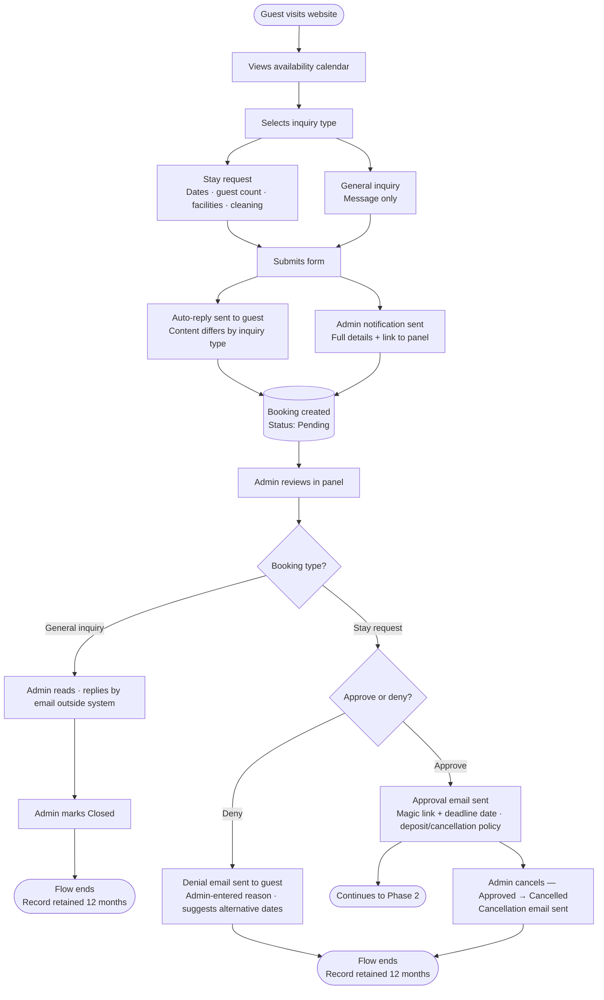
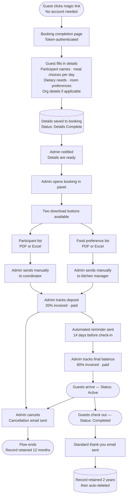

# Åkerögården — Booking System
## Software Requirements Specification
**Version:** 0.52 — Working Draft  
**Date:** July 2026  
**Status:** In progress — subject to change  
**Prepared by:** Developer & Claude (Anthropic)  
**Client:** Åkerögården, Norrtälje, Sverige  

**Changes from v0.51:**

- **FR-70 (admin/public host separation) genuinely satisfied for the first time (Phase 10b).** FR-70 was nominally scoped in Phase 0 but never actually built — one web app served every route on both hostnames, with separation only nominal (admin pages were `[Authorize]`-gated, so `/admin` on the public host redirected to login rather than 404ing). Phase 10b makes it real, structurally: the code is split into three projects (`AkeroGarden.Web.Core` shared RCL + `.Public` pure Static SSR + `.Admin` Interactive Server + Identity), deployed as **two App Service sites on one Basic B1 plan** (`akerogarden.se` → public, `admin.akerogarden.se` → admin). The internet-facing public process loads no Identity, SignalR, or admin assemblies, so an admin route such as `/bokningar` on the public host is now a genuine 404 — process isolation, not edge gating. **No FR/NFR text change** (FR-70's wording already described the target); this is an implementation milestone. Zero added cost (the plan is the billing unit). `architecture.md` (note 1 + diagram), `infra/azure/README.md`, `infra/ops/dns-cutover-runbook.md`, and `implementation-plan.md` (Phase 10b) updated in step. Staging cut over to the two-app topology and verified live 2026-07-17.

**Changes from v0.50:**

- **CI/CD platform changed from GitHub Actions to Azure DevOps (Phase 10a, mid-phase).** The client's Azure DevOps access (via their subscription, no GitHub presence) made this preferable once actually assessed — the repo (all branches, full history) is mirrored to Azure Repos (`dev.azure.com/akerogarden/akerogarden`); deploys authenticate via a service-principal-backed service connection instead of a publish-profile secret; the three GitHub Actions workflows are ported to Azure Pipelines YAML. §2 (tech-stack decision table) and §11.1 updated; `infra/azure/README.md` and `implementation-plan.md` updated to match. The GitHub repository is being retired as a **read-only archive** (frozen, no further pushes; history stays reachable) — decided 2026-07-17; Azure Repos is the single source of truth going forward.

**Changes from v0.49:**

- **Phase 10 split into 10a (staging re-provisioning) and 10b (production go-live); staging moves to the client's Azure tenant.** The client now has their own Azure subscription (Pay-As-You-Go, new tenant) — both staging and production will be provisioned there instead of the developer's personal MSDN subscription that has hosted staging until now. Since Azure's resource-move feature does not work across tenants, staging is **recreated from the existing Bicep templates** in the client's tenant (not migrated), and the old MSDN-hosted copy is deleted once the new one is verified — tracked as the new **Phase 10a**. At the same time, staging's long-deferred custom-subdomain binding is no longer deferred: it gets the same public/admin split as production (`staging.akerogarden.se` + `admin.staging.akerogarden.se`, vs. today's single Azure default hostname). Production provisioning (previously all of "Phase 10") becomes **Phase 10b**, unchanged in scope but now explicitly sequenced after 10a and provisioned directly in the client's tenant from the start. §11/§11.1 (hosting tables) and `implementation-plan.md` updated in step; `infra/azure/README.md` and `infra/ops/dns-cutover-runbook.md` updated to match.

**Changes from v0.48:**

- **Whole-physical-building blocking removed from Phase 11 and deferred to a future release.** The `BlockedPeriod` `PhysicalBuilding` scope (block all lodging units of a physical building — e.g. all of Stora bostadslängan — in one action) was carried as an open Phase 11 item. Reassessed and dropped from committed scope: it is not a capability gap (the admin can already block each lodging building separately), only an ergonomic shortcut for a low-frequency operation, and it would add a permanent fourth `BlockScope` value to every blocking switch/validator/calculator for little routine benefit. Now listed in §10 "Deferred to future releases" — to be built only if the client confirms it is a recurring real need. No code, data-model, or ERD change (the scope was never implemented); `implementation-plan.md` Phase 11 updated in step (item and Satisfies row). The `PhysicalBuilding` entity's design rationale (§8.14, changelog v0.32) is unchanged — it still exists for cleaning pricing and still *permits* this future scope.

**Changes from v0.47:**

- **FR-97 (audit-trail admin view) now tracked in §10 "Deferred to future releases."** The audit-trail backend — capture + retention (FR-95/96/98, §6.9, §8.15) — ships in Phase 11, but its admin-facing UI (a per-booking "Aktivitetslogg" panel and a global, filterable audit-log page) has no committed delivery, and Phase 11 is the final phase. FR-97 stays a numbered requirement in §6.9 (wording unchanged — it already reads "UI deferred") but is now **also** listed as explicit deferred scope in §10, alongside the other future-release items, rather than an open-ended in-phase "deferred" note with nowhere to land. Until it is built, the trail is read directly from the database. No data-model, email, or ERD impact; `implementation-plan.md` Phase 11 (Slice D) updated in step to point at the §10 deferral.

**Changes from v0.46:**

- **Admin profile fields — first name, last name, phone (all required) — added during audit-trail implementation.** Admins previously carried only an email. FR-74 and the §6.4 storage note now require every admin to have a **first name, last name and phone number**, all mandatory. Decision taken with the client-developer: the **invitee enters their own** first/last/phone when they activate their account (the setup/password page), so the invite itself stays email-only. `PhoneNumber` is the built-in ASP.NET Identity field; `FirstName`/`LastName` are added to `ApplicationUser` (Identity infrastructure — still no custom app entity). This pairs with the audit trail: `AuditLog.ActorNameSnapshot` (§8.15, new) captures the acting admin's **name** alongside their email at write time, so the trail reads "Anna Andersson gjorde X" rather than an address. The admin name (staff data, not guest data) in the audit trail does not affect NFR-37, which governs *guest* personal data. `docs/product/erd.md` updated (AUDITLOG gains `ActorNameSnapshot`).

**Changes from v0.45:**

- **New audit trail (Phase 11 — post-production; backend now, admin view deferred).** The system had no record of who changed what: no reference-data or booking service logged the acting user, no entity carried a `ModifiedBy` field, and no `AuditLog` table existed. Added a first-class **`AuditLog`** entity (§8.15) and a new **§6.9 Admin — Audit Trail** (FR-95–98). Design decisions taken with the client-developer: (1) **no personal data in the trail** — booking-change entries record only *which* action occurred (approve, cancel, payment marked, participants edited, …) plus the acting user and the `BookingReference`, never the guest field values, so no guest names/contact details and no special-category dietary/allergy data (GDPR art. 9) are ever duplicated into the log (NFR-37); reference-data entries (prices, rooms, zones — no personal data) may carry a before/after summary; (2) the **actor** is one of `Admin` / `Guest` (completion via magic link) / `System` (background jobs), so a change is always attributable; (3) the trail is **append-only** — no admin edit-or-delete path (NFR-36); (4) **reads are not audited** — only changes; (5) **retention matches the booking** — booking-scoped entries are deleted with the booking (FR-67/68/89/90), non-booking entries after 2 years (FR-98). The admin-facing view (FR-97) is captured in scope but its UI is a later slice — the trail is written from the outset and, until the view exists, is queryable directly against the database. Entity count 13 → 14. `docs/legal/Integritetspolicy.md` and `docs/product/erd.md` updated in step; no change to any go-live requirement.

**Changes from v0.44:**

- **FR-74 extended — pending-invite resend/remove (staging feedback 2026-07-11).** An invited admin's one-time setup link expires after 1 hour; there was no way to resend a fresh invite or remove a stale, never-completed one. FR-74 now covers **resend a fresh invitation** and **remove a pending invite**, both limited to never-activated invites (activated accounts keep deactivate-only, no delete). Scheduled in the new **Phase 9 — Pre-go-live** (a phase inserted before go-live, which becomes Phase 10); agreed, not yet built. No data-model change stated here beyond the plan's `ApplicationUser.SetupCompletedAt` implementation note.

**Changes from v0.43:**

- **Cleaning reworked: moved from inquiry to the completion form as self-clean/buy toggles, and a new `PhysicalBuilding` entity introduced (Phase 8 client feedback + design review).** The client's demo feedback was that offering the full cleaning list (incl. "Hela lägret") at inquiry is illogical — a guest should only be offered cleaning for what they actually occupy, and at inquiry no rooms/buildings are chosen yet. Cleaning therefore leaves the inquiry form (FR-03) and is chosen on the **completion form** (new FR-93), where occupancy is known. The guest sees up to three self-clean/buy toggles: **Huvudbyggnad** and a **combined sleeping-building** toggle (whenever there is overnight lodging), and **Konferensbyggnad** (only when the Konferensrum facility is booked). The sleeping toggle is *combined* because which residential building the group sleeps in is not known when cleaning is chosen — it is resolved from the room assignment. "Hela lägret" is no longer a guest option (per-area toggles make it redundant, 4 × 2 000 = 8 000); it stays a rate-card line for manual invoicing.
  - **Modelling decision (why `PhysicalBuilding`, not a lookup array):** cleaning is priced **per physical building**, but the accommodation `Building` entities (Blidö, Tjockö, …) are really *lodging units that sit inside* larger physical buildings (Lilla/Stora bostadslängan); the physical buildings that cleaning is priced on did not exist as entities. Rather than bolt a hand-maintained `uuid[]` mapping onto `CleaningZone`, a first-class **`PhysicalBuilding`** entity (§8.14) is introduced: `Building` gets a `PhysicalBuildingId` FK, `Facility` gets a nullable `PhysicalBuildingId` FK (Konferensrum → Konferensbyggnad), and `CleaningZone` links to a `PhysicalBuilding` by FK instead of ID arrays. Sleeping-cleaning then resolves by a structural join (room → building → physical building → zone) with referential integrity, and the model **unlocks whole-physical-building blocking** later (e.g. block all of Stora bostadslängan in one action) — a `BlockedPeriod` `PhysicalBuilding` scope is a future slice, not built here. Chosen over a `CleaningZone`↔`Building` join table (which would fix integrity but not give the reusable building concept) because a concrete future use — whole-längan blocking — exists. Pre-go-live with no production data, the migration + seed backfill is painless.
  - **Data-model impact:** new `PhysicalBuilding` (§8.14, admin-managed, FR-94); `Building.PhysicalBuildingId` FK (§8.2, FR-13); `Facility.PhysicalBuildingId` nullable FK (§8.8); `CleaningZone` keeps `Kind` but replaces the building/facility ID arrays with a single `PhysicalBuildingId` FK (§8.11, FR-85); `Booking` gains three cleaning-choice booleans (§8.1); `BookingCleaningSelection` is populated at completion, sleeping rows resolved + price-snapshotted when room assignment is set/changed (deferred snapshot, §8.12) so NFR-33 holds. **App entity count 12 → 13.** `CleaningZone` stays the admin rate card, still shown on Mat & priser (FR-82). See §3.1, §5.5, FR-03, FR-13, FR-85, FR-87, FR-93, FR-94, §8.1, §8.2, §8.8, §8.11, §8.12, §8.14; erd.md updated.

**Changes from v0.42:**

- **FR-92 refined after local manual smoke testing.** Two fixes to the booking-reference feature, no data-model impact: (1) the reference is now appended to every email **subject line** (e.g. "Bokningsuppgifter inskickade (AG-2026-0007)"), not just the body, so it's visible in an inbox list without opening the email; (2) the Swedish label shown in emails and the admin search box changed from **"Bokningsreferens"** ("booking reference") to the type-neutral **"Referensnummer"** ("reference number") — a general inquiry isn't a booking, so the booking-specific label read wrong on that email. The underlying field, format (`AG-YYYY-NNNN`), and generation logic are unchanged.

**Changes from v0.41:**

- **New FR-92: human-readable booking reference number (Phase 8, discussion item raised in `implementation-plan.md`).** Bookings previously carried only an opaque `Guid Id`, leaving guests and admin with no shared, speakable identifier for phone/email support. Every booking (stay request or general inquiry) is now assigned a `BookingReference` (format `AG-YYYY-NNNN`, e.g. `AG-2026-0042`) at creation, generated from a database-identity `SequenceNumber` — a global monotonic sequence, not a per-year-reset counter, so no locking is needed and no race condition is possible at this booking volume. `YYYY` reflects the booking's creation year; the sequence itself does not restart at 1 each January. Not PII (safe in URLs, NFR-05) and not a security credential (the magic-link completion token remains the authenticated lookup). Shown in every guest and admin email, the admin booking list (searchable) and detail page. Data-model addition — see §8.1.

**Changes from v0.40:**

- **FR-45 (Matlista) redesigned from a per-person table into a kitchen prep summary (Phase 8 client UAT).** Superseding the v0.40 per-day matrix: testing a real 80-guest/5-day export showed that *any* per-person layout (one row per guest) is the wrong shape — ~80 near-identical rows over ~12 pages. A caterer needs "how many of each dish per meal per day", and names only matter for special handling. The Matlista now has two parts: a **tillagningsöversikt** (per-day/per-meal dish counts + breakfast headcount, no names) and a **kostbehov & allergier** list (only participants with a dietary requirement/note, named, with their meals). The full named roster stays in the participant list (FR-44), so no data is lost and PII is not duplicated. No data-model impact.

**Changes from v0.39:**

- **FR-59 refined from an "apply to all days" shortcut to a per-day group default (Phase 8 client UAT).** Testing a real 80-guest, 5-day full-board booking showed that applying one meal choice to *every* day of the stay is unrealistic — real groups vary meals by day. The "Standard för hela gruppen" panel now offers a lunch/dinner dropdown **per serving day**, each cascading to that day's slot for every participant (per-participant override retained). Presentation-only; no data-model impact. FR-45 (food-preference list) was first re-laid-out as a per-day matrix (later superseded — see v0.41). Admin save/action feedback (NFR-17/18) now renders as a fixed in-viewport toast rather than a top-of-page line the admin had to scroll up to see.

**Changes from v0.38:**

- **NFR-17 extended to the admin panel's mobile usability (Phase 8 client feedback).** The client indicated the admin panel will often be operated from a mobile phone. NFR-17 previously scoped full mobile responsiveness to the public website only; it now also requires the admin panel's **primary navigation** (a collapsible hamburger menu ≤860px) and the **Översikt dashboard** (reflows to a single column) to be usable on a phone. Dense admin data tables may remain horizontally scrollable on small screens (an explicit, accepted boundary — the target is "every day-to-day task is completable on a phone", not pixel-identical to desktop). Implemented in Phase 8 (admin hamburger + dashboard reflow); no data-model impact.

**Changes from v0.37:**

- **§11 hosting cost table corrected against live Azure retail prices (North Europe, July 2026).** The Azure Managed Redis (Balanced B0) line was overstated at **~$45/month**; the actual retail price is **$0.018/hour ≈ ~$13/month** (single consumption meter, verified via the Azure Retail Prices API — the ~$45 figure in the v0.35 changelog below was an unvalidated estimate made during the Azure Cache → Managed Redis migration). The Postgres row now shows its 32 GB storage (~$4/month) separately from compute (~$13/month). Corrected **production total: ~$72–73 → ~$45/month.** §11.1 staging estimate and `infra/azure/README.md` updated to match. No infrastructure or SKU change — figures only.

**Changes from v0.36:**

- Public **Menu and Prices pages merged into a single "Mat & priser" page** (`/mat-och-priser`), decided during the Phase 6 (UI/UX) redesign — a group organiser weighs food and cost together, so they read as one page. **FR-82 and FR-83 keep their numbers** but now describe content served on the combined page; FR-01 and the §1.2 in-scope page list updated (menu, prices → "mat & priser"); the §4 and §5 public-display notes updated. No data-model or admin change — meal options and price rules/cleaning zones are still separately admin-managed. `implementation-plan.md` slice 3 updated.

**Changes from v0.35:**

- Rate-limit store changed from **Azure Cache for Redis (Basic C0)** to **Azure Managed Redis (Balanced B0)** — forced by Microsoft retiring the classic Azure Cache for Redis and blocking new instance creation (the deploy failed with "Azure Cache for Redis is retiring, create Azure Managed Redis instance instead"). Azure Managed Redis is the successor, speaks the same Redis protocol (no application code change — StackExchange.Redis is unchanged), and is provisioned from the same Bicep via `Microsoft.Cache/redisEnterprise` (Balanced B0, EnterpriseCluster policy, TLS on port 10000). Cost rises from ~$16 to ~$45/month; §1.5, §11 cost table, §11.1 and NFR-04 updated. NFR-04's intent (distributed rate-limit store, correct under multi-instance scale-out) is unchanged.

**Changes from v0.34:**

- `Facility` (§8.8) gains `AmountExVat` and `VatRate` fields, mirroring `CleaningZone`. This resolves an internal inconsistency found during Phase 3: `BookingFacilitySelection` (§8.13) and NFR-34 require snapshotting the facility's agreed **amount**, and the erd.md modelling note calls facility and cleaning selections symmetric, but the `Facility` entity had no price to snapshot. Facility prices (§5.4) now have a home in the model. As with `CleaningZone`, these are reference figures only — no totals are computed (C8). erd.md updated; a Phase 1 retrofit (entity + migration + admin CRUD price inputs) is applied in the Phase 3 branch. Public display is unchanged: FR-81 still shows name/description/image and FR-82 still lists price rules + cleaning zones (facility prices remain admin-facing reference data).

**Changes from v0.33:**

- Bicep adopted as the Azure infrastructure-as-code tool (§11): both production and staging are provisioned from `.bicep` templates with environment-specific parameter files. Click-through portal provisioning is not used. Azure provisioning in Phase 0 is deferred to the end of that phase — Bicep templates and CI pipeline are written first, Azure resources are actually provisioned only once there is a working deployable artifact (admin auth working locally). implementation-plan.md Phase 0 updated accordingly.
- NFR-35 added (§7.6): fonts must be self-hosted; no external font CDN requests permitted (GDPR — loading Google Fonts sends user IPs to Google without a legal basis per Austrian DPA January 2022 ruling). docs/ux/design.md updated with font hosting instructions.

**Changes from v0.32:**
- Environment strategy added (§11.1): the spec previously detailed only production. Now defines all four environments — local dev (Dockerised PostgreSQL/Redis/Azurite + a local SMTP catcher on the developer's Mac), automated test (ephemeral containers in CI), a separate minimal Azure **staging** environment (`staging.akerogarden.se`, mirrors prod on cheapest tiers, powered down when idle, synthetic data only — no real PII), and production (unchanged). Deploy flow: dev → CI → staging → production. implementation-plan.md Phase 0 and Phase 6 updated accordingly.

**Changes from v0.31:**
- Facility selections aligned to the snapshot pattern (surfaced during the ERD pass; mirrors C6): `Booking.RequestedFacilityIds[]` replaced by a `BookingFacilitySelection` child entity (Section 8.13) — live `FacilityId` FK plus facility name and amount snapshots — so the agreed facility price survives later edits, consistent with `BookingCleaningSelection`, meals, and rooms. New NFR-34 (facility snapshot); §8.1 updated; ERD updated.

**Changes from v0.30:**
- Post-review consistency pass (Opus): caught inconsistencies introduced across the v0.19–v0.30 edits. FR-76 aligned to the §2.5 state machine — cancellation is allowed from `Approved`, `DetailsComplete`, or `Active` (was "any status except Completed/Denied", which wrongly implied `Pending`/`Closed` were cancellable). §5.5 terminology aligned to "cleaning zones" (was "building zones" in two places). §1.3 in-scope blocking bullet now includes whole-property scope (I8). §10 out-of-scope calendar wording updated to the three-state model (was the stale "booked/free"). §8.1 `DayGuestCount` clarified as the inquiry-stage estimate, with the day-guest `Participant` records authoritative for the kitchen list.

**Changes from v0.29:**
- I14 resolved (Round 2 architect review): room assignments now carry a live `RoomId` foreign key on `Participant` (alongside the existing `RoomAssignmentSnapshot` text, kept for history per NFR-16). Previously the assignment was text-only, so the system could not detect room conflicts, show occupancy, or exclude taken rooms. FR-56 updated to also exclude already-occupied rooms and to flag double-assignment conflicts in the admin panel. §8.5 updated. **This was the last open Round 2 item — all 20 are now resolved.**

**Changes from v0.28:**
- I11 resolved (Round 2 architect review): meals-by-day-of-stay rule defined for the check-in 14:00 / check-out 12:00 schedule — arrival day = dinner only, middle days = breakfast + lunch + dinner, departure day = breakfast only. The completion form shows a meal picker only for meals that actually occur on each day (so a one-night stay collects a single dinner selection). §4.1 and FR-57 updated.
- I12 resolved (Round 2 architect review): day guests are single-day — a new `AttendanceDate` field (day guests only) records the one date attended; a visitor across multiple days is entered as one day-guest record per date, which keeps per-day kitchen headcount exact and lets `AttendsBreakfast` apply to a specific day. §4.2, FR-58, and §8.5 updated.

**Changes from v0.27:**
- I13 resolved (Round 2 architect review): the completion token could already be expired by the time the 14-days-before-check-in nudge fired (the token expires at the earlier of issue+30 days or check-in−14 days, so for bookings approved well in advance it dies before the nudge). Fix: when the nudge fires and the booking is still `Approved`, the system regenerates the completion token (fresh link, ≥48 h per §2.6, invalidating the prior link) and includes it in the nudge; the admin alert states the new expiry. FR-63 and the §9 nudge/alert rows updated.

**Changes from v0.26:**
- I10 resolved (Round 2 architect review): boundary conditions pinned down. (1) Deposit: cancellation **more than** 2 months before arrival → full refund; **2 months or less** → forfeited (exactly 2 months = forfeited). §5.6, FR-79, §9 updated. (2) Age tiers: the free/paid line is **age 4** — `Infant` = 0–3 (free), `Child` = 4–12, `Adult` = 13+ (the Child/Adult split is kitchen-portion-only, no price effect). §5.1/5.2 and §8.5 updated. (3) Completion-token thresholds are evaluated as exact timestamps (valid up to the expiry instant, rejected at/after it); §2.6 clarified. (4) FR-75 admin warning fires when check-in is 14 days away or sooner.

**Changes from v0.25:**
- I9 resolved (Round 2 architect review): the `IsPubliclyVisible` flag is **removed** from both `Booking` and `BlockedPeriod`. It was a footgun — a hidden booking or block left the public calendar showing dates as available when they were not, prompting guests to inquire on closed dates — and since the calendar exposes only aggregate Free/Partial/Full (NFR-07), hiding a booking served no privacy purpose. Now all occupying bookings and all blocks always count toward public availability. The "private stay / internal hold" need is covered by an admin-created booking (FR-47) or a block, both of which now correctly reduce availability. FR-12 and FR-41 removed; FR-10 simplified (no "publicly visible" qualifier); the field is dropped from §8.1 and §8.10.

**Changes from v0.24:**
- I8 resolved (Round 2 architect review): the two overlapping blocking entities (`RoomBlock` and `BlockedPeriod`) are merged into a single `BlockedPeriod` entity with a `Scope` field (`WholeProperty | Building | Room`). Previously a building could be blocked two different ways with different effects — and a building blocked via `RoomBlock` did not reduce public-calendar capacity. Now one feature, one admin screen: every block reduces the date's effective capacity for its scope, and the calendar reflects it. `RoomBlock` (§8.4) merged away; `AffectedBuildingIds` dropped from `BlockedPeriod`; FR-10 now computes against effective capacity; FR-21 and §3.3 reworded.

**Changes from v0.23:**
- Round 2 documentation-hygiene sweep:
  - L8: FR-01 page list now includes the menu and prices pages (was inconsistent with §1.3 and FR-82/83).
  - L10: §9 email catalog now includes the completion-nudge (guest) and not-completed-alert (admin) emails introduced by FR-63; the two-week reminder row scoped to `DetailsComplete`-or-later.
  - L13: §8.1 now states that stay-specific fields are null/unused for `GeneralInquiry` bookings.
  - L14: NFR-10 reconciled with unbounded day guests (§4.2) — target raised to 300 participants; larger lists must still succeed beyond the 10-second guarantee.
  - L15: §5 no longer asserts a blanket 12% VAT — VAT is stored per `VatRate` (price rule / cleaning zone); exact rates per category to be confirmed with the client's accountant.
  - (L11 design.md and L12 operational-tasks.md updated separately — outside requirements.md.)

**Changes from v0.22:**
- C10 resolved (Round 2 architect review): the contradiction between FR-49 ("resend the completion link regardless of whether it has been used") and the §2.5 state machine (which has no path back through the completion form) is resolved by an **admin-edits-only** model. After a guest submits, the booking is `DetailsComplete` and the completion link is never re-issued; any correction is made by the admin in the panel (FR-48), with no status change. FR-49 rewritten and scoped to the `Approved` (awaiting-completion) state; FR-43 merged into FR-49 (token regeneration and resend are now one requirement); §2.5 annotated to make the no-reopen rule explicit.

**Changes from v0.21:**
- C9 resolved (Round 2 architect review): retention now has a functional requirement for all four §2.7 cases. Previously only Completed (FR-67) and Denied/Cancelled (FR-68) had deletion FRs; Pending-no-response and Closed inquiries would have been left in the database indefinitely. New FR-89 (delete `Pending` 12 months after submission), FR-90 (delete `Closed` 12 months after submission), and FR-91 (defines when `DeleteAfter` is (re)computed for every state and confirms live in-progress states are never auto-deleted). §8.1 `DeleteAfter` note updated.

**Changes from v0.20:**
- C8 resolved (Round 2 architect review): (1) Confirmed as a deliberate design choice that the system stores and computes **no monetary amounts** — no booking total, deposit amount, or balance. Deposit/final tracking is purely paid/unpaid status (FR-42); the 20%/80% figures in emails are fixed policy wording, not computed values. Stated explicitly in Section 5.6. (2) New `AgeCategory` field (`Adult | Child | Infant`) on Participant (Section 8.5), so accommodation pricing tiers (standard rate vs free infant) and the free-infant headcount are derivable, and the kitchen can plan child portions. Collected per participant on the completion form (FR-57, FR-58); Sections 5.1/5.2 annotated. Exact Child/Infant age threshold deferred to I10.

**Changes from v0.19:**
- C7 resolved (Round 2 architect review): the public availability calendar now counts bookings in `Approved`, `DetailsComplete`, or `Active` status (termed "occupying bookings") — previously it counted only `Approved`, so a confirmed group vanished from the calendar the moment it advanced to `DetailsComplete`/`Active`, making fully-booked dates appear free. `Pending` inquiries still do not count (availability subject to admin confirmation); terminal statuses never count. FR-10 reworded; Section 2.3 diagram updated. (The separate `IsPubliclyVisible` interaction remains tracked under I9.)

**Changes from v0.18:**
- C6 resolved (Round 2 architect review): cleaning "building zones" now have a dedicated admin-managed `CleaningZone` entity (Section 8.11) — distinct from both bookable Facilities (resolving the I4 violation in the data model) and accommodation Buildings. The old `Booking.CleaningSelections` (GUID[] → Facility) is replaced by a `BookingCleaningSelection` child entity (Section 8.12) that snapshots zone name and amount at booking time, so the agreed price survives later edits to the zone. Hela lägret is modelled generically via `IncludesZoneIds`. New Section 6.3.6 + FR-85–88 (cleaning zone CRUD, which was entirely missing); FR-03 and Section 5.5 reworded (full active zone list shown at inquiry — no per-booking filtering); FR-82 extended to render cleaning zones on the public prices page; NFR-14 extended; new NFR-33 (cleaning snapshot). Stale document footer version stamp corrected (was "0.6"), closing L9.

**Changes from v0.17:**
- L1 resolved: public calendar shows 12 rolling months forward from today; no backward navigation — FR-84 added
- L2 resolved: image upload accepts JPEG, PNG, WebP; max 5 MB; inline error on violation — FR-27 updated
- L3 resolved: denial email uses a fixed Swedish line for alternative dates ("Kontakta oss för att diskutera alternativa datum") — no admin-entered dates field; Section 9 updated
- L4 resolved: booking status transition state machine defined in Section 2.4; invalid transitions are blocked by the system
- L6 resolved: when the 2-week reminder fires and booking is still `Approved` (completion form not submitted), the system sends both a guest nudge and an admin alert — FR-63 updated
- L7 resolved: Hela lägret covers all four building zones (Huvudbyggnad, Lilla bostadslängan, Konferensbyggnad, Stora bostadslängan); selecting it disables individual zone checkboxes on the inquiry form — Section 5.5 updated

**Changes from v0.16:**
- I5 resolved: `DeletionWarningEmailSentAt` field added to Booking model to prevent duplicate pre-deletion warning emails from the daily background job
- I6 resolved: framework pinned to .NET 10 LTS (released November 2025, supported until November 2028); .NET 9 is EOL as of May 2026; Section 1.5 updated
- I7 resolved: Blazor rendering mode specified — Static SSR for all public-facing pages; Interactive Server for admin panel; Section 1.5 updated

**Changes from v0.15:**
- I4 resolved: FR-03 wording corrected — "cleaning service selection per relevant facility" replaced with "per applicable building zone" to resolve terminology collision with bookable facilities

**Changes from v0.14:**
- I3 resolved: `AttendsBreakfast` boolean added to Participant model; FR-58 updated; breakfast-only day guest validation is a deferred minor detail that does not affect the model

**Changes from v0.13:**
- I2 resolved: calendar uses three states (Free / Partially booked / Fully booked) based on total booked guest count vs. property capacity (79 beds); FR-09 and FR-10 updated; public site note about partial availability added

**Changes from v0.12:**
- I1 resolved: FR-46 (admin management of public site text content) dropped — hero text, about text, contact details, and social links are hardcoded as they are not subject to change
- Prices and menu are now shown publicly: "not displayed publicly" notes removed from Sections 4.1 and 5; "Public display of menu or pricing" removed from Section 10 Out of Scope
- New FR-81: public facilities page renders dynamically from admin-managed facility records
- New FR-82: public prices page renders dynamically from admin-managed price rules
- New FR-83: public menu page renders dynamically from admin-managed meal options

**Changes from v0.11:**
- C5 resolved: General inquiry lifecycle defined — admin reads and replies outside the system, then marks `Closed`; no approve/deny applies; new `Closed` status added (general inquiries only)
- New FR-80: general inquiries have no approve/deny — only action is mark Closed
- FR-05 updated: auto-reply content differs by inquiry type
- `Closed` status added to Section 2.4; booking-type applicability noted on all statuses
- Closed general inquiry retention added to Section 2.6 (12 months from submission)
- Phase 1 lifecycle diagram updated to show the general inquiry branch
- Section 9 inquiry acknowledgement split into two variants

**Changes from v0.10:**
- C4 resolved: Cancellation fully defined — admin-only, from any non-terminal status; cancellation type (Guest-initiated / Property-initiated) required; reason optional; cancellation email sent automatically with deposit clause conditional on type and timing
- New FR-76 through FR-79: cancel action, cancellation type, optional reason, cancellation email
- `CancelledAt`, `CancellationInitiator`, `CancellationReason` fields added to Booking model (Section 8.1)
- Cancellation email added to Section 9
- Section 2.4 status reference updated with reachability notes
- Lifecycle diagrams updated to show cancellation paths

**Changes from v0.9:**
- C3 resolved: Magic link minimum window rule added — token always valid for at least 48 hours from issue regardless of check-in proximity; Section 2.5 and FR-53 updated
- New FR-75: admin receives a warning when approving a booking with check-in within 14 days, stating the shortened token expiry window; approval is not blocked

**Changes from v0.8:**
- C2 resolved: Full-board vs self-catering is declared at booking level on the inquiry form (`MealPlan`: FullBoardAll / SelfCateringAll / Mixed) and overridable per participant on the completion form (`IsFullBoard` boolean, pre-populated from booking default)
- `MealPlan` enum field added to Booking model (Section 8.1)
- `IsFullBoard` boolean field added to Participant model (Section 8.5)
- FR-03 updated: inquiry form now includes meal plan selection
- FR-57 updated: completion form collects `IsFullBoard` per participant; meal selection only shown for full-board participants
- Section 4.1 updated to describe the three meal plan options and per-participant override
- Day guests clarified: only applicable when `MealPlan` is `FullBoardAll` or `Mixed` — not valid for `SelfCateringAll` bookings

**Changes from v0.7:**
- C1 resolved: Admin authentication fully defined — ASP.NET Core Identity, email + password login at `admin.akerogarden.se`, 30-day "remember me" persistent cookie, password reset via one-time email link; multiple admin accounts supported in v1 (designed for 2–3); all admins have equal access — role differentiation remains deferred
- New FR-70 through FR-74: admin login page, remember-me session, password reset, admin account creation, admin account deactivation
- New Section 6.4 "Admin — Authentication and Account Management"; existing Sections 6.4–6.7 renumbered to 6.5–6.8
- ASP.NET Core Identity added to technology decisions (Section 1.5)
- "Multi-admin with role-based permissions" in Section 10 updated: multiple accounts now v1; role-based permissions remain deferred

**Changes from v0.6:**
- Q8 resolved: No buildings or rooms at Åkerögården are accessible — all `IsAccessible` values are false; Section 3.1 updated for Tallstugan (was "Unknown"), Ljusterö, Vätö 1, and Vätö 2 (were "Accessible") — Q8 removed from Open Questions
- Q10 resolved: Spelrum price is 1 500 kr per day, cleaning included — price updated in Section 5.4; no separate cleaning fee
- Q11 resolved: Spelrum cleaning is included in the 1 500 kr/day facility price; standalone Spelrum cleaning row removed from Section 5.5 — Q10 and Q11 removed from Open Questions

**Changes from v0.5:**
- Approval email scope clarified: must state cancellation/deposit policy (Section 5.6) in addition to the expiry date
- Denial email now requires an admin-entered reason, shown to the guest — new `DenialReason` field on Booking
- New FR-50: admin must enter a denial reason when setting a booking to `Denied`, which is included in the denial email
- Resolved contradiction between deferred Swedish admin UI and "Out of Scope" multi-language exclusion: English admin UI confirmed for v1, with Swedish admin UI now explicitly tracked as a near-term post-launch item (not someday-maybe), given NFR-19's non-technical Swedish-speaking admin
- New NFR-25: PostgreSQL Flexible Server uses private network access only (VNet integration), replacing the old Windows-firewall-based "block port 5432" approach
- New Section 7.7 Testing (NFR-26–28): unit tests for business logic (pricing, retention, token expiry) and integration tests for all API endpoints, required to pass in CI — addresses the old system's documented "no test suite" gap
- NFR-04 rate limiter now requires a distributed store (Azure Cache for Redis) from day one rather than in-memory state, avoiding the old system's documented scaling known issue. Added to Technology Decisions (1.5) and Hosting cost table (Section 11, ~$16/month added)
- New NFR-29: quarterly backup restore drill required, addressing README's "test the restore procedure" step that had no equivalent here
- New NFR-30: SMTP credentials stored as encrypted secrets, not plain text/source control
- New NFR-31: end-to-end email delivery verified against production SMTP before go-live
- README.md deleted — all content migrated to requirements.md (this document), design.md, and operational-tasks.md
- Q7 resolved: early check-in/late check-out surcharge is admin discretion, no fixed price, arranged outside the system — Section 2.7 updated, Q7 removed from Open Questions
- Q9 resolved: game room named "Spelrum" — Q9 removed from Open Questions
- Q10 resolved (structurally): Spelrum is selectable in the booking inquiry form and has its own cleaning line item, same as Kapell/Konferensrum. Q10 narrowed to just the pending price figures (placeholders added to Sections 5.4 and 5.5)
- Section 2.1 lifecycle diagram updated: denial node now shows the admin-entered reason, approval node now shows the deposit/cancellation policy — diagram had drifted out of sync with Section 9/FR-50
- Reversed the v0.6 "English admin UI" decision: the entire system (public site and admin panel) is Swedish-only — English was never actually needed, not even as a deferred item. New NFR-32; removed "Swedish admin UI" from both Out of Scope lists in Section 10
- New Q11: whether Spelrum's cleaning should be its own line item in Section 5.5 (which is otherwise building-level zones only) or folded into its containing building's package — flagged, not yet resolved
- Resolved conflict between booking-level `GuestChoosesRooms` and the per-participant "choose for me" flag: room choice is booking-level only. FR-56/57 rewritten — the completion form is filled in by the booking's contact person on behalf of the whole group (not by each participant individually), and only shows a room field at all when `GuestChoosesRooms` is true. Clarified that participant names are collected for fire-safety/headcount purposes
- Renumbered FR-50 through FR-69 (previously the denial-reason requirement was appended out of sequence as FR-69 after FR-49). It's now FR-50 in its correct position in Section 6.4, and every subsequent FR shifted up by one — FR-01 through FR-69 now read sequentially top to bottom

**Changes from v0.4:**
- Q1 resolved: meal selection is per day (lunch & dinner), with a "same for all days" shortcut on the completion form
- Q2 resolved: admin can resend the magic link manually; approval email must state the deadline date explicitly
- Q3 resolved: both options available — admin can edit data directly in the panel, or resend the magic link for the guest to resubmit
- Q4/Q5/Q6 resolved: pricing is per person (headcount), not per room/bed capacity. Section 5.3 rewritten accordingly
- Day guests added as a new participant type: no bed, meals only (Q6 insight)
- New FR: admin can block a specific room or building for a date range (e.g. renovation)
- New FR: admin can create a booking on behalf of a guest, bypassing the public inquiry form
- New FR: day guest participant type supported (meals, no overnight)
- New FR: completion form includes "same for all days" shortcut for meal selection
- Smedjan corrected: separate cabin, 1 room, 1 double bed, 2 persons, not accessible
- New facility added: Spelrum (game room) — foosball, pinball, shuffleboard
- Check-in 14:00 / check-out 12:00 confirmed; early/late surcharge is an open question
- Section 5.3 room pricing model moved to Out of Scope (future release)
- New open questions: Q7 (check-in/out surcharge), Q8 (Tallstugan accessibility), Q9 (Spelrum name), Q10 (Spelrum in booking/cleaning flow)

---

## Table of Contents

1. [Introduction](#1-introduction)
2. [Booking Lifecycle](#2-booking-lifecycle)
3. [Accommodation and Capacity](#3-accommodation-and-capacity)
4. [Meals and Food Preferences](#4-meals-and-food-preferences)
5. [Pricing](#5-pricing)
6. [Functional Requirements](#6-functional-requirements)
7. [Non-Functional Requirements](#7-non-functional-requirements)
8. [Core Data Model](#8-core-data-model)
9. [Email Templates](#9-email-templates)
10. [Out of Scope](#10-out-of-scope)
11. [Hosting and Infrastructure](#11-hosting-and-infrastructure)
12. [Open Questions](#12-open-questions)

---

## 1. Introduction

### 1.1 Purpose

This document defines the software requirements for the Åkerögården booking system — a web application built to manage guest inquiries, bookings, participant data, meal orders, and administrative workflows for Åkerögården, a rural retreat property in Norrtälje, Sweden.

It serves as the single source of truth for all design, development, and testing decisions. Any scope change must be reflected as a new version of this document.

### 1.2 Project Background

Åkerögården has operated as a retreat and conference facility since 1978. The property currently accommodates up to 79 overnight guests across six residential buildings and two standalone cabins. The exact room configuration, meal offerings, facilities, and prices are managed by the property admin and may change over time. The system must reflect this — nothing operational is hardcoded.

### 1.3 Scope

**In scope:**
- A public-facing web application (.NET 10 Blazor, Static SSR) with pages for home, about, facilities, mat & priser (combined menu + prices), contact, availability calendar, and booking inquiry
- A public availability calendar showing only whether dates are booked or free — no personal data, no detail beyond availability status
- A full admin panel for booking management, review, approval, and all reference data management (buildings, rooms, meals, facilities, prices)
- Admin ability to create bookings manually on behalf of guests
- Admin ability to block a room, a building, or the whole property for a date range
- A token-based booking completion flow for approved guests — no account creation required
- Automated and manual email workflows at defined lifecycle points
- Downloadable participant and food preference lists (PDF and Excel)
- GDPR-compliant data retention and automatic deletion

**Out of scope** (see Section 10):
- Online payment processing
- Automatic list delivery to coordinators or kitchen
- Guest accounts or login
- Room-based pricing (future release)

### 1.4 Stakeholders

| Role | Responsibilities | System access |
|---|---|---|
| Property admin | Manages all bookings; manages all reference data (buildings, rooms, meals, facilities, prices); approves or denies inquiries; downloads lists; tracks invoices; can create bookings on behalf of guests | Full admin panel |
| Guest / contact person | Views availability calendar; submits inquiry; receives magic link; completes booking details | Public site + token-secured completion page |
| Coordinator (external) | Receives participant name list from admin | None — sent manually |
| Kitchen manager (external) | Receives food preference list from admin | None — sent manually |

### 1.5 Technology Decisions

| Concern | Decision | Rationale |
|---|---|---|
| Framework | .NET 10 Blazor (LTS — supported until November 2028) | Developer comfort; full-stack C# consistency |
| Blazor rendering mode | Static SSR for all public-facing pages; Interactive Server for the admin panel | Static SSR produces plain server-rendered HTML for SEO and fast first load; Interactive Server is appropriate for the admin panel where SEO is irrelevant and rich interactivity is needed |
| Admin authentication | ASP.NET Core Identity | Single-library solution for credential storage, password hashing, cookie auth, and password reset — no external auth dependency |
| Database | PostgreSQL on Azure | Managed backups; familiar query model |
| Hosting | Azure App Service (Linux, B1) | Managed SSL; CI/CD from Azure DevOps Pipelines |
| File storage | Azure Blob Storage | List downloads and media uploads |
| Rate limiting store | Azure Managed Redis | Distributed rate-limit counters; correct under multi-instance scale-out (NFR-04). Successor to the retired Azure Cache for Redis |
| Email | MailKit (SMTP via One.com) | Robust .NET email library |
| ORM | Entity Framework Core | Standard .NET data access layer |
| CI/CD | Azure DevOps Pipelines | Migrated from GitHub Actions in Phase 10a — client has Azure DevOps access via their subscription, no GitHub presence |

---

## 2. Booking Lifecycle

### 2.1 Phase 1 — Inquiry to Decision



### 2.2 Phase 2 — Completion to Post-Stay



### 2.3 Public Calendar Logic

```mermaid
flowchart LR
    A[Date on calendar] --> B{Any occupying bookings\n(Approved/DetailsComplete/Active)\nor blocked periods?}
    B -->|No| C[🟢 Free]
    B -->|Yes — partial| D[🟡 Partially booked]
    B -->|Yes — full| E[🔴 Fully booked]
    C --> F[Guest selects date\nPre-fills inquiry form]
    D --> F
    E --> G[Date shown as unavailable]
```

### 2.4 Booking Status Reference

| Status | Applies to | Description |
|---|---|---|
| `Pending` | Both | Inquiry submitted, awaiting admin review |
| `Approved` | Stay request | Admin approved; awaiting guest completion |
| `Denied` | Stay request | Admin denied; retained 12 months |
| `DetailsComplete` | Stay request | Guest submitted participant and meal data |
| `Active` | Stay request | Group currently on-site |
| `Completed` | Stay request | Stay finished; in retention period |
| `Cancelled` | Stay request | Cancelled by admin; reachable from `Approved`, `DetailsComplete`, or `Active`; deposit rules apply (see Section 5.6) |
| `Closed` | General inquiry | Admin has read and responded; no approve/deny applies; retained 12 months from submission |

### 2.5 Booking Status Transitions

The system shall enforce the following allowed transitions. Any transition not in this table is blocked.

| From | To | Who / How |
|---|---|---|
| `Pending` | `Approved` | Admin — stay requests only |
| `Pending` | `Denied` | Admin — stay requests only |
| `Pending` | `Closed` | Admin — general inquiries only |
| `Approved` | `DetailsComplete` | System — on guest completion form submission |
| `Approved` | `Cancelled` | Admin |
| `DetailsComplete` | `Active` | Admin — marks guests as arrived |
| `DetailsComplete` | `Cancelled` | Admin |
| `Active` | `Completed` | Admin — marks stay finished |
| `Active` | `Cancelled` | Admin |

`Denied`, `Completed`, `Closed`, and `Cancelled` are terminal states — no transitions out.

> **No reopen after completion (C10):** `DetailsComplete` has no transition back to the completion flow. Once the guest submits, they cannot re-open the form; the single-use token stays invalidated (FR-62) and is not re-issued (FR-49). Any correction after submission is made by the admin directly in the panel (FR-48) and does not change the booking's status.

### 2.6 Magic Link Rules

- Cryptographically random token (minimum 128-bit entropy)
- Expires at whichever comes first: 30 days after issue, or 14 days before check-in — with a minimum floor of 48 hours from issue regardless of how close check-in is
- All three thresholds are evaluated as exact timestamps; the link is valid up to its computed expiry instant and is rejected at or after it
- The approval email must display the exact expiry date and time in plain text so the guest knows their deadline
- Single-use — invalidated immediately on form submission
- Generating a new token immediately invalidates any previously issued token for the same booking
- Admin can manually regenerate or resend the completion token from the booking detail page while the booking is awaiting completion (status `Approved`), whether or not the previous token has expired; once the booking is `DetailsComplete` the token is not re-issued (see FR-49)
- When the admin approves a booking with check-in 14 days away or sooner, the system displays a warning stating the exact token expiry (e.g. "Completion link will expire in 48 hours — consider contacting the guest directly")

### 2.7 GDPR Retention

| Outcome | Retention | Trigger |
|---|---|---|
| Completed stay | 2 years | From check-out date |
| Denied or cancelled | 12 months | From denial or cancellation date |
| Pending (no response) | 12 months | From submission date |
| Closed general inquiry | 12 months | From submission date |

Admin receives a warning email 30 days before any record is deleted.

### 2.8 Check-In and Check-Out Times

- Standard check-in: **14:00**
- Standard check-out: **12:00**
- Early check-in and late check-out are available for a surcharge, at the admin's discretion (no fixed price rule). This is arranged directly between the guest and the admin outside the system — there is no field on the inquiry or completion form for it, and no PriceRule entry

---

## 3. Accommodation and Capacity

> **All accommodation data is admin-managed.** Buildings and rooms are created, edited, and deleted through the admin panel. The values below reflect the current known state of the property and will be entered by the admin on first setup — they are not hardcoded.

### 3.1 Buildings Overview

| Building | Rooms | Total beds | Accessibility | Notes |
|---|---|---|---|---|
| Blidö | 4 | 12 | Not accessible | Common room · 1 shower/cleaning room · 2 toilets |
| Ljusterö | 4 | 17 | Not accessible | Common room · 1 shower/cleaning room · 1 toilet |
| Singö | 4 | 16 | Not accessible | Common room · 1 shower · 2 toilets |
| Tjockö | 4 | 10 | Not accessible | Common room · 1 shower/cleaning room · 2 toilets |
| Vätö 1 | 5 | 8 | Not accessible | Common room · 2 showers/cleaning rooms · 2 toilets |
| Vätö 2 | 5 | 8 | Not accessible | Common room · 2 showers/cleaning rooms · 2 toilets |
| Smedjan | 1 | 2 | Not accessible | Standalone cabin · 1 double bed · private facilities |
| Tallstugan | 1 | 4 | Not accessible | Standalone cabin · private shower and toilet |
| **Total overnight** | | **79** | | |

> **Lodging units vs physical buildings.** The rows above are lodging **`Building`** units (§8.2). Several of them physically sit inside a larger **`PhysicalBuilding`** (§8.14) — the level at which cleaning is priced (§5.5) and a whole building can be blocked (future). Mapping:
>
> | PhysicalBuilding | Lodging units in it |
> |---|---|
> | Lilla bostadslängan | Blidö, Ljusterö, Singö, Tjockö |
> | Stora bostadslängan | Vätö 1, Vätö 2 |
> | Smedjan | Smedjan (standalone) |
> | Tallstugan | Tallstugan (standalone) |
> | Huvudbyggnad | *(no lodging — matsal & shared areas)* |
> | Konferensbyggnad | *(no lodging — conference; Konferensrum facility sits here)* |

### 3.2 Room-Level Detail

| Building | Room | Beds | Configuration |
|---|---|---|---|
| Blidö | Room 1 | 4 | 2 bunk beds |
| Blidö | Room 2 | 2 | 2 single beds |
| Blidö | Room 3 | 3 | 3 single beds |
| Blidö | Room 4 | 3 | 3 single beds |
| Ljusterö | Room 1 | 3 | 3 single beds |
| Ljusterö | Room 2 | 6 | 3 bunk beds |
| Ljusterö | Room 3 | 4 | 2 bunk beds |
| Ljusterö | Room 4 | 4 | 2 bunk beds |
| Singö | Room 1 | 3 | 3 single beds |
| Singö | Room 2 | 5 | 2 bunk beds + 1 single |
| Singö | Room 3 | 4 | 1 bunk bed + 2 singles |
| Singö | Room 4 | 4 | 1 bunk bed + 2 singles |
| Tjockö | Room 1 | 3 | 3 single beds |
| Tjockö | Room 2 | 2 | 2 single beds |
| Tjockö | Room 3 | 3 | 3 single beds |
| Tjockö | Room 4 | 2 | 2 single beds |
| Vätö 1 | Room 1 | 2 | 2 single beds |
| Vätö 1 | Room 2 | 2 | 2 single beds |
| Vätö 1 | Room 3 | 1 | 1 single bed |
| Vätö 1 | Room 4 | 1 | 1 single bed |
| Vätö 1 | Room 5 | 2 | 2 single beds |
| Vätö 2 | Room 6 | 2 | 2 single beds |
| Vätö 2 | Room 7 | 1 | 1 single bed |
| Vätö 2 | Room 8 | 1 | 1 single bed |
| Vätö 2 | Room 9 | 2 | 2 single beds |
| Vätö 2 | Room 10 | 2 | 2 single beds |
| Smedjan | Room 1 | 2 | 1 double bed |
| Tallstugan | Room 1 | 4 | 1 bunk bed + 2 singles |

### 3.3 Blocking (Room, Building, or Whole Property)

The admin can block availability for a defined date range at one of three scopes — a single room, an entire building, or the whole property — for example during renovation or when something is broken. This is a single feature (one `BlockedPeriod` record per block; see Section 8.10). Room- and building-scoped blocks exclude the affected rooms from the room selection on the completion form (FR-56) and from the admin's room assignment view, and they reduce the date's effective capacity on the public availability calendar (FR-10). A whole-property block marks the date fully unavailable.

---

## 4. Meals and Food Preferences

> **All meal options are admin-managed.** The admin can add, edit, and deactivate meal options at any time. The options below reflect the current menu and will be entered on first setup. Active meal options are displayed publicly on the combined Mat & priser page (FR-83).

### 4.1 Meal Structure

Full-board accommodation includes per day: breakfast (buffet, no selection required), lunch (one option per participant per day), dinner (one option per participant per day), and fika twice daily (included, no selection).

**Three meal plan options exist at booking level**, declared on the inquiry form:

| Value | Meaning |
|---|---|
| `FullBoardAll` | All guests are full-board — meals included for everyone |
| `SelfCateringAll` | All guests are self-catering — no meals provided |
| `Mixed` | A mix of full-board and self-catering participants; each participant specifies their own plan on the completion form |

The booking-level `MealPlan` pre-populates each participant's `IsFullBoard` field on the completion form. The contact person can override any individual participant's value at that point. The admin can also override per participant in the admin panel at any time (FR-48).

**Meal selection is per day, for full-board participants only.** Each full-board participant selects a lunch and a dinner option for each applicable day of their stay (see the meals-by-day rule below). The completion form must provide a "same for all days" shortcut. Self-catering participants have no meal selection.

**Meals by day of stay** (based on check-in 14:00 / check-out 12:00):
- **Arrival day:** dinner only — guests arrive after lunch; a dinner selection is collected.
- **Middle days (full days):** breakfast (buffet, no selection), lunch, and dinner — lunch and dinner selections collected.
- **Departure day:** breakfast only — guests leave before lunch; no selection (breakfast is a buffet).

The completion form shows a meal picker only for meals that actually occur on each day, so a one-night stay (arrival + departure) collects a single dinner selection.

### 4.2 Day Guests

A booking may include day guests in addition to overnight guests. Day guests do not occupy a bed or a room. They attend for meals only and are included in participant counts on the food preference list. The number of day guests (and which meals they attend) must be captured on the completion form. Each day guest attends a single date (captured as `AttendanceDate`, Section 8.5); a visitor who attends on multiple days is entered as a separate day-guest record per day. There is no upper limit on day guest count — groups may have more day visitors than the property's overnight bed capacity.

> **Day guests are only applicable when `MealPlan` is `FullBoardAll` or `Mixed`.** A `SelfCateringAll` booking does not have catered meals, so there is no basis for day guest meal attendance. The inquiry form must not show the day guest field when `SelfCateringAll` is selected.

### 4.3 Current Breakfast

Standard buffet. No per-person selection required.

### 4.4 Current Lunch Options

| Key | Description |
|---|---|
| `LUNCH_FISH` | Breaded fish with Danish remoulade, boiled vegetables, boiled potatoes |
| `LUNCH_CHICKEN` | Oven-roasted chicken drumstick with tzatziki and bulgur |
| `LUNCH_PASTA` | Spaghetti bolognese |
| `LUNCH_MEATBALLS` | Meatballs with mashed potatoes and cream sauce |
| `LUNCH_VEGETARIAN` | Stir-fried vegetables with noodles |

### 4.5 Current Dinner Options

| Key | Description |
|---|---|
| `DINNER_CHICKEN` | Grilled chicken fillet with mushroom sauce, sautéed vegetables, wedge potatoes |
| `DINNER_BURGER` | Burger with fries |
| `DINNER_HOTDOG` | Hot dog with bread or mashed potatoes |
| `DINNER_PANCAKES` | Pancakes with jam and cream |
| `DINNER_VEGETARIAN` | Stir-fried vegetables with noodles |

### 4.6 Dietary Requirements

Fixed system values — not admin-managed. Adding a new dietary type requires a code change.

| Value | Label |
|---|---|
| `NONE` | No dietary requirements |
| `VEGETARIAN` | Vegetarian |
| `VEGAN` | Vegan |
| `GLUTEN_FREE` | Gluten intolerance |
| `LACTOSE_FREE` | Lactose intolerance |
| `NUT_ALLERGY` | Nut allergy |
| `OTHER` | Other — free-text, max 200 characters |

---

## 5. Pricing

> **All prices are admin-managed** and can be changed at any time through the admin panel. Active price rules are displayed publicly on the combined Mat & priser page (FR-82).  
> Invoicing is performed manually outside the system. All prices are **exclusive of VAT**. VAT is stored per item via the `VatRate` field (on each price rule and cleaning zone), because rates differ by category — e.g. 12% for lodging and food, potentially 25% for facility/conference hire. The exact rate per category is admin-entered configuration to be confirmed with the client's accountant. Currency is SEK.

### 5.1 Accommodation With Meals (Full Board)

Applies to participants where `IsFullBoard` is true.

Pricing is **per person per night** based on the number of guests declared in the booking.

| Guest category | Price ex. VAT | Per |
|---|---|---|
| Adults and children aged 4 and over | 550 kr | Per person per night |
| Children aged 3 and under | Free | Per night |

> The applicable tier (standard rate vs free infant) is derived from each overnight participant's `AgeCategory` (Section 8.5).

### 5.2 Accommodation Without Meals (Self-Catering)

Applies to participants where `IsFullBoard` is false.

| Guest category | Price ex. VAT | Per |
|---|---|---|
| Adults and children aged 4 and over | 250 kr | Per person per night |
| Children aged 3 and under | Free | Per night |
| Kitchen use (self-catering guests) | 100 kr per person | Per day |

> As in 5.1, the standard-rate vs free-infant tier is derived from each overnight participant's `AgeCategory` (Section 8.5).

### 5.3 Cabins

**1 October – 31 March:**

| Cabin | Price ex. VAT | Per |
|---|---|---|
| Smedjan | 1 500 kr | Per night |
| Tallstugan | 1 500 kr | Per night |

**1 April – 30 September:**

| Cabin | Price ex. VAT | Per |
|---|---|---|
| Smedjan | 1 500 kr | Per night |
| Smedjan | 7 000 kr | Full week |
| Tallstugan | 1 500 kr | Per night |
| Tallstugan | 7 000 kr | Full week |

### 5.4 Facilities

| Facility | Price ex. VAT | Per |
|---|---|---|
| Chapel (Kapellet) | 1 000 kr | Per day |
| Conference room (Konferensrum) | 1 000 kr | Per day |
| Grounds excursion (Utflykt — gården) | 2 000 kr | Per day |
| Caravan pitch (Husvagn) | 300 kr | Per day |
| Tent pitch (Tält) | 250 kr | Per day |
| Game room (Spelrum) | 1 500 kr *(cleaning included)* | Per day |

### 5.5 Cleaning

Cleaning is admin-managed `CleaningZone` reference data (Section 8.11), displayed on the public Mat & priser page (FR-82). It is **not** selected at inquiry — it is chosen on the **completion form** (FR-93), after approval, because it depends on what the booking actually occupies (rooms/buildings are not assigned at inquiry time).

If cleaning is not purchased for a given area, the guest is responsible for cleaning it themselves before departure.

Cleaning is priced **per physical building** (§8.14). Each cleaning zone links to one physical building by FK (`CleaningZone.PhysicalBuildingId`), except the `Everything` bundle.

| Area (PhysicalBuilding) | Price ex. VAT | `Kind` (§8.11) | Offered when |
|---|---|---|---|
| Huvudbyggnad | 2 000 kr | `MainBuilding` | booking has any overnight lodging |
| Lilla bostadslängan | 2 000 kr | `SleepingBuilding` | a room is assigned in a `Building` in it (Blidö/Ljusterö/Singö/Tjockö) |
| Stora bostadslängan | 2 000 kr | `SleepingBuilding` | a room is assigned in a `Building` in it (Vätö 1/Vätö 2) |
| Smedjan | 500 kr | `SleepingBuilding` | the Smedjan cabin is assigned |
| Tallstugan | 500 kr | `SleepingBuilding` | the Tallstugan cabin is assigned |
| Konferensbyggnad | 2 000 kr | `Conference` | a booked `Facility` in it is booked (Konferensrum) |
| Hela lägret | 8 000 kr | `Everything` (bundle) | rate-card reference only — not a guest option |

> **Cleaning is per physical building, never per room.** A `SleepingBuilding` zone cleans a whole physical building: Lilla/Stora bostadslängan each hold several lodging `Building` units (assigning any room in Tjockö means the whole Lilla bostadslängan is cleaned), while Smedjan/Tallstugan are their own one-unit physical buildings. Assigning any room in a physical building puts its zone in play at the **full** price — never prorated per room; two occupied lodging units in the same physical building (Blidö *and* Tjockö → both Lilla) count as **one** zone charge. Applicability resolves by structural join (room → `Building.PhysicalBuildingId` → `CleaningZone.PhysicalBuildingId`, and `Facility.PhysicalBuildingId` for conference), so a new physical building or facility-linked zone is added by admin configuration alone, with no code change.

**Completion-form cleaning choice.** The guest is offered up to three self-clean/buy toggles, each shown only when relevant:

- **Huvudbyggnad** (main building — matsal & shared areas) — offered whenever the booking has overnight lodging.
- **Sovbyggnader** (the sleeping building(s) used) — a single **combined** toggle covering whichever residential buildings the group sleeps in (Lilla and/or Stora bostadslängan). Offered whenever the booking has overnight lodging. The specific building(s) — and therefore the priced snapshot — are resolved from the room assignment (Section 8.5), which is why this is one combined choice rather than a per-building one: the sleeping building is not known when cleaning is chosen.
- **Konferensbyggnad** — offered only when the Konferensrum facility is booked.

> **Hela lägret** ("everything") covers all four building zones. It is a rate-card line for reference and manual invoicing only — it is **not** a separate guest option, because with per-area toggles it is simply "all areas selected", and 4 × 2 000 already equals the 8 000 package. Spelrum cleaning is included in its facility fee and is not a cleaning zone. The bundle relationship is modelled on `CleaningZone` via `IncludesZoneIds` (Section 8.11).

### 5.6 Payment Schedule

| Payment | Amount | Condition |
|---|---|---|
| Deposit | 20% of total | Due to confirm booking |
| Deposit refund | Full refund | Cancelled more than 2 months before arrival |
| Deposit forfeited | No refund | Cancelled 2 months or less before arrival |
| Final balance | Remaining 80% | Due before arrival |

> **Note on deposit tracking:** The system does not process payments. "Notera handpenning betald" means the admin manually marks in the panel that the 20% deposit invoice has been sent and/or that payment has been received. It is a status checkbox — not a payment integration. No monetary amount — no booking total, deposit amount, or balance — is stored or calculated anywhere in the system; the 20% / 80% figures shown in emails are fixed policy wording, not values computed by the system.

---

## 6. Functional Requirements

### 6.1 Public Website

| ID | Requirement |
|---|---|
| FR-01 | The system shall provide a public-facing website with pages for: home, about, facilities, mat & priser (combined menu + prices), contact, availability calendar, and booking inquiry |
| FR-02 | The booking inquiry page shall present two tracks: stay request and general inquiry |
| FR-03 | The stay request track shall collect: contact name, email, phone (optional), check-in date, check-out date, number of overnight guests, meal plan (FullBoardAll / SelfCateringAll / Mixed — required), number of day guests (optional — hidden when SelfCateringAll is selected), requested bookable facilities (multi-select from active facility list — e.g. Kapellet, Spelrum), organisation details (optional), and a free-text message. **Cleaning is not selected here** — it is chosen on the completion form (FR-93), since it depends on what the booking actually occupies (rooms/buildings are not assigned at inquiry time) |
| FR-04 | The general inquiry track shall collect: contact name, email, phone (optional), and a required free-text message |
| FR-05 | The system shall send an automatic acknowledgement email to the guest immediately upon submission. Content differs by inquiry type: stay requests receive a booking receipt ("we received your stay request"); general inquiries receive a contact acknowledgement ("we received your message and will be in touch") |
| FR-06 | The system shall send an admin notification email immediately upon submission with all details and a direct link to the booking record |
| FR-07 | The public website shall display the privacy policy and link to it from the booking form and the site footer |
| FR-81 | The public facilities page shall display active facility records in their configured display order, drawn dynamically from the admin-managed facility list (name, description, image) |
| FR-82 | The public website shall display current active price rules and active cleaning zones, drawn dynamically from the admin-managed price and cleaning-zone lists, on a combined **Mat & priser** page (shown together with the menu, FR-83) |
| FR-83 | The public website shall display current active meal options (lunch and dinner), drawn dynamically from the admin-managed meal list, on the combined **Mat & priser** page (shown together with prices, FR-82) |

### 6.2 Public Availability Calendar

| ID | Requirement |
|---|---|
| FR-08 | The system shall display a public-facing availability calendar |
| FR-09 | The calendar shall show three states per date: Free, Partially booked, or Fully booked. No names, group sizes, booking references, or any other personal detail shall be exposed |
| FR-10 | Calendar state per date is determined by summing `OvernightGuestCount` across all **occupying bookings** — those in status `Approved`, `DetailsComplete`, or `Active` — whose date range includes that date, against the date's **effective capacity**. Effective capacity = total property capacity (79 beds) minus the beds removed by any `Building`- or `Room`-scoped blocks active on that date. State: **Free** — no occupying bookings and no blocks; **Fully booked** — booked guest count reaches effective capacity, or a `WholeProperty` block covers that date; **Partially booked** — any date with occupying bookings and/or partial blocks that is neither Free nor Fully booked. `Pending` inquiries do not count (availability is subject to admin confirmation); `Denied`, `Cancelled`, `Completed`, and `Closed` bookings never count |
| FR-10a | The public calendar page shall display a note clarifying that partially available dates are subject to admin confirmation — submitting an inquiry does not guarantee availability |
| FR-11 | Selecting a date range on the public calendar shall pre-fill the check-in and check-out fields on the inquiry form |
| FR-12 | *(Removed in v0.26 — the `IsPubliclyVisible` flag is dropped; all occupying bookings and all blocks always contribute to public availability. See architect-review I9.)* |
| FR-84 | The public calendar shall display 12 rolling months forward from today's date. Backward navigation to past months is not available |

### 6.3 Admin — Content Management

#### 6.3.1 Buildings

| ID | Requirement |
|---|---|
| FR-13 | The admin shall be able to create a **lodging building** with: name, **the physical building it belongs to** (§8.14, required), description, accessibility status, shared facilities description, and display order |
| FR-14 | The admin shall be able to edit any building field |
| FR-15 | The admin shall be able to deactivate a building without deleting historical data |
| FR-16 | The admin shall not be able to hard-delete a building that has existing room assignments on any booking |
| FR-94 | The admin shall be able to manage **physical buildings** (§8.14) — create/edit with name, description, active/inactive status and display order; deactivate rather than hard-delete while referenced by a lodging building, a facility, or a cleaning zone. Physical buildings are the level at which cleaning is priced (§5.5) and (in a future slice) a whole building can be blocked |

#### 6.3.2 Rooms

| ID | Requirement |
|---|---|
| FR-17 | The admin shall be able to create a room within a building with: room name, bed count, bed configuration description, and display order |
| FR-18 | The admin shall be able to edit any room field |
| FR-19 | The admin shall be able to deactivate a room without deleting historical assignments |
| FR-20 | The admin shall not be able to hard-delete a room referenced in an existing booking |
| FR-21 | The admin shall be able to create a block at room, building, or whole-property scope for a defined date range, with an internal reason (e.g. renovation, damage) — the unified blocked-period feature (Section 8.10, FR-40). Room- and building-scoped blocks are excluded from room selection (FR-56) and the admin assignment view for the affected period, and reduce effective calendar capacity (FR-10) |

#### 6.3.3 Meal Options

| ID | Requirement |
|---|---|
| FR-22 | The admin shall be able to create a meal option with: name, description, meal type (Lunch or Dinner), vegetarian flag, and active/inactive status |
| FR-23 | The admin shall be able to edit any meal option |
| FR-24 | The admin shall be able to deactivate a meal option — it will no longer appear on the completion form |
| FR-25 | Deactivating a meal option shall not alter existing selections already saved on bookings |
| FR-26 | The admin shall not be able to hard-delete a meal option referenced in an existing meal preference record |

#### 6.3.4 Facilities

| ID | Requirement |
|---|---|
| FR-27 | The admin shall be able to create a facility with: name, description, image, and display order. Image upload accepts JPEG, PNG, and WebP formats; maximum 5 MB per file. Violations show an inline error — no silent failures |
| FR-28 | The admin shall be able to edit any facility field |
| FR-29 | The admin shall be able to deactivate a facility |
| FR-30 | The admin shall not be able to hard-delete a facility referenced in an existing booking |

#### 6.3.5 Prices

| ID | Requirement |
|---|---|
| FR-31 | The admin shall be able to create a price rule with: label, amount (ex. VAT), VAT rate, unit, seasonal validity dates (optional), and active/inactive status |
| FR-32 | The admin shall be able to edit any price rule |
| FR-33 | The admin shall be able to deactivate a price rule without deleting it |
| FR-34 | Price rules are displayed as read-only reference information on booking records — not used for automatic calculation |

#### 6.3.6 Cleaning Zones

| ID | Requirement |
|---|---|
| FR-85 | The admin shall be able to create a cleaning zone with: name, description, amount (ex. VAT), VAT rate, **kind (`MainBuilding` / `SleepingBuilding` / `Conference` / `Everything`) and the physical building it cleans (§8.14 FK — required for all kinds except `Everything`)**, included zones (optional — for the `Everything` bundle), active/inactive status, and display order |
| FR-86 | The admin shall be able to edit any cleaning zone field |
| FR-87 | The admin shall be able to deactivate a cleaning zone — it will no longer appear on the completion form. Deactivation shall not alter cleaning selections already saved on existing bookings |
| FR-88 | The admin shall not be able to hard-delete a cleaning zone referenced by an existing booking's cleaning selection |

### 6.4 Admin — Authentication and Account Management

| ID | Requirement |
|---|---|
| FR-70 | The admin panel shall be hosted at the subdomain `admin.akerogarden.se`, fully separated from the public site |
| FR-71 | Admin users shall authenticate via email address and password on a dedicated login page at `admin.akerogarden.se/login` |
| FR-72 | The login form shall offer a "remember me" option that persists the admin session for 30 days via a secure, HTTP-only cookie |
| FR-73 | Admin users shall be able to reset their password via a one-time reset link sent to their registered email address; the link shall expire after 1 hour |
| FR-74 | An authenticated admin shall be able to create new admin accounts (by email invitation) and deactivate existing admin accounts; an admin cannot deactivate their own account. The system is designed for a small number of admins (2–3); there is no enforced hard limit. For a **pending invitation** (an invited account that has not completed its one-time setup link — which expires after 1 hour), an admin shall additionally be able to **resend a fresh invitation** and **remove the pending invite**; these two actions apply only to never-activated invites (an activated account offers deactivate only, never delete). Every admin shall have a **first name, last name and phone number (all required)**; the **invitee enters these themselves** when activating their account on the setup/password page (so the invitation stays email-only). These are shown in the admin account list and used to attribute audit-trail actions by name (§6.9, §8.15). *(Pre-go-live / Phase 9 — agreed on staging 2026-07-11; invite lifecycle built, admin profile fields added during Phase 11 audit-trail work.)* |

> **Note on admin user storage:** Admin accounts are managed by ASP.NET Core Identity, which provides its own user tables (`AspNetUsers`, etc.). There is no custom `AdminUser` entity in the application data model — Identity tables are treated as infrastructure. The `ApplicationUser` (Identity) record carries `FirstName` and `LastName` (custom) plus the built-in `PhoneNumber` and `Email` — all required (FR-74) and entered by the invitee at account activation — and the existing `IsActive` / `SetupCompletedAt` flags. These remain infrastructure, not an app entity.

---

### 6.5 Admin — Booking Management

| ID | Requirement |
|---|---|
| FR-35 | The admin panel shall be accessible only to authenticated admin users; all authenticated admins have equal access to all features |
| FR-36 | The admin panel shall display a list of all bookings, filterable by status, date range, and booking type, and searchable by booking reference (FR-92) |
| FR-37 | The admin panel shall display a calendar view of bookings and blocked periods |
| FR-38 | The admin shall be able to approve or deny an inquiry |
| FR-39 | The admin shall be able to add internal notes to any booking |
| FR-40 | The admin shall be able to create, edit, and delete blocked periods |
| FR-41 | *(Removed in v0.26 — public-visibility flag dropped; see architect-review I9 and FR-12.)* |
| FR-42 | The admin shall be able to track deposit and final payment status per booking |
| FR-43 | *(Merged into FR-49 in v0.23 — token regeneration and resend are a single requirement.)* |
| FR-44 | When booking details are complete, a participant list download button shall be available (PDF and Excel) |
| FR-45 | When booking details are complete, a food preference list ("Matlista") download shall be available (PDF and Excel), structured as a **kitchen prep summary**: (1) a **tillagningsöversikt** listing, per serving day and meal (frukost/lunch/middag), the count of each chosen dish (e.g. "Tis · Middag · Halloumibiff · 78") plus a per-day breakfast headcount — **no participant names**; and (2) a **kostbehov & allergier** section naming **only** the participants who have a dietary requirement or note, with their per-day meals so the kitchen can prepare adapted plates. The full named roster lives in the participant list (FR-44), so the food list carries no per-person bulk. *(Redesigned after Phase 8 client UAT: a per-person row-per-guest table is unusable for large groups — a caterer needs "how many of each dish", and names only matter for special handling.)* |
| FR-47 | The admin shall be able to create a booking manually on behalf of a guest, bypassing the public inquiry form. All fields available in the inquiry form must be editable by the admin when creating a booking this way |
| FR-48 | The admin shall be able to edit the participant data on a booking directly in the admin panel after guest submission |
| FR-49 | The admin shall be able to (re)generate and resend the completion magic link from the booking detail page while the booking is still awaiting completion (status `Approved`), whether or not the previous link has expired. Generating a new link immediately invalidates any previous link (Section 2.6). Once the booking is `DetailsComplete`, the link is not re-issued — corrections after submission are made by the admin directly in the panel (FR-48), with no status change |
| FR-50 | When setting a booking's status to `Denied`, the admin shall be required to enter a denial reason. The reason shall be included in the denial email sent to the guest |
| FR-75 | When the admin sets a booking's status to `Approved` and check-in is 14 days away or sooner, the system shall display an inline warning stating the shortened completion link expiry (e.g. "Check-in is in X days — the completion link will expire in 48 hours. Consider contacting the guest directly."). Approval is not blocked |
| FR-76 | The admin shall be able to cancel a booking from `Approved`, `DetailsComplete`, or `Active` status (matching the transitions in Section 2.5). Cancellation is an admin-only action. `Pending` inquiries are denied rather than cancelled; terminal states (`Completed`, `Denied`, `Closed`, already-`Cancelled`) cannot be cancelled |
| FR-77 | When cancelling, the admin must select the cancellation type: Guest-initiated or Property-initiated. This selection controls the deposit clause in the cancellation email |
| FR-78 | The admin may optionally enter a free-text cancellation reason, stored as an internal note on the booking |
| FR-79 | On cancellation, the system shall automatically send a cancellation email to the guest. If Guest-initiated: the email states whether the deposit is refunded (full refund if cancelled more than 2 months before check-in) or forfeited (cancelled 2 months or less before check-in). If Property-initiated: the email states a full refund will be issued regardless of timing |
| FR-80 | General inquiries shall not have an approve or deny action. The only admin status action available for a general inquiry is to mark it as `Closed`. Promote-to-stay-request is not supported — if a guest wishes to book after a general inquiry, they submit a new stay request |
| FR-92 | Every booking (stay request or general inquiry) shall be assigned a human-readable `BookingReference` (format `AG-YYYY-NNNN`) at creation, derived from a database-generated monotonic `SequenceNumber` — see §8.1. It shall be shown on the admin booking list and detail page, in the subject line and body of every automated guest and admin email (§9), and shall be usable as an admin search term on the booking list (extends FR-36's filtering). The Swedish label shown to guest and admin is the type-neutral **"Referensnummer"**, not "Bokningsreferens" — a general inquiry isn't a booking, so a booking-specific label reads wrong on that email |

### 6.6 Booking Completion (Guest-Facing)

| ID | Requirement |
|---|---|
| FR-51 | On approval, the system shall generate a unique completion token and store it against the booking |
| FR-52 | The approval email shall contain the magic link and must display the exact token expiry date in plain text |
| FR-53 | The token shall expire at whichever is earlier: 30 days after issue, or 14 days before check-in — with a minimum floor of 48 hours from issue. A token generated when check-in is less than 14 days away shall always be valid for at least 48 hours regardless |
| FR-54 | The completion page requires no account — the URL token is the sole authentication |
| FR-55 | The completion form shall present meal options drawn from the current active admin-managed meal list — only for participants where `IsFullBoard` is true. Self-catering participants have no meal selection section |
| FR-56 | If `GuestChoosesRooms` is true, the completion form shall present room options drawn from the current active admin-managed room list, excluding any rooms or buildings blocked for the booking's dates and any rooms already fully occupied by other bookings on those dates (determined via the live `RoomId` link, Section 8.5), so the booking's contact person can assign a room per overnight participant. If `GuestChoosesRooms` is false, no room field is shown — the admin assigns rooms separately in the panel. The system shall flag room-assignment conflicts (a room assigned beyond its bed count for overlapping dates) in the admin panel |
| FR-57 | The completion form shall collect per overnight participant, entered by the booking's contact person on everyone's behalf (not by each participant individually): full name (required for fire-safety/headcount purposes), age category (`Adult` / `Child` / `Infant`), meal plan (`IsFullBoard` — pre-populated from the booking's `MealPlan` setting but overridable per participant by the contact person), meal selection per applicable day — lunch and dinner, shown only when `IsFullBoard` is true and only for meals that occur that day (§4.1 meals-by-day rule: arrival day dinner only, departure day none) — dietary requirements, and — only if `GuestChoosesRooms` is true — a room assignment |
| FR-58 | The completion form shall collect per day guest: full name, age category (`Adult` / `Child` / `Infant`), attendance date (the single day they attend), whether they attend breakfast (`AttendsBreakfast` — checkbox, no meal selection required), meal selection for lunch and/or dinner if attending (drawn from active meal options), dietary requirements. Day guests have no room assignment |
| FR-59 | The completion form shall provide a group-level meal default ("Standard för hela gruppen") that lets the contact person set the meal choice **per day** once and cascade it to that day's meal slot for every participant, so large groups need not have each participant's every day filled by hand; each participant's meals remain individually overridable. *(Refined from an "apply one choice to all days" shortcut after Phase 8 client UAT: applying the same meal to every day of a multi-day stay is unrealistic — real groups vary meals by day.)* |
| FR-60 | The completion form shall collect org/invoice details if applicable |
| FR-61 | On submission the admin receives a notification email |
| FR-62 | On submission the token is invalidated and booking status updated to `DetailsComplete` |
| FR-93 | The completion form shall collect the group's cleaning choice as up to three self-clean/buy toggles, each shown only when applicable: **Huvudbyggnad** and the **combined sleeping-building(s)** toggle when the booking has overnight lodging, and **Konferensbyggnad** when the Konferensrum facility is booked (§5.5). Each toggle corresponds to a `CleaningZone` rate-card record via its `Kind` and mapping (§8.11). The Huvudbyggnad and Konferensbyggnad choices snapshot their zone amount into `BookingCleaningSelection` at submission; the sleeping-building choice is stored as intent (`Booking.SleepingCleaningPurchased`) and its priced `BookingCleaningSelection` rows are resolved from the assigned rooms' buildings and snapshotted when room assignment is set or changed (§8.5/8.11/8.12) — **one row per distinct occupied `SleepingBuilding` zone, at the zone's full price, never per room** (multiple occupied buildings mapping to the same zone collapse to one row) — so a later rate edit never changes what was agreed (NFR-33). The default is self-clean; the guest cleans any area not purchased. "Hela lägret" is not a guest option — it remains admin/rate-card reference only |

### 6.7 Automated Notifications

| ID | Requirement |
|---|---|
| FR-63 | The system shall send an automated reminder 14 days before check-in. Behaviour depends on booking status: if `DetailsComplete` or later — send the standard guest reminder (FR-64); if still `Approved` (guest has not submitted the completion form) — the system shall first **regenerate the completion token** (fresh link, valid for at least 48 hours per Section 2.6, invalidating any prior link) and send the guest a nudge containing that fresh link ("You have not yet completed your booking details"), AND send the admin an alert ("Guest has not completed their booking — consider following up directly") stating the new link expiry. This prevents nudging the guest with an already-expired link |
| FR-64 | The reminder shall confirm participant count, day guest count, meal summary, check-in time (14:00), and check-out time (12:00) |
| FR-65 | The system shall send a standard fixed thank-you email when the admin marks the booking completed — this message is not customisable per booking |
| FR-66 | The admin shall receive a warning email 30 days before automatic deletion of any record |

### 6.8 Data Retention

| ID | Requirement |
|---|---|
| FR-67 | Completed booking records shall be automatically deleted 2 years after check-out |
| FR-68 | Denied or cancelled records shall be automatically deleted 12 months after denial or cancellation |
| FR-69 | Deletion shall be performed by a scheduled background job |
| FR-89 | Records that remain in `Pending` status shall be automatically deleted 12 months after their submission date |
| FR-90 | Closed general inquiries shall be automatically deleted 12 months after their submission date |
| FR-91 | The `DeleteAfter` date shall be (re)computed whenever a booking enters a retention-relevant state: submission date + 12 months while `Pending`; check-out date + 2 years on `Completed`; denial or cancellation date + 12 months on `Denied`/`Cancelled`; submission date + 12 months on `Closed`. Records in the live in-progress states (`Approved`, `DetailsComplete`, `Active`) are not subject to automatic deletion. Both the pre-deletion warning (FR-66) and the deletion job (FR-69) operate off `DeleteAfter` |

### 6.9 Admin — Audit Trail

> An append-only record of who changed what, and when, for accountability. Captures **changes only** (not reads), attributed to an actor that is one of `Admin`, `Guest` (completion via magic link, FR-54), or `System` (background jobs, FR-69). The trail deliberately stores **no guest personal data** — booking-change entries record the action and the affected `BookingReference` (not PII, FR-92), never the guest field values, so no names, contact details, or special-category dietary/allergy data (GDPR art. 9) are ever duplicated into it (NFR-37). Backed by the `AuditLog` entity (§8.15). *(Phase 11, post-production. FR-95/96/98 are the backend capture + retention, built first; FR-97 is the admin-facing view, a later slice — until it exists the trail is queryable directly against the database.)*

| ID | Requirement |
|---|---|
| FR-95 | The system shall record an immutable audit entry for every action that changes a booking: each status transition (§2.5), approval and denial (FR-38/50), cancellation including initiator (FR-76/77), deposit and final-payment status changes (FR-42), manual admin creation of a booking (FR-47), admin edits to participant or booking data after submission (FR-48), completion-form submission (FR-62, actor `Guest`), and (re)generation/resend of the completion link (FR-49). Each entry records the actor, the action, the affected booking (by `BookingReference`), and a timestamp — **never the guest field values themselves** (NFR-37) |
| FR-96 | The system shall record an audit entry for every admin create, edit, deactivate, and hard-delete on reference data (`Building`, `PhysicalBuilding`, `Room`, `MealOption`, `Facility`, `PriceRule`, `CleaningZone`) and for every admin-account and invitation lifecycle action (FR-74: create/invite, deactivate, resend, remove). As these records contain no personal data, the entry may include a before/after summary of the changed fields |
| FR-97 | The admin panel shall provide a view of the audit trail — a per-booking activity list on the booking detail page and a global, filterable audit-log page (by actor, action, and date range). *(UI deferred — the trail is captured from the outset per FR-95/96; the admin-facing view is a later slice. Until it is built, the trail is read directly from the database.)* |
| FR-98 | Audit entries scoped to a booking shall be deleted together with that booking when it is automatically deleted (FR-67/68/89/90). Audit entries not scoped to a booking (reference-data and admin-account actions) shall be deleted 2 years after they are written, by the scheduled background job (FR-69) |

---

## 7. Non-Functional Requirements

### 7.1 Security

| ID | Requirement |
|---|---|
| NFR-01 | All traffic served over HTTPS; SSL managed by Azure App Service |
| NFR-02 | All routes under `admin.akerogarden.se` redirect unauthenticated requests to the login page |
| NFR-03 | Completion tokens are cryptographically random (min 128-bit entropy), single-use, time-limited |
| NFR-04 | Inquiry endpoint enforces rate limiting: max 5 submissions per IP per 10 minutes, backed by a distributed store (Azure Managed Redis) rather than in-memory state, so the limit holds correctly if App Service ever scales to multiple instances |
| NFR-05 | No personal data stored in URL query parameters |
| NFR-06 | All personal data stored within EU (Azure North Europe or Sweden Central) |
| NFR-07 | The public calendar endpoint exposes only availability status — no data that could identify a guest, group size, or booking detail |
| NFR-25 | The PostgreSQL Flexible Server shall have public network access disabled, reachable only via VNet integration from the App Service. No direct internet path to the database shall exist |
| NFR-30 | SMTP credentials shall be stored as encrypted secrets (Azure App Service Application Settings or Key Vault), never committed to source control or stored in plain text configuration |
| NFR-36 | The audit trail (§6.9, §8.15) shall be append-only. No application function — admin UI or API — shall provide a path to edit or delete audit entries; entries are removed only by the scheduled retention job (FR-98). This preserves the trail's integrity as an accountability record |

### 7.2 Performance

| ID | Requirement |
|---|---|
| NFR-08 | Public pages load within 3 seconds on standard broadband |
| NFR-09 | Admin pages load within 5 seconds |
| NFR-10 | List downloads complete within 10 seconds for up to 300 participants (overnight + day guests combined). Day guest counts are unbounded (Section 4.2); lists larger than 300 must still generate successfully but are not covered by the 10-second target |

### 7.3 Reliability

| ID | Requirement |
|---|---|
| NFR-11 | 99% uptime target, consistent with Azure App Service Basic tier SLA |
| NFR-12 | Automated daily database backups with 7-day point-in-time restore |
| NFR-13 | Failed email sends are logged and retried; email failure does not fail the booking operation |
| NFR-29 | A restore drill shall be performed quarterly to confirm backups are actually restorable, with results documented. Not satisfied merely by the existence of automated backups |
| NFR-31 | End-to-end email delivery (admin notification and all guest-facing emails) shall be verified against the production SMTP configuration before go-live, not assumed to work from a successful build |

### 7.4 Data Integrity

| ID | Requirement |
|---|---|
| NFR-14 | Deactivating or editing a room, meal option, facility, price rule, or cleaning zone shall not alter data already saved on existing bookings |
| NFR-15 | Meal preference records shall store a snapshot of the meal option name at submission time |
| NFR-16 | Room assignment records shall store a snapshot of the room name and building at submission time |
| NFR-33 | Cleaning selection records shall store a snapshot of the cleaning zone name and amount (ex. VAT) at the time of selection, so the price the guest agreed to is preserved if the zone is later edited |
| NFR-34 | Facility selection records shall store a snapshot of the facility name and amount (ex. VAT) at the time of selection, so the price the guest agreed to is preserved if the facility is later edited |
| NFR-35 | All fonts shall be self-hosted (files in `wwwroot/fonts/`, declared via `@font-face`). No external font CDN requests (e.g. Google Fonts) are permitted — loading remote fonts sends visitor IP addresses to third-party servers without a legal basis under GDPR |

### 7.5 Usability

| ID | Requirement |
|---|---|
| NFR-17 | The public website shall be fully responsive on mobile devices. The admin panel's primary navigation (a collapsible hamburger menu at ≤860px) and the Översikt dashboard (single-column reflow) shall also be usable on a mobile phone; the admin's dense data tables may remain horizontally scrollable on small screens |
| NFR-18 | The booking completion flow shall be completable by a non-technical user with no instructions beyond the approval email |
| NFR-19 | The admin panel shall be usable by a single non-technical admin for all day-to-day operations |
| NFR-32 | All UI text — public website and admin panel alike — shall be in Swedish. English is not a target language; this is not a deferred/future item, it is the v1 default |

### 7.6 GDPR and Compliance

| ID | Requirement |
|---|---|
| NFR-20 | Privacy policy accessible from booking form and site footer |
| NFR-21 | Explicit privacy policy acknowledgement at inquiry submission |
| NFR-22 | Privacy policy names data controller, states retention periods, references IMY |
| NFR-23 | System does not collect personnummer |
| NFR-24 | All data processing within Azure EU regions |
| NFR-37 | The audit trail (§6.9, §8.15) shall not store guest personal data. Entries record only the acting user's identity (admin email, or the actor type `Guest`/`System`), the action, the affected `BookingReference` (not PII, FR-92), and a timestamp — never guest names, contact details, or special-category dietary/allergy data (GDPR art. 9). Booking-scoped entries are covered by the audited booking's retention period (FR-98) |

### 7.7 Testing

| ID | Requirement |
|---|---|
| NFR-26 | Unit test coverage required for business logic with non-trivial rules: pricing calculation, retention/deletion date computation, completion token expiry logic, and meal/participant validation |
| NFR-27 | Integration test coverage required for all API endpoints, including the booking inquiry endpoint, admin approval/denial actions, and the token-authenticated completion submission |
| NFR-28 | CI pipeline shall fail the build if unit or integration tests fail |

---

## 8. Core Data Model

> A full Entity Relationship Diagram will be produced as a separate artefact prior to development.

### 8.1 Booking

> For `GeneralInquiry` bookings the stay-specific fields below are null/unused and stored as nullable: `CheckIn`, `CheckOut`, `OvernightGuestCount`, `DayGuestCount`, `MealPlan`, `GuestChoosesRooms`, facility selections, cleaning selections, the cleaning-choice booleans, organisation/invoice fields, the deposit/payment flags, and the completion-token fields. Only the contact fields, `Message`, `BookingType`, `Status`, `AdminNotes`, and the retention fields apply to a general inquiry.

| Field | Type | Notes |
|---|---|---|
| `Id` | GUID | Primary key |
| `SequenceNumber` | int | Database-generated identity column; global monotonic sequence, never reused, no per-year reset (FR-92) |
| `BookingReference` | string | Human-readable reference, format `AG-YYYY-NNNN` (e.g. `AG-2026-0042`); `YYYY` is the booking's creation year, `NNNN` is `SequenceNumber` zero-padded to 4 digits; frozen at creation, never regenerated (FR-92). Not PII, not a security credential — the completion token remains the authenticated lookup |
| `BookingType` | Enum | `StayRequest` \| `GeneralInquiry` |
| `Status` | Enum | See Section 2.4 |
| `ContactName` | string | Required |
| `ContactEmail` | string | Required |
| `ContactPhone` | string | Optional |
| `CheckIn` | date | Required for stay requests |
| `CheckOut` | date | Required for stay requests |
| `OvernightGuestCount` | int | Required for stay requests |
| `DayGuestCount` | int | Optional — inquiry-stage estimate of guests attending meals only (no bed). The authoritative day-guest list for the kitchen comes from the day-guest `Participant` records (each with `AttendanceDate`), which may differ from this estimate |
| `IsOrganisation` | bool | |
| `OrgName` | string | Conditional |
| `OrgNumber` | string | Conditional |
| `InvoiceAddress` | string | Conditional |
| *(facility selections)* | — | Stored as `BookingFacilitySelection` child records (Section 8.13), not an inline array — snapshots facility name and amount at booking time |
| *(cleaning selections)* | — | Stored as `BookingCleaningSelection` child records (Section 8.12), not an inline array — snapshots zone name and amount. Populated at **completion** (FR-93), not inquiry; sleeping-building rows are resolved and snapshotted at room-assignment time |
| `MainBuildingCleaningPurchased` | bool? | Completion-form cleaning choice (FR-93) — the `MainBuilding` zone; snapshot row written to `BookingCleaningSelection` at submission. Null until completion / for general inquiries |
| `SleepingCleaningPurchased` | bool? | Completion-form cleaning choice (FR-93) — the combined sleeping-building toggle; intent flag. Priced `BookingCleaningSelection` rows for the occupied `SleepingBuilding` zone(s) are resolved from room assignment (§8.5/8.11) and snapshotted when assignment is set/changed |
| `ConferenceCleaningPurchased` | bool? | Completion-form cleaning choice (FR-93) — the `Conference` zone; shown/settable only when the Konferensrum facility is booked; snapshot row written at submission |
| `Message` | string | Max 5 000 characters |
| `AdminNotes` | string | Internal only |
| `DenialReason` | string | Required when `Status` is set to `Denied`; shown to the guest in the denial email |
| `CompletionToken` | string | Nullable |
| `CompletionTokenExpiry` | datetime | Nullable |
| `MealPlan` | Enum | `FullBoardAll \| SelfCateringAll \| Mixed` — declared on inquiry form; determines default `IsFullBoard` value for all participants |
| `GuestChoosesRooms` | bool | Booking-wide setting, not per-participant. True = contact person assigns rooms for the whole group on the completion form (FR-56/57); false = admin assigns rooms separately in the panel |
| `DepositInvoiced` | bool | |
| `DepositPaid` | bool | |
| `FinalInvoiced` | bool | |
| `FinalPaid` | bool | |
| `CancelledAt` | datetime? | Set when status changes to `Cancelled`; used as trigger for 12-month GDPR retention |
| `CancellationInitiator` | Enum? | `GuestInitiated \| PropertyInitiated` — required when cancelling; controls deposit clause in cancellation email |
| `CancellationReason` | string? | Optional internal note entered by admin at cancellation |
| `CreatedByAdmin` | bool | True when admin created booking on behalf of guest |
| `CreatedAt` | datetime | Auto |
| `UpdatedAt` | datetime | Auto |
| `DeleteAfter` | date | Computed per FR-91 — value depends on the booking's terminal/pending state; null for live in-progress states |
| `DeletionWarningEmailSentAt` | datetime? | Set when the 30-day pre-deletion warning email is sent; prevents the daily background job from sending duplicate warnings |
| `ReminderEmailSentAt` | datetime? | Set when the automated 14-days-before-check-in reminder (standard reminder, or completion nudge if still `Approved`) is sent; ensures the daily background job fires it exactly once (FR-63) |

### 8.2 Building

> A `Building` is a **lodging unit** (Blidö, Tjockö, Smedjan, …) that holds rooms. Each belongs to one physical building (§8.14) — several lodging units share a physical building (Blidö/Ljusterö/Singö/Tjockö → Lilla bostadslängan), while the standalone cabins are their own physical building (Smedjan → Smedjan).

| Field | Type | Notes |
|---|---|---|
| `Id` | GUID | Primary key |
| `Name` | string | e.g. Blidö |
| `PhysicalBuildingId` | GUID | Foreign key → PhysicalBuilding (§8.14); the physical building this lodging unit sits in. Drives cleaning-zone resolution (room → building → physical building → zone) and future whole-building blocking |
| `Description` | string | |
| `SharedFacilities` | string | |
| `IsAccessible` | bool | |
| `IsActive` | bool | |
| `DisplayOrder` | int | |

### 8.3 Room

| Field | Type | Notes |
|---|---|---|
| `Id` | GUID | Primary key |
| `BuildingId` | GUID | Foreign key → Building |
| `Name` | string | e.g. Room 1 |
| `BedCount` | int | Number of beds |
| `BedConfiguration` | string | |
| `IsActive` | bool | |
| `DisplayOrder` | int | |

### 8.4 RoomBlock

> **Merged into `BlockedPeriod` (Section 8.10) in v0.25.** Room-, building-, and whole-property blocking are now a single entity with a `Scope` field. This section is retained as a pointer only — there is no separate `RoomBlock` table.

### 8.5 Participant

| Field | Type | Notes |
|---|---|---|
| `Id` | GUID | Primary key |
| `BookingId` | GUID | Foreign key → Booking |
| `FullName` | string | Required |
| `ParticipantType` | Enum | `Overnight` \| `DayGuest` |
| `AgeCategory` | Enum | `Adult \| Child \| Infant` — fixed system values. Age bands: `Infant` = 0–3 years (free), `Child` = 4–12, `Adult` = 13+. Pricing tier: `Adult` and `Child` bill at the standard per-person rate, `Infant` is free (the free/paid line is age 4). The Child/Adult split is for kitchen portion planning only and does not affect price |
| `AttendanceDate` | date? | Day guests only — the single date this day guest attends; null for overnight participants. A visitor attending multiple days is entered as one day-guest record per date (I12) |
| `RoomId` | GUID? | Foreign key → Room (live). Null for day guests and for not-yet-assigned overnight participants. Enables room-conflict detection, occupancy views, and exclusion of assigned/blocked rooms (FR-21, FR-56) |
| `RoomAssignmentSnapshot` | string | Room name + building captured at assignment time, for history (NFR-16); the live link is `RoomId`. Null for day guests |
| `IsFullBoard` | bool | Pre-populated from booking `MealPlan` (`FullBoardAll` → true, `SelfCateringAll` → false, `Mixed` → set per participant on completion form); overridable by contact person on completion form and by admin in panel |
| `AttendsBreakfast` | bool | Day guests only — true if attending breakfast buffet; always true for overnight guests (no selection needed) |
| `DietaryRequirements` | Enum[] | Multi-select |
| `DietaryNotes` | string | Free text, max 200 chars |

### 8.6 MealPreference

| Field | Type | Notes |
|---|---|---|
| `Id` | GUID | Primary key |
| `ParticipantId` | GUID | Foreign key → Participant |
| `Date` | date | The specific day this selection applies to |
| `MealType` | Enum | `Lunch` \| `Dinner` |
| `MealOptionId` | GUID | Foreign key → MealOption |
| `MealOptionSnapshot` | string | Name stored at submission for historical accuracy |

### 8.7 MealOption

| Field | Type | Notes |
|---|---|---|
| `Id` | GUID | Primary key |
| `Name` | string | |
| `Description` | string | |
| `MealType` | Enum | `Lunch` \| `Dinner` |
| `IsVegetarian` | bool | |
| `IsActive` | bool | |
| `DisplayOrder` | int | |

### 8.8 Facility

| Field | Type | Notes |
|---|---|---|
| `Id` | GUID | Primary key |
| `Name` | string | |
| `Description` | string | |
| `ImageUrl` | string | Azure Blob Storage URL |
| `AmountExVat` | decimal | Reference figure — invoicing is manual (no automatic calculation). Snapshotted onto `BookingFacilitySelection` at selection time (NFR-34) |
| `VatRate` | decimal | e.g. 0.25 — stored per facility, mirroring PriceRule/CleaningZone |
| `PhysicalBuildingId` | GUID? | Nullable FK → PhysicalBuilding (§8.14); set only where booking the facility puts a physical building's cleaning in play (Konferensrum → Konferensbyggnad). Null for facilities with no associated cleaning building (Kapellet, pitches, Spelrum) |
| `IsActive` | bool | |
| `DisplayOrder` | int | |

### 8.9 PriceRule

| Field | Type | Notes |
|---|---|---|
| `Id` | GUID | Primary key |
| `Label` | string | |
| `AmountExVat` | decimal | |
| `VatRate` | decimal | e.g. 0.12 |
| `Unit` | string | e.g. "per person per night" |
| `SeasonStart` | date? | Nullable |
| `SeasonEnd` | date? | Nullable |
| `IsActive` | bool | |
| `Notes` | string | |

### 8.10 BlockedPeriod

> Unified blocking entity (absorbed the former `RoomBlock` in v0.25). One record blocks availability at a single scope for a date range.

| Field | Type | Notes |
|---|---|---|
| `Id` | GUID | Primary key |
| `Scope` | Enum | `WholeProperty \| Building \| Room` |
| `BuildingId` | GUID? | Set for `Building` and `Room` scope; null for `WholeProperty` |
| `RoomId` | GUID? | Set for `Room` scope only; null otherwise |
| `StartDate` | date | |
| `EndDate` | date | |
| `Reason` | string | Internal only — e.g. "Renovation", "Broken window" |
| `CreatedAt` | datetime | Auto |

### 8.11 CleaningZone

| Field | Type | Notes |
|---|---|---|
| `Id` | GUID | Primary key |
| `Name` | string | e.g. Huvudbyggnad |
| `Description` | string | Optional |
| `AmountExVat` | decimal | Reference figure — invoicing is manual (no automatic calculation) |
| `VatRate` | decimal | e.g. 0.12 — stored per zone, mirroring PriceRule |
| `Kind` | Enum | `MainBuilding \| SleepingBuilding \| Conference \| Everything` — drives when the zone is offered and which completion-form toggle it belongs to (FR-93, §5.5): `MainBuilding` = any overnight; `SleepingBuilding` = a room is assigned in a `Building` whose `PhysicalBuildingId` matches; `Conference` = a booked `Facility` whose `PhysicalBuildingId` matches; `Everything` = rate-card reference only |
| `PhysicalBuildingId` | GUID? | Foreign key → PhysicalBuilding (§8.14) — the physical building this zone cleans. Set for `MainBuilding`/`SleepingBuilding`/`Conference`; **null** for the `Everything` bundle. Replaces the former `AppliesToBuildingIds`/`AppliesToFacilityIds` ID arrays: applicability is now a structural join (room → building → physical building → zone; or facility → physical building → zone) with referential integrity |
| `IncludesZoneIds` | GUID[] | Empty for a normal zone. For the `Everything` bundle (Hela lägret) lists the zone IDs it covers. Reference/rate-card only — the bundle is not a guest option (§5.5) |
| `IsActive` | bool | Inactive zones are hidden from the completion form |
| `DisplayOrder` | int | |

### 8.12 BookingCleaningSelection

> Replaces the former `Booking.CleaningSelections` array. One row per cleaning zone actually purchased on a booking, populated at **completion** (FR-93). `MainBuilding` and `Conference` rows are written at completion submission; `SleepingBuilding` rows are resolved from the assigned rooms' buildings by the join room → `Building.PhysicalBuildingId` → the `CleaningZone` with that `PhysicalBuildingId`, and written/refreshed when room assignment is set or changed — one row per distinct occupied zone, at full price, never per room. Snapshots preserve the agreed price even if the zone is later edited (NFR-33).

| Field | Type | Notes |
|---|---|---|
| `Id` | GUID | Primary key |
| `BookingId` | GUID | Foreign key → Booking |
| `CleaningZoneId` | GUID | Foreign key → CleaningZone (live reference; not hard-deletable while referenced — FR-88) |
| `ZoneNameSnapshot` | string | Zone name stored at selection time |
| `AmountExVatSnapshot` | decimal | Amount stored at selection time |
| `VatRateSnapshot` | decimal | VAT rate stored at selection time |

### 8.13 BookingFacilitySelection

> Replaces the former `Booking.RequestedFacilityIds` array. One row per facility selected on a booking. Snapshots preserve the agreed price even if the facility is later edited (NFR-34).

| Field | Type | Notes |
|---|---|---|
| `Id` | GUID | Primary key |
| `BookingId` | GUID | Foreign key → Booking |
| `FacilityId` | GUID | Foreign key → Facility (live reference; not hard-deletable while referenced — FR-30) |
| `FacilityNameSnapshot` | string | Facility name stored at selection time |
| `AmountExVatSnapshot` | decimal | Amount stored at selection time |
| `VatRateSnapshot` | decimal | VAT rate stored at selection time |

### 8.14 PhysicalBuilding

> A physical building on the property (Huvudbyggnad, Lilla/Stora bostadslängan, Konferensbyggnad, Smedjan, Tallstugan). The level at which **cleaning is priced** and the future level at which a whole building can be **blocked** in one action. Admin-managed reference data (FR-94); deactivate rather than hard-delete while referenced (FR-16 pattern). Some physical buildings hold lodging units (`Building.PhysicalBuildingId`), others do not (Huvudbyggnad = matsal/shared; Konferensbyggnad = conference). A `CleaningZone` links to one (§8.11), and a `Facility` may sit in one (§8.8).

| Field | Type | Notes |
|---|---|---|
| `Id` | GUID | Primary key |
| `Name` | string | e.g. Lilla bostadslängan |
| `Description` | string? | Optional |
| `IsActive` | bool | |
| `DisplayOrder` | int | |

### 8.15 AuditLog

> Append-only accountability record of every change (never reads) — who did what, when (§6.9, FR-95/96). **Semi-polymorphic**: `EntityType`/`EntityId` identify the affected record of any kind, while an optional hard FK `BookingId` (cascade-delete) is set for booking-scoped entries so they are removed with their booking (FR-98) and can be listed per booking. Stores **no guest personal data** (NFR-37) — booking-change entries carry only the action + `BookingReferenceSnapshot`, not guest field values; special-category dietary/allergy data (art. 9) is never written here. Audit ≠ snapshot: the snapshot pattern (NFR-15/16/33/34) preserves *what was agreed*; the audit trail records *who acted*.

| Field | Type | Notes |
|---|---|---|
| `Id` | GUID | Primary key |
| `Timestamp` | datetime | Auto — UTC, set at write |
| `ActorType` | Enum | `Admin \| Guest \| System` |
| `ActorUserId` | GUID? | ASP.NET Identity user id when `ActorType = Admin`; null for `Guest`/`System`. Not FK-constrained — Identity tables are infrastructure (§6.4) |
| `ActorEmailSnapshot` | string? | Acting admin's email captured at write time (admins can be deactivated/removed — FR-74); null for `Guest`/`System` |
| `ActorNameSnapshot` | string? | Acting admin's full name (FR-74) captured at write time, for readable attribution in the trail; null for `Guest`/`System`. Staff data, not guest data — outside NFR-37's scope |
| `ActionType` | Enum | The action performed — e.g. `BookingApproved`, `BookingCancelled`, `PaymentStatusChanged`, `ParticipantsEdited`, `CompletionSubmitted`, `CleaningZoneEdited`, `AdminInviteRemoved` |
| `EntityType` | string | The kind of record affected — e.g. `Booking`, `CleaningZone`, `Room`, `AdminInvite` |
| `EntityId` | GUID | The affected record's id |
| `BookingId` | GUID? | FK → Booking, **ON DELETE CASCADE**, for booking-scoped entries (drives per-booking listing + retention, FR-98); null for reference-data/admin-account entries |
| `BookingReferenceSnapshot` | string? | The affected booking's reference (FR-92) for readability; null for non-booking entries |
| `Summary` | string | Human-readable Swedish description of the action. For reference-data entries (FR-96) may include a before/after of changed fields; for booking entries records the action only — never guest field values (NFR-37) |

---

## 9. Email Templates

All emails sent in Swedish. All include Åkerögården name, contact email, and privacy policy link in footer. Every email below (guest- or admin-facing) also states the booking's `BookingReference` (FR-92), so either side can quote it on a support call.

| Email | Trigger | Recipient | Key content |
|---|---|---|---|
| Inquiry acknowledgement — stay request | Stay request submitted | Guest | Booking receipt confirmation; **booking reference**; expected response time |
| Inquiry acknowledgement — general inquiry | General inquiry submitted | Guest | Message receipt; **booking reference**; "we will be in touch" |
| Admin — new inquiry | Inquiry submitted | Admin | All details; **booking reference**; link to booking in panel |
| Denial | Admin sets Denied | Guest | Polite denial; **admin-entered reason stated in plain text**; **booking reference**; fixed closing line: *"Kontakta oss för att diskutera alternativa datum"* |
| Cancellation | Admin sets Cancelled | Guest | Cancellation confirmed; **booking reference**; **deposit clause conditional on initiator and timing** — Guest-initiated + >2 months: full refund; Guest-initiated + ≤2 months: deposit forfeited; Property-initiated: full refund regardless of timing |
| Approval + magic link | Admin sets Approved | Guest | Approval; **booking reference**; magic link; **exact expiry date stated in plain text**; **deposit/cancellation policy (20% deposit, full refund >2 months before arrival, forfeited 2 months or less before)**; what to prepare |
| Admin — details complete | Guest submits completion | Admin | Data ready; **booking reference**; link to booking; reminder to download lists |
| Two-week reminder | Automated — 14 days before check-in (booking `DetailsComplete` or later) | Guest | **Booking reference**; participant count; day guest count; meal summary; check-in 14:00; check-out 12:00; address |
| Completion nudge | Automated — 14 days before check-in, booking still `Approved` (FR-63) | Guest | "You have not yet completed your booking details"; **booking reference**; **freshly regenerated completion link (valid ≥48 h)**; instructions to complete |
| Admin — guest not completed | Automated — 14 days before check-in, booking still `Approved` (FR-63) | Admin | "Guest has not completed their booking — consider following up directly"; **booking reference**; link to booking; the new completion-link expiry |
| Thank-you | Admin marks Completed | Guest | Standard fixed message; **booking reference**; invitation to return — not customisable per booking |
| Pre-deletion warning | Automated — 30 days before `DeleteAfter` | Admin | Record due for deletion; **booking reference**; link to booking |

---

## 10. Out of Scope

**Initial release:**
- Online payment processing
- Automatic list delivery to coordinators or kitchen
- Guest accounts or login
- English UI — not planned at all, not even as a future item. Public site and admin panel are Swedish-only (NFR-32)
- Native mobile application
- External calendar integration
- SMS notifications
- Reviews or ratings
- Room-level granularity on public calendar (the three aggregate states only — Free / Partially booked / Fully booked; no room-level detail)
- Room-based pricing (pricing is per person per night in phase 1 — room-based pricing deferred to a future release)

**Deferred to future releases:**
- **Audit-trail admin view (FR-97)** — the backend audit capture + retention (FR-95/96/98, §6.9, §8.15) ships in Phase 11; the admin-facing UI (a per-booking "Aktivitetslogg" panel and a global, filterable audit-log page — by actor, action, and date range) is deferred to a future release. Until it is built, the trail is queryable directly against the database. FR-97 remains a live numbered requirement (§6.9); this entry tracks its deferral, it is not a removal
- **Whole-physical-building blocking (`BlockedPeriod` `PhysicalBuilding` scope)** — a fourth blocking scope that would block every lodging unit of a physical building (e.g. all of Stora bostadslängan, which holds Vätö 1 + Vätö 2) in a single action, reducing effective calendar capacity (FR-10) and excluding those rooms from selection (FR-56). The `PhysicalBuilding` entity (§8.14) already permits it. Deferred because it is only an ergonomic shortcut over blocking each lodging building separately, for a low-frequency operation, and adds a permanent fourth `BlockScope` value to every blocking path. To be built only on confirmation from the client that it is a recurring real need; if built, sync §8.10 (`Scope` enum + `PhysicalBuildingId`), §3.3, and FR-21/FR-40 in step.
- Automated invoice generation
- Dedicated GDPR contact address (dataskydd@akerogarden.se)
- Role-based admin permissions (multiple admin accounts are supported in v1 — role differentiation and per-admin access control are deferred)
- Room-based pricing model
- **External scheduler for the daily jobs** — evaluate replacing the in-process hosted `BackgroundService` + Always On (v1 mechanism for the reminder/retention jobs) with an external Azure scheduler (Azure Functions timer trigger, or a Logic App calling a protected trigger endpoint). Benefits to assess: survives app idle without Always On, decouples scheduling from the web process, and scales cleanly to multiple instances (the in-process loop assumes a single B1 instance). Costs to weigh: a new Azure resource, its own deploy/secret story, and a callable trigger surface. Not required for v1's volume; captured for a future study.

---

## 11. Hosting and Infrastructure

> The cost table below specifies the **production** environment. All four environments (local dev, CI test, staging, production) are described in §11.1 below.
> **Infrastructure-as-code:** All Azure resources (production and staging) are provisioned via **Bicep** templates checked into the repository, with environment-specific parameter files. Click-through portal provisioning is not used — if a resource is not in the Bicep templates, it does not exist and cannot be reproduced.
> **Subscription ownership:** both staging and production are provisioned in the **client's own Azure subscription/tenant** (Phase 10a/10b), not the developer's — the repository and CI/CD pipeline remain developer-owned, but the Azure resources themselves, and their cost, belong to the client.

| Service | Azure tier | Est. monthly (USD) | Purpose |
|---|---|---|---|
| Azure App Service | Basic B1 (Linux) | ~$13 | Hosts the Blazor Server application |
| Azure Database for PostgreSQL Flexible Server | Burstable B1ms | ~$17 | Primary database — compute ~$13 + 32 GB storage ~$4; daily backups within the free allotment |
| Azure Blob Storage | Hot tier, LRS | ~$1–2 | List downloads; facility images; uploaded media |
| Azure Managed Redis | Balanced B0 | ~$13 | Distributed rate-limit counters (NFR-04); successor to the retired Azure Cache for Redis |
| Azure-managed SSL | Included | $0 | HTTPS certificate management |
| Custom domains | Included on Basic+ | $0 | akerogarden.se (public site) + admin.akerogarden.se (admin panel) — both point to the same App Service |
| **Total** | | **~$45/month** | |

> Prices are USD pay-as-you-go list prices verified against the Azure Retail Prices API for North Europe, July 2026. Traffic-driven costs (bandwidth egress, blob transactions, Redis ops) are negligible at this site's volume — the first 100 GB/month of egress is free. Re-verify at [azure.microsoft.com/pricing/calculator](https://azure.microsoft.com/pricing/calculator) before client sign-off.

### 11.1 Environments

The system uses four environments. Production is the table above; the others:

| Environment | Where | Make-up | Purpose |
|---|---|---|---|
| **Local dev** | Developer's machine (macOS) | .NET 10 SDK; PostgreSQL, Redis, and Azurite (Blob emulator) via Docker; a local SMTP catcher (e.g. Mailpit) so dev mail never sends; `dotnet user-secrets` for config | Day-to-day development. No Azure cost |
| **Automated test** | Azure Pipelines (Azure DevOps) CI | Ephemeral PostgreSQL/Redis service containers per run | Runs the unit + integration suite (NFR-26–28) on every push; gates the build. No standing infra |
| **Staging** | Azure — separate resource group, `staging.akerogarden.se` (public) + `admin.staging.akerogarden.se` (admin), in the client's Azure tenant (Phase 10a) | Mirrors production's shape on minimal tiers: App Service B1, PostgreSQL Flexible Server Burstable B1ms, Blob (small), Azure Managed Redis Balanced B0. Can be powered down when idle (Redis has no stop — delete + recreate via Bicep to zero its cost between sessions) | Pre-go-live verification and admin UAT (NFR-18/19); migrations and config validated here before promotion. Deploy flow: dev → CI → staging → production |
| **Production** | Azure (§11 table) | As specified above | Live system |

**Staging notes:**
- **No real personal data in staging** — seed with synthetic/anonymised data only (GDPR; NFR-23/24 still apply).
- Staging uses its own SMTP configuration pointing to a **test inbox**, never real guest addresses.
- Estimated staging cost ~$45/month while fully running (same shape as production); ~$17/month with App Service + Postgres stopped but Redis kept (Redis has no stop); ~$0 if Redis is also deleted between sessions and recreated via Bicep.
- Staging is a **separate resource group**, not a deployment slot, because production runs on App Service B1 Basic, which does not support slots (slots require Standard tier or higher).
- Staging was originally provisioned in the developer's personal (MSDN) Azure subscription, before the client had one of their own. **Phase 10a recreates staging fresh in the client's tenant** — Azure resource moves don't work across tenants, so this is a redeploy from the existing Bicep templates, not a migration; the old subscription's copy is deleted once the new one is verified.

---

## 12. Open Questions

All known open questions have been resolved. This section will be updated if new questions arise during development.

---

*End of document — Version 0.48 Working Draft*  
*Åkerögården Booking System — Software Requirements Specification*