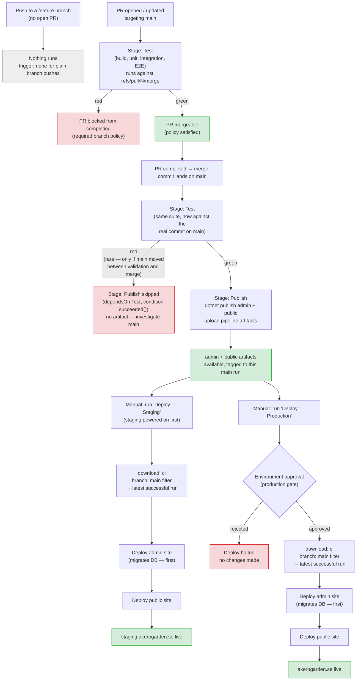

# CI/CD Pipeline Flow

Single-pipeline, two-stage design (`azure-pipelines.yml`): **Test** runs on every PR and on
every push to `main`; **Publish** runs only on `main`, and only if Test passed on that exact
commit. Deploys (`azure-pipelines-deploy-staging.yml`, `azure-pipelines-deploy-prod.yml`) are
always manual and always pull from the latest successful `main` run — never a PR-validation run.

## Why it's shaped this way

- `main` is branch-policy-gated: a PR cannot merge until Test is green.
- A PR's Test run only tests a **preview** of the merge (`refs/pull/N/merge`). If another PR
  lands on `main` in between validation and completion, the real merge commit could differ from
  what was tested — so Test runs again on the actual `main` commit before Publish is trusted to
  run. This costs one re-test per merge, not per push.
- Publish only ever runs after Test succeeds *in the same pipeline run*, on the *same commit* —
  so every artifact that exists is one whose exact commit was tested. There's no separate,
  always-fires publish path that could ship an untested commit.
- Deploys are separate, manual, and pull artifacts by branch (`branch: main` filter on the `ci`
  pipeline resource) — so "latest successful run" can never resolve to a PR-validation run that
  never reached Publish.

